# Informe del Laboratorio 06

**Curso:** Desarrollo de Aplicaciones Empresariales<br>
**Tema:** motor de plantillas con Django<br>
**Aplicación:** `news`<br>
**Fecha de revisión documental:** 16 de noviembre de 2026

## 1. Introducción

El motor de plantillas de Django permite construir páginas dinámicas manteniendo separadas la persistencia, la lógica de consulta y la presentación. Este laboratorio aplica dicho enfoque en un portal de noticias con portada, detalle, categorías y administración personalizada.

Tras recuperar el proyecto se revisaron los modelos y las migraciones y se utilizaron los datos originales exclusivamente mediante una copia de pruebas externa al repositorio. Se corrigieron previamente el escapado inseguro del detalle, la edición de la fecha de publicación, la declaración de Jazzmin y determinados aspectos de navegación y diseño. Esta etapa se limita a documentar el estado comprobado y obtener evidencia auténtica; no introduce cambios funcionales.

## 2. Objetivos

### Objetivo general

Documentar y demostrar la implementación del motor de plantillas de Django en un portal de noticias, con evidencias verificables y preservación de los datos originales.

### Objetivos específicos

1. Explicar la relación entre modelos, vistas, rutas y plantillas.
2. Identificar el uso de herencia, bloques, fragmentos, variables, etiquetas y filtros.
3. Evidenciar la administración, los filtros y la búsqueda de noticias.
4. Distinguir el escapado automático de la interpretación de HTML almacenado.
5. Presentar casos de prueba y sus límites sin atribuir verificaciones no realizadas.

## 3. Entorno y metodología

### 3.1. Entorno comprobado

| Componente | Versión o estado |
|---|---|
| Python | 3.14.3 |
| Django | 6.1 |
| Pillow | 12.3.0 |
| django-jazzmin | 3.0.5 |
| Navegador | Chrome 157.0.8103.51, modo headless |
| Persistencia | Copia SQLite externa; seis noticias, tres categorías y tres autores |

### 3.2. Procedencia de las verificaciones

Se utilizaron tres conjuntos diferenciados de evidencia:

- **H1, pruebas funcionales previas a los últimos ajustes de presentación:** 22 comprobaciones que incluyeron creación de noticias, validaciones, CSRF y reversión de registros temporales.
- **H2, pruebas después de los ajustes de presentación:** 11 comprobaciones de lectura y revisión visual de 21 páginas, en nueve anchos entre 320 y 1440 px. La raíz ya redirige a `/news/` y el desbordamiento fue corregido.
- **D, sesión documental actual:** capturas nuevas del portal y del administrador, lectura de código, prueba de plantillas en memoria y comprobación de conservación de datos. No se repitió la creación de noticias.

El [resumen portable de resultados](evidencias/resultados-pruebas.json) conserva la separación entre etapas. Los registros externos originales se identifican por su nombre en dicho resumen; no se enlazan como si fueran archivos disponibles en este repositorio.

### 3.3. Protección de datos y autenticidad

La base original permaneció fuera del repositorio y nunca se abrió en escritura. La copia conservada en el entorno externo fue la única base autorizada para la sesión administrativa.

Para las capturas D se autorizó expresamente crear una cuenta temporal real con los permisos `view_article`, `view_category` y `view_author`, e iniciar una sesión real. No se utilizaron contraseñas de cuentas existentes ni se modificaron sus permisos. La cuenta lectora evita que el panel exponga la administración de usuarios o permita editar noticias. Al cerrar navegador, servidor y conexiones, se restituyó la copia a su contenido inicial y se comprobó su SHA-256.

Las imágenes son capturas PNG completas del navegador. No se combinaron pantallas, no se cambiaron resultados mediante edición del DOM y no se ocultaron errores relevantes. En las capturas de código y salida se visualizan archivos de texto reales, con tipografía ampliada para lectura. Su finalidad y su origen se indican expresamente.

## 4. Desarrollo: los 13 procedimientos

Los procedimientos siguientes corresponden a los trece requisitos facilitados para la revisión. No se dispuso del PDF original de la guía; por tanto, el informe no sustituye una evaluación de aspectos adicionales que pudiera contener ese documento.

### Procedimiento 1. Proyecto Django, aplicación `news` y Pillow

El proyecto contiene `manage.py`, el paquete `config` y la aplicación `news`. `INSTALLED_APPS` registra `news`, `movies` y los componentes de Django, además de Jazzmin. Pillow proporciona el soporte requerido por los campos de imagen.

Las dependencias reales de [requirements.txt](requirements.txt) son:

```text
Django>=6.1,<6.2
Pillow>=12.0.0
django-jazzmin==3.0.5
```

No se instalaron dependencias durante la elaboración de este informe. La captura siguiente muestra el listado real de los 34 archivos funcionales antes de añadir documentación, no una estructura propuesta.

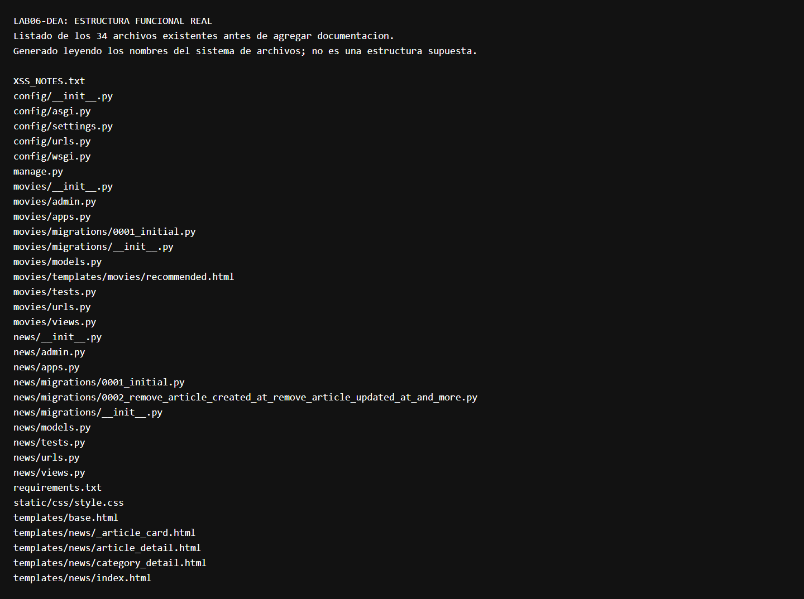

**Fuente verificable:** [listado de estructura](evidencias/fuentes/08-estructura.txt).

### Procedimiento 2. Configuración de TEMPLATES, STATIC y MEDIA

En [config/settings.py](config/settings.py), `TEMPLATES` utiliza `django.template.backends.django.DjangoTemplates`, el directorio `BASE_DIR / 'templates'` y `APP_DIRS=True`. Esto permite localizar tanto las plantillas generales como la plantilla propia de `movies`.

Las líneas de configuración de recursos, agrupadas aquí por finalidad, son:

```python
STATIC_URL = 'static/'
STATICFILES_DIRS = [BASE_DIR / 'static']
STATIC_ROOT = BASE_DIR / 'staticfiles'
MEDIA_URL = '/media/'
MEDIA_ROOT = BASE_DIR / 'media'
```

`STATIC_ROOT` es un destino de recolección y no necesita existir para estas pruebas locales. Los archivos subidos se sirven durante desarrollo mediante la configuración de [config/urls.py](config/urls.py), condicionada por `DEBUG`.

Se comprobó HTTP 200 y el contenido del CSS. No hay imágenes asociadas a los registros recuperados: la entrega de un archivo MEDIA permanece **NO VERIFICADA**. No se generaron imágenes o registros artificiales para aparentar esa prueba.

### Procedimiento 3. Modelos `Article`, `Category` y `Author`

[news/models.py](news/models.py) define las entidades y sus relaciones. Fragmento real de `Article`:

```python
class Article(models.Model):
    title = models.CharField(max_length=250)
    slug = models.SlugField(max_length=280, unique=True, blank=True)
    content = models.TextField()
    published_at = models.DateTimeField()
    image = models.ImageField(upload_to='articles/', blank=True, null=True)
    author = models.ForeignKey(Author, on_delete=models.CASCADE, related_name='articles')
    categories = models.ManyToManyField(Category, related_name='articles', blank=True)
```

`Author` tiene `name`, `bio` y `photo`; `Category` tiene `name` y un `slug` único. La relación autor–artículo es uno-a-muchos; artículo–categoría es muchos-a-muchos. Los `related_name='articles'` permiten consultar los artículos de un autor o de una categoría.

| Entidad o asociación | Cantidad comprobada |
|---|---:|
| `Article` | 6 |
| `Category` | 3 |
| `Author` | 3 |
| `news_article_categories` | 6 |

Las migraciones [0001_initial.py](news/migrations/0001_initial.py) y [0002_remove_article_created_at_remove_article_updated_at_and_more.py](news/migrations/0002_remove_article_created_at_remove_article_updated_at_and_more.py) existen y figuran aplicadas. No se modificaron ni ejecutaron en esta etapa.

La base inspeccionada no presenta slugs vacíos o duplicados ni referencias foráneas inválidas. Esto no significa que el método `save()` resuelva automáticamente futuras colisiones de títulos equivalentes.

### Procedimiento 4. Plantilla base con bloques

[templates/base.html](templates/base.html) concentra el documento HTML, navegación, sidebar y footer. Los puntos de extensión son:

```django
News Portal - Noticias

```

El bloque `sidebar` contiene por defecto la lista de categorías. Las plantillas hijas sobrescriben `title` y `content` y mantienen el sidebar heredado. La separación reduce duplicación y permite conservar una estructura coherente.

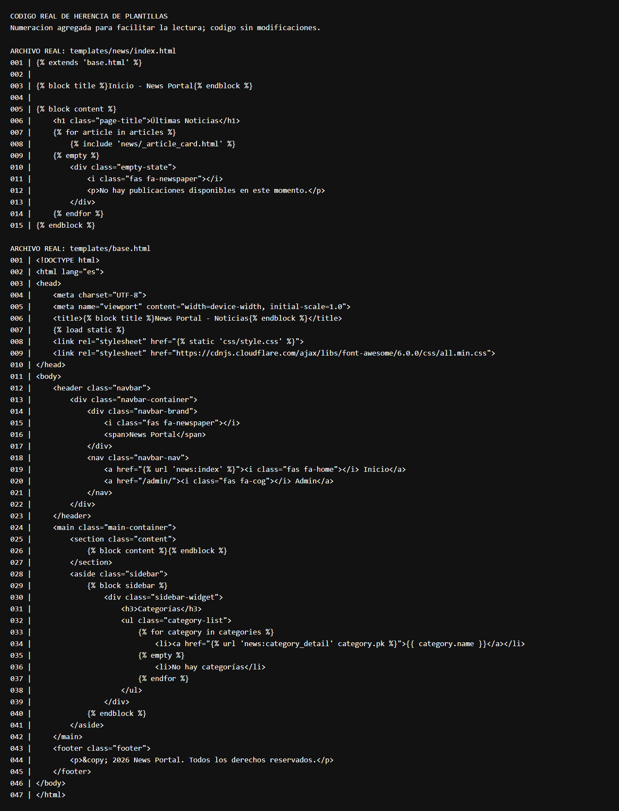

La numeración y los rótulos de archivo se añadieron al [texto de consulta](evidencias/fuentes/09-herencia.txt); las líneas de código proceden de los archivos reales.

### Procedimiento 5. Fragmento `_article_card.html`

La tarjeta se implementa en [templates/news/_article_card.html](templates/news/_article_card.html) y se reutiliza desde portada y categoría mediante `include`. El fragmento recibe `article` del contexto del bucle y muestra sus atributos y relaciones.

```django

```

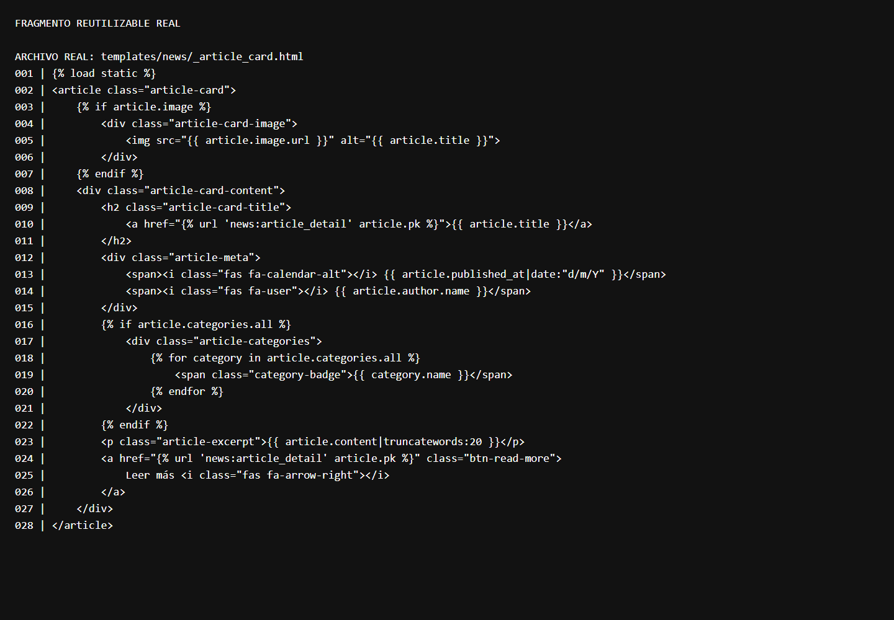

La imagen es condicional; no se accede a `article.image.url` cuando el campo está vacío. La reutilización del fragmento se verificó en H2: se renderiza seis veces en portada y dos en cada categoría.

### Procedimiento 6. Portada con `for`, `empty`, `date` y `truncatewords`

La vista `index` obtiene artículos y categorías, optimizando las relaciones con `select_related('author')` y `prefetch_related('categories')`. [templates/news/index.html](templates/news/index.html) recorre `articles`, incluye la tarjeta y contempla `empty`.

```django

    

    <div class="empty-state">
        <i class="fas fa-newspaper"></i>
        <p>No hay publicaciones disponibles en este momento.</p>
    </div>

```

El fragmento aplica `date:"d/m/Y"` y `truncatewords:20`. La implementación del filtro agrega una elipsis cuando corresponde; no se atribuye el recorte a los artículos originales si su texto no supera el límite. H1 verificó el caso largo con contenido temporal, posteriormente revertido.

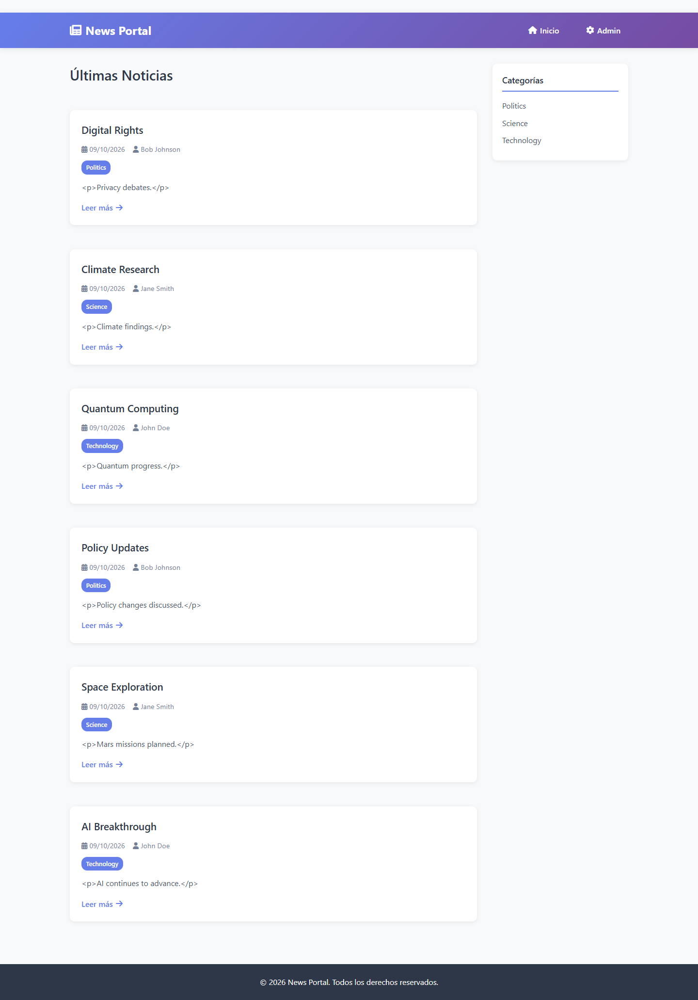

Se observan las seis tarjetas y las tres categorías. Algunas etiquetas `<p>` permanecen visibles como texto en los resúmenes: se conserva el comportamiento real y no se editó la captura para disimularlo.

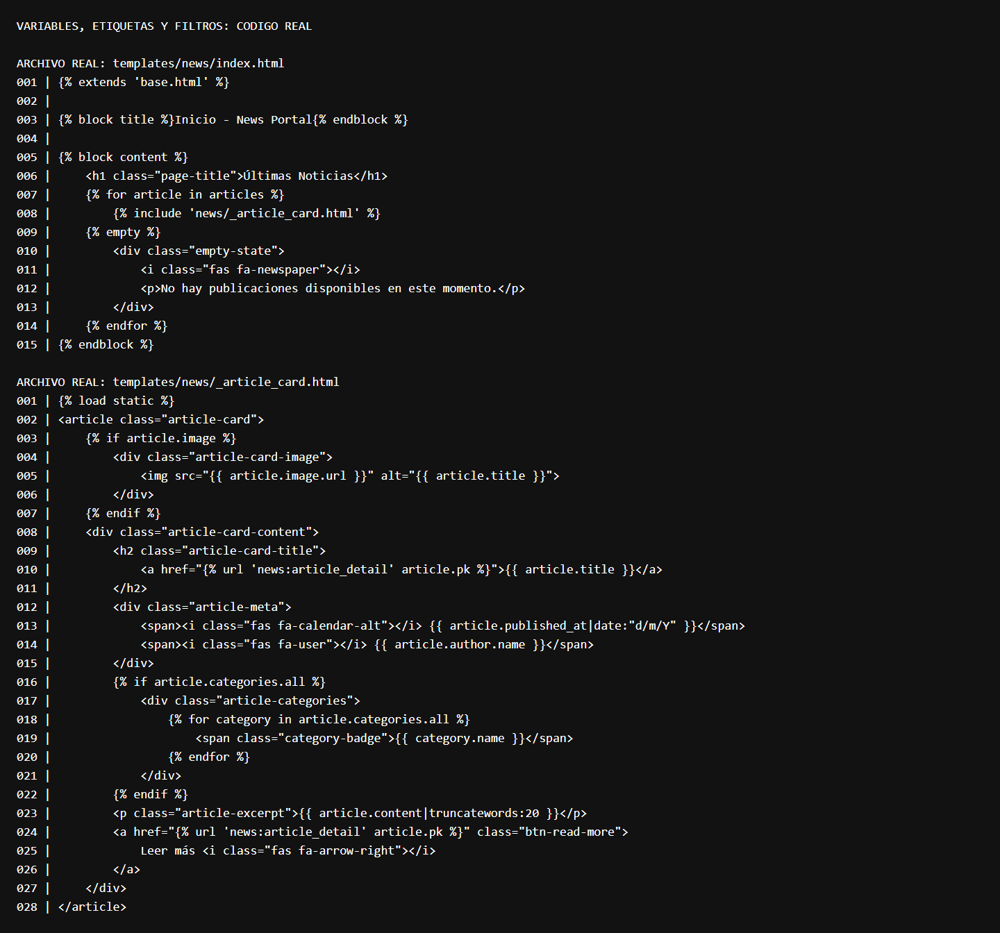

### Procedimiento 7. Detalle de noticias

La vista `article_detail` utiliza `get_object_or_404` y obtiene el artículo por su clave primaria. La plantilla [templates/news/article_detail.html](templates/news/article_detail.html) hereda la base y muestra título, autor, fecha, categorías, imagen opcional y contenido.

El contenido se presenta como texto mediante:

```django
{{ article.content|striptags|force_escape }}
```

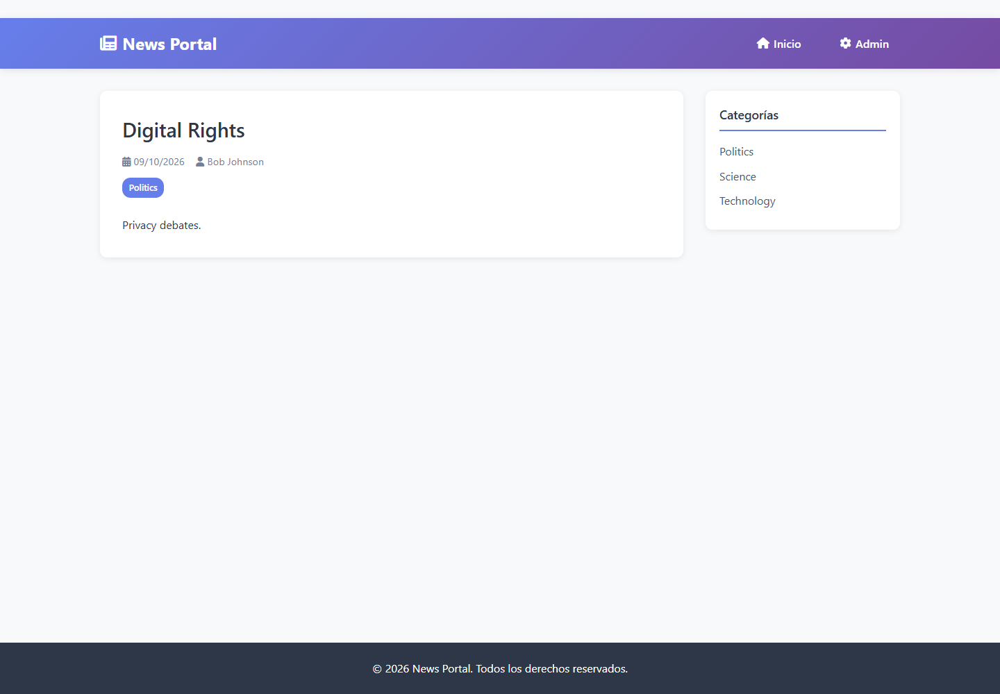

La figura corresponde a `/news/article/6/`. El texto aparece sin interpretar los párrafos almacenados como HTML. H2 comprobó los seis detalles; D volvió a navegar al detalle capturado. Esta presentación elimina formato y no constituye un editor de HTML enriquecido.

### Procedimiento 8. Listado por categoría

`category_detail` localiza la categoría y consulta `category.articles`, conservando las optimizaciones de relaciones. [templates/news/category_detail.html](templates/news/category_detail.html) reutiliza la tarjeta y define un mensaje para una categoría sin noticias.

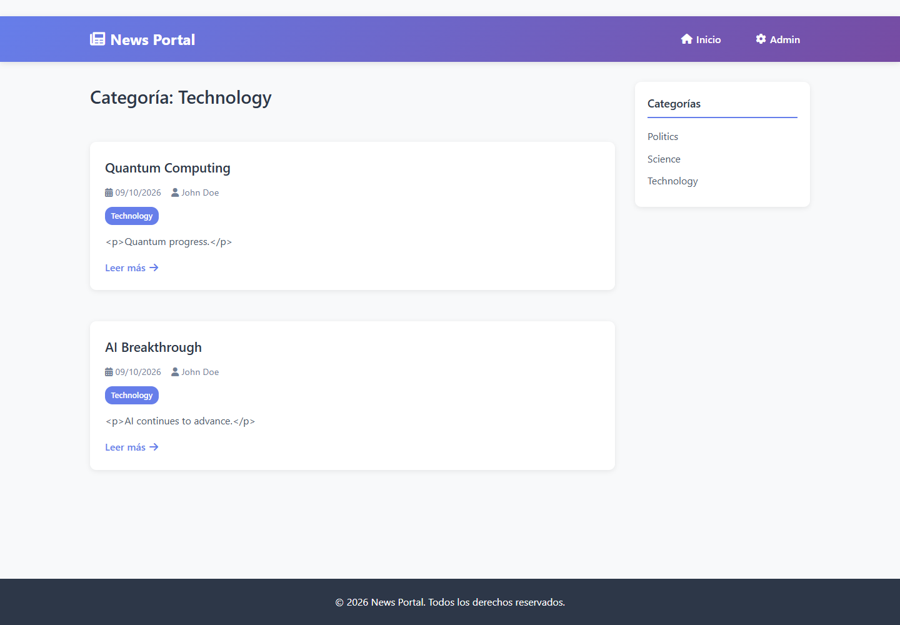

La figura corresponde a `/news/category/1/`. Las otras dos categorías también tienen dos noticias; su correspondencia se comprobó mediante ORM y respuestas de las vistas en H2. El escenario vacío se probó en H1 con una categoría temporal, después revertida.

### Procedimiento 9. Rutas nombradas y etiqueta `url`

[news/urls.py](news/urls.py) declara `app_name='news'` y los nombres `index`, `article_detail` y `category_detail`. Las plantillas resuelven los enlaces mediante el namespace, por ejemplo:

```django


```

La raíz utiliza el mecanismo de Django siguiente, sin duplicar vistas ni plantillas:

```python
path('', RedirectView.as_view(pattern_name='news:index', permanent=False), name='home'),
```

Se comprobó la secuencia `/` → HTTP 302 → `/news/` → HTTP 200. Las rutas de películas se conservan. Las rutas inexistentes de noticias responden 404. El enlace al administrador sigue escrito como `/admin/`; esto no se presenta como un uso de la etiqueta `url`.

### Procedimiento 10. CSS con `static` e imágenes con MEDIA

En la plantilla base:

```django

<link rel="stylesheet" href="">
```

La tarjeta y el detalle utilizan `article.image.url`, derivada del almacenamiento configurado y de `MEDIA_URL`, dentro de una condición que comprueba la existencia del campo. No requieren una variable de contexto `MEDIA_URL` para esa expresión.

El CSS emplea columnas `minmax(0, 3fr) minmax(0, 1fr)`, que distribuyen el espacio disponible después del `gap`. A 968 px o menos pasa a una columna. El cuerpo flexible y la altura mínima de la ventana mantienen el footer al fondo sin superponerlo al contenido.

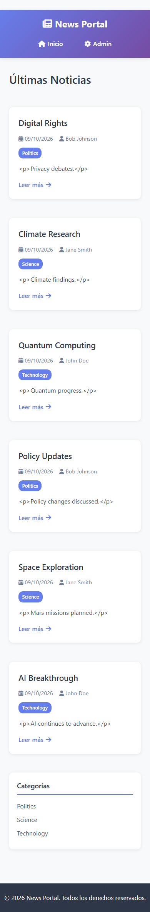

H2 revisó 21 páginas en los anchos 320, 390, 768, 820, 968, 969, 1000, 1024 y 1440 px. No se detectó desbordamiento horizontal en esos casos. D agregó esta captura móvil, sin afirmar una revisión de todos los dispositivos existentes. La entrega de imágenes subidas sigue pendiente por falta de archivos asociados.

### Procedimiento 11. Administrador personalizado

Las tres clases de [news/admin.py](news/admin.py) utilizan `list_display`, `list_filter` y `search_fields`. En artículos, la búsqueda abarca título, contenido y nombre del autor; los filtros abarcan autor, categorías y fecha de publicación. `filter_horizontal` facilita seleccionar categorías.

```python
@admin.register(Article)
class ArticleAdmin(admin.ModelAdmin):
    list_display = ('id', 'title', 'author', 'published_at')
    search_fields = ('title', 'content', 'author__name')
    list_filter = ('author', 'categories', 'published_at')
    filter_horizontal = ('categories',)
    prepopulated_fields = {'slug': ('title',)}
```

`published_at` no está en `readonly_fields`, por lo que se introduce desde el formulario. El alta válida y las validaciones fueron probadas en H1, con reversión de los registros. Las capturas siguientes son de una sesión real D, autenticada con la cuenta lectora temporal autorizada; por su rol no muestran botones de creación ni edición.

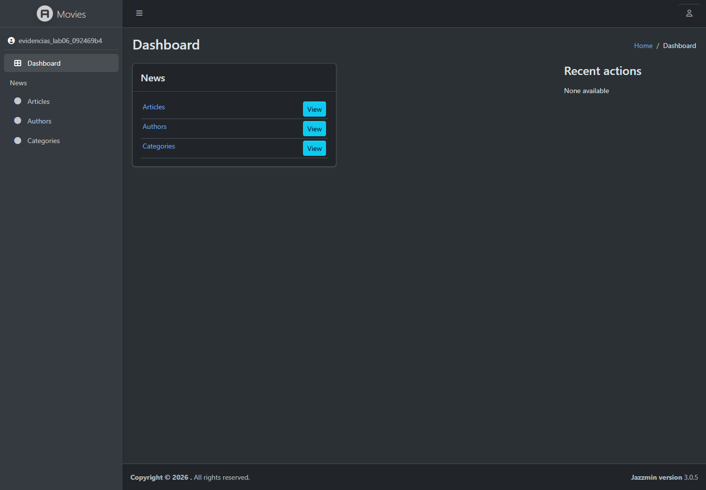

Se observan las tres entidades. La marca «Movies» proviene de la configuración previa y el modo oscuro responde a `default_theme_mode="auto"`. La cuenta visible es temporal y no representa una cuenta personal existente.

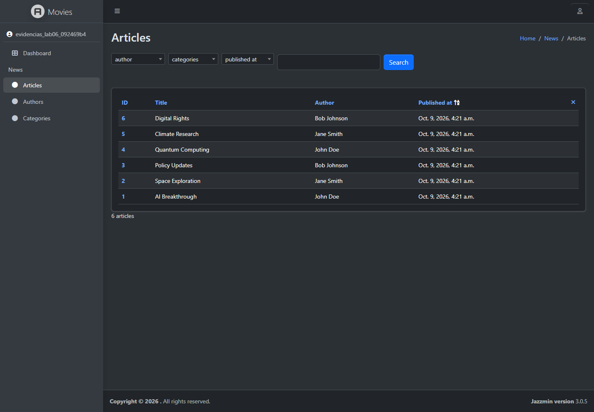

Las columnas corresponden a `list_display`; el contador muestra seis registros.

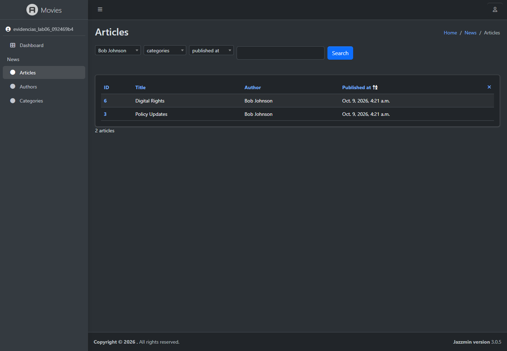

El filtro por `author__id__exact=3` produce dos registros, con el autor seleccionado visible. No se alteró la tabla para obtener el resultado.

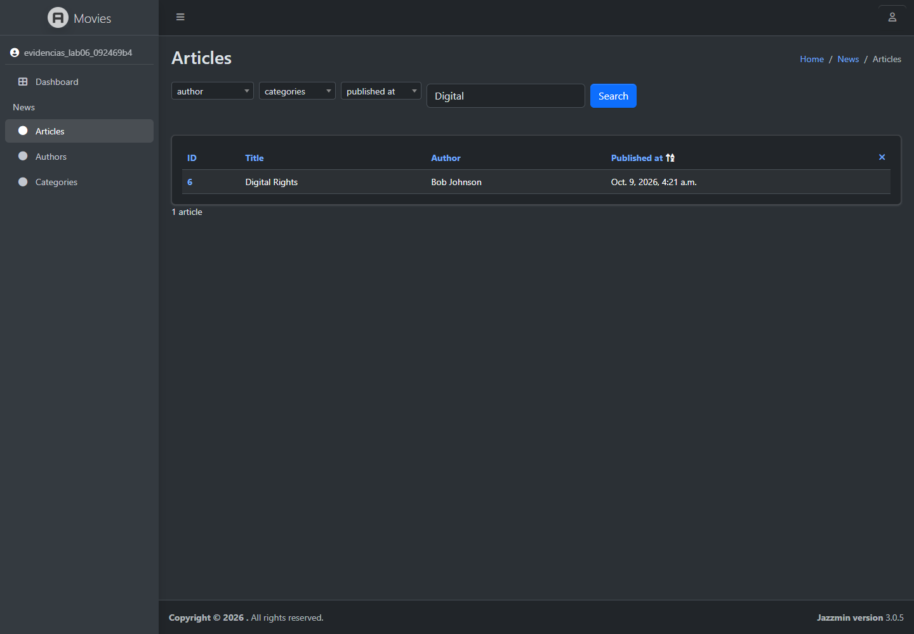

La consulta `Digital` devuelve una noticia. La captura muestra tanto el término como el resultado real.

### Procedimiento 12. Escapado automático y HTML almacenado

Django escapa variables por defecto. El detalle añade una transformación de presentación y un escapado explícito final. `striptags` no debe considerarse una barrera de seguridad suficiente por sí sola: cualquier resto se procesa con `force_escape`. No se utiliza `safe`, `mark_safe` ni `autoescape off` en la expresión implementada.

Para obtener evidencia sin alterar noticias se ejecutó realmente el motor de plantillas en memoria con la entrada inofensiva:

```html
<strong>Prueba de HTML</strong> <em>solo texto</em>
```

La variable normal produjo:

```text
&lt;strong&gt;Prueba de HTML&lt;/strong&gt; &lt;em&gt;solo texto&lt;/em&gt;
```

La expresión real del detalle produjo `Prueba de HTML solo texto`. Las comprobaciones del programa confirmaron ambas salidas.

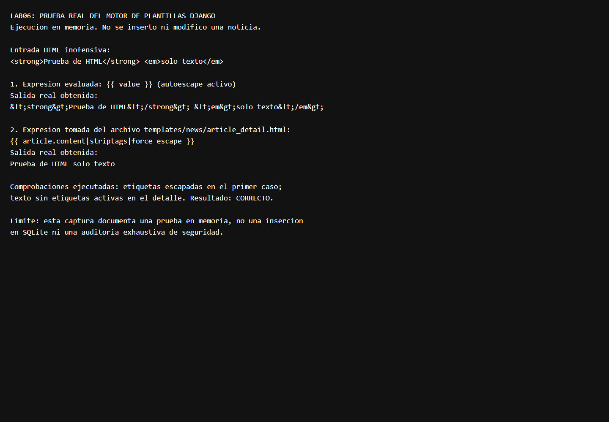

La [salida de texto](evidencias/fuentes/12-escapado.txt) deja explícito que no se insertó una noticia. H1 ya había comprobado contenido temporal almacenado y H2 siete casos de HTML peligroso o malformado en memoria. Estos ensayos no equivalen a una auditoría exhaustiva de XSS o de toda la aplicación.

La protección CSRF está habilitada mediante middleware. H1 comprobó que un POST administrativo sin token devuelve 403 y que la solicitud válida permite el alta. Las capturas no muestran tokens ni cookies.

### Procedimiento 13. Documentación y evidencias

La entrega documental se compone de [README.md](README.md), este informe, el [catálogo](evidencias/README.md), trece PNG, cinco fuentes de texto y el [resumen de resultados](evidencias/resultados-pruebas.json).

El catálogo relaciona cada figura con su procedencia. Los enlaces son relativos para que funcionen dentro del directorio del laboratorio. Las bases SQLite, perfiles de navegador, credenciales y registros HTTP sin depurar permanecen fuera de `evidencias/`.

## 5. Casos de prueba y resultados obtenidos

| Caso | Procedimiento o entrada | Resultado esperado | Resultado obtenido | Etapa |
|---|---|---|---|---|
| CP01 | GET `/` | Redirigir a `/news/` | 302 y destino correcto | H2 y D |
| CP02 | GET `/news/` | Seis tarjetas | Seis noticias originales | H2 y D |
| CP03 | Detalle existente | 200 y datos de la noticia | Seis detalles correctos; captura del ID 6 | H2 y D |
| CP04 | Listados de categorías | Dos noticias por categoría | Tres categorías correctas; captura del ID 1 | H2 y D |
| CP05 | Administrador de artículos | Seis filas | Seis filas y columnas configuradas | D |
| CP06 | Filtro por autor 3 | Dos resultados | Dos filas | D |
| CP07 | Búsqueda `Digital` | Una coincidencia | Una fila | D |
| CP08 | Alta válida con fecha y hora | Guardar y redirigir | HTTP 302 y valores persistidos dentro de la transacción; luego rollback | H1 |
| CP09 | Campos vacíos, fecha inválida o slug duplicado | Rechazar sin crear noticias | Errores de formulario y recuento sin incremento | H1 |
| CP10 | POST sin CSRF | Rechazar | HTTP 403 | H1 |
| CP11 | HTML inofensivo en una variable y en la expresión del detalle | Escapado o texto sin etiquetas activas | Ambas salidas comprobadas en memoria | D |
| CP12 | Resumen de más de 35 palabras | Veinte palabras y elipsis | Recorte correcto; registro temporal revertido | H1 |
| CP13 | Categoría sin noticias | Mensaje `empty` | Categoría temporal real, posteriormente revertida | H1 |
| CP14 | Portada y sidebar sin resultados | Mensajes `empty` | Consultas vacías controladas; no se borraron originales | H1 |
| CP15 | Artículo, categoría y ruta inexistentes | 404 | 404 en los tres casos | H2 |
| CP16 | CSS y navegación responsive | Recurso 200, sin desbordamiento | 21 páginas en nueve anchos; footer al fondo | H2 |
| CP17 | Conservación de SQLite | Hash inicial intacto | Original intacto y copia restituida | D |
| CP18 | Entrega de imagen subida | Archivo MEDIA accesible | **NO VERIFICADO:** no hay imágenes asociadas | Pendiente |

No se ejecutó una suite integrada a través de `manage.py test`: [news/tests.py](news/tests.py) y [movies/tests.py](movies/tests.py) continúan como esqueletos. Los casos externos comprobados se documentan como tales.

## 6. Conservación de información

La base original tiene un tamaño de **225 280 bytes**. Su SHA-256 inicial, mantenido al terminar la sesión documental, es:

```text
aea5866ba83b18f0e402b75c9fd1cbcec21351c0b3f141f48b49e9e63feee53e
```

La copia terminó con el mismo hash, una vez retirados la cuenta y las sesiones temporales mediante restitución del contenido inicial. No se incorporó ninguna base al repositorio ni se ejecutaron migraciones, `flush` o cambios sobre las noticias originales.

Los perfiles de navegador y las herramientas de captura se mantuvieron en el entorno temporal externo. Los servidores locales y navegadores iniciados para las capturas se cerraron al finalizar.

## 7. Observaciones y limitaciones

1. **Imágenes:** el modelo y las plantillas contemplan imágenes, pero no existe evidencia de carga de un archivo porque las seis noticias y los tres autores tienen sus campos vacíos.
2. **Resúmenes:** conservan etiquetas escapadas visibles, mientras que el detalle presenta texto sin esas etiquetas. No se modificó el contenido almacenado para uniformarlos.
3. **HTML enriquecido:** la solución del detalle pierde formato. No es una herramienta de edición ni de sanitización de HTML para conservar etiquetas.
4. **Favicon:** el navegador detecta un 404 en `/favicon.ico`. Se documenta y no se corrige dentro de esta etapa.
5. **Administrador:** se conservan rótulos en inglés y la marca «Movies». No se confunden con el objetivo de `news` ni se ocultan mediante edición de imágenes.
6. **Configuración:** se ha probado un entorno local de desarrollo, no un despliegue seguro de producción.
7. **Automatización de captura:** el primer intento de login utilizó identificadores que la plantilla de Jazzmin no incluye. Se corrigieron los selectores de la herramienta externa para usar `name`; no se cambió el proyecto. Las cuatro capturas administrativas corresponden al intento posterior autenticado correctamente.
8. **Guía:** la correspondencia se limita a los trece requisitos proporcionados, sin atribuir una nota ni afirmar cumplimiento de un PDF no disponible.

## 8. Conclusiones

El portal integra modelos relacionados, consultas optimizadas, rutas nombradas y plantillas con herencia y reutilización. La portada, el detalle y los listados por categoría utilizan una estructura común sin duplicar la tarjeta de noticia.

Las pruebas y las capturas muestran datos reales recuperados y operaciones administrativas verificadas. Se distingue entre verificaciones históricas, resultados actuales y aspectos no comprobados. El escapado evita interpretar el contenido como HTML activo, y los ajustes responsive preservan el diseño en los tamaños ensayados.

La documentación se preparó sin modificar código funcional, otros laboratorios o datos originales. Las evidencias son locales y no se realizó ninguna publicación en GitHub.
