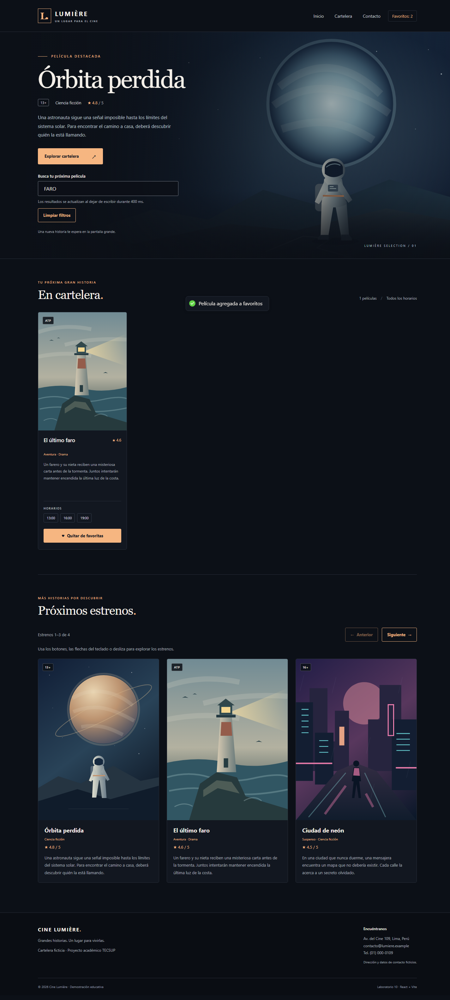
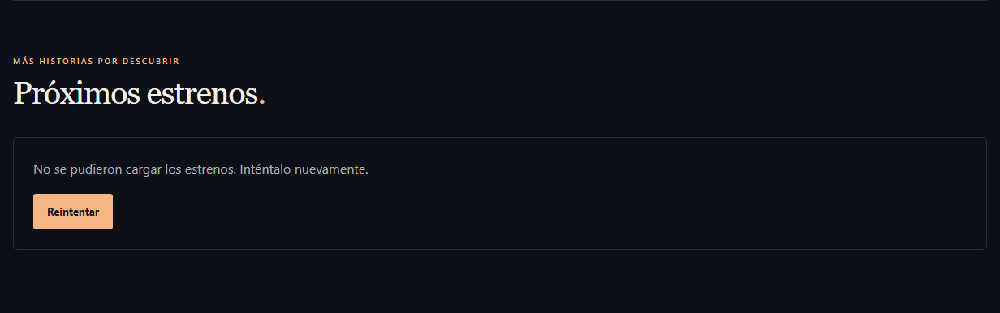
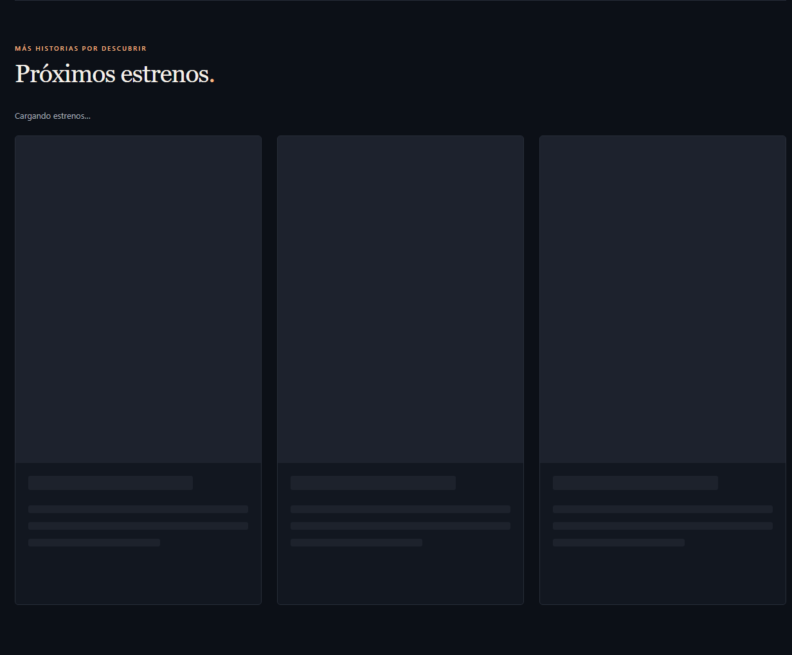
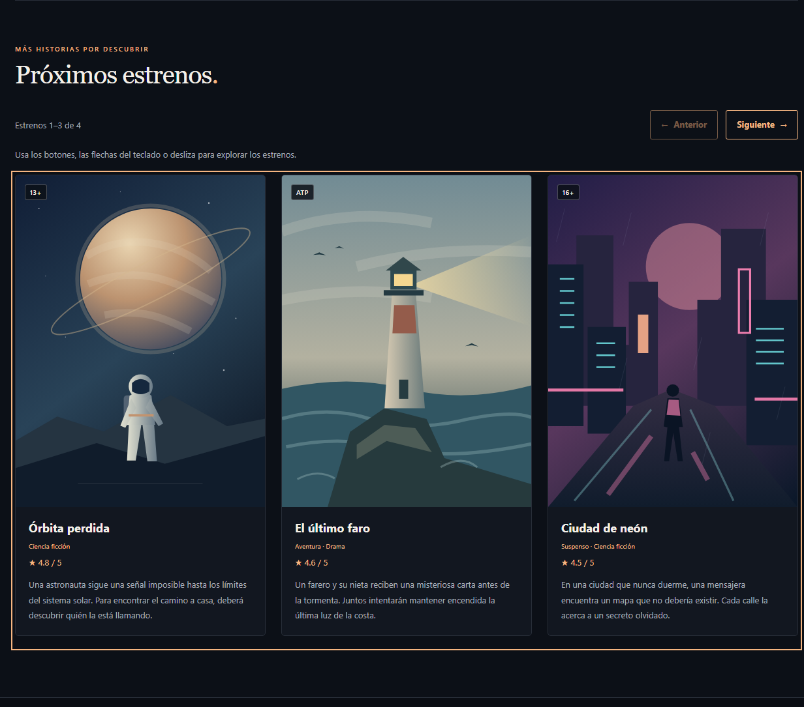
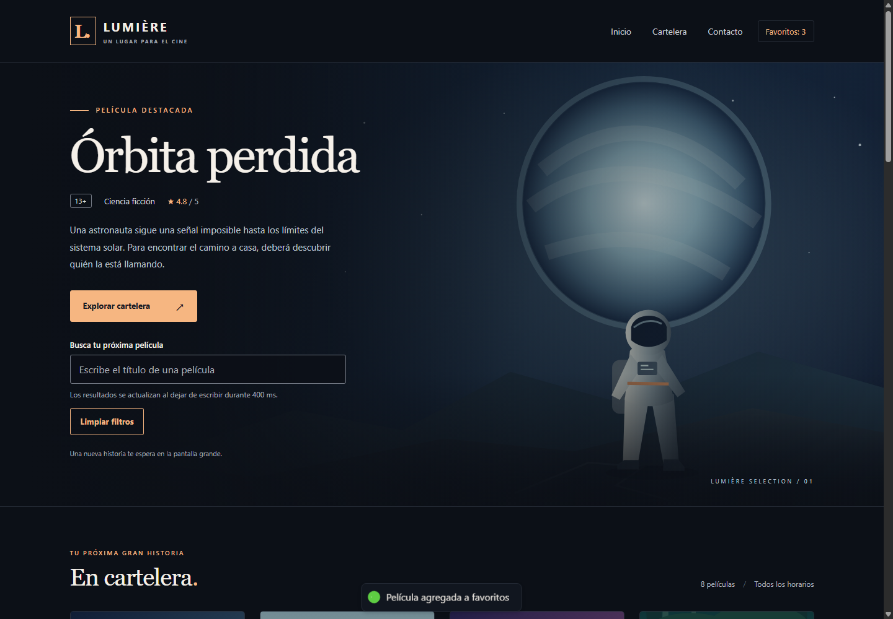
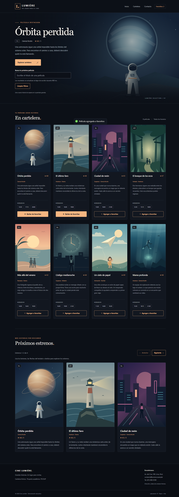
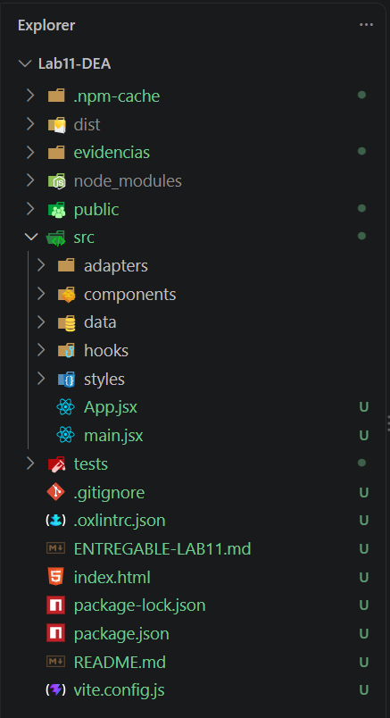

# Laboratorio 11 - Comunicación entre Componentes en ReactJS

## 1. Datos del estudiante

| Dato | Información |
| --- | --- |
| Estudiante | Michael Fernandez |
| Curso | Desarrollo de Aplicaciones Empresariales |
| Institución | Tecsup |
| Laboratorio | Semana 11 |
| Proyecto | Cine Lumière |
| Tecnología principal | ReactJS con Vite |
| Carpeta de trabajo | `Lab11-DEA` |
| Fecha de revisión | 15 de noviembre de 2026 |

**Estado del documento:** preparación local del entregable de la actividad 11. No se ha subido a GitHub ni al campus virtual.

## 2. Objetivo

Explicar y evidenciar cómo se comunican los componentes de una cartelera mediante props, callbacks y estado compartido. Documentar la extracción de lógica en `useDebounce`, `useWindowSize` y `usePremieres`, así como los resultados reales de las pruebas y la ubicación de los datos en el árbol de componentes.

## 3. Metodología y alcance

Se inspeccionaron `src/`, sus diez componentes propios, los tres hooks, el adaptador, los datos, los estilos, las pruebas, la configuración y las evidencias. Cada desarrollo se presenta con implementación, archivos, código representativo, funcionamiento, prueba y captura. Los fragmentos proceden de los archivos actuales. La revisión final solo corrige identificación académica, documentación y exclusión de caché; no modifica funcionalidades.

El documento original de la guía no está disponible dentro de `Lab11-DEA`; la correspondencia siguiente utiliza las 12 actividades oficiales transcritas por el estudiante. Los bloques A–J conservan la organización temática del desarrollo, y la actividad 11 integra la documentación y el árbol de estados. Solo queda contrastar posibles requisitos adicionales de formato con el documento original.

La aplicación utiliza datos locales. No se implementaron una API, una base de datos, un sistema de compras ni nuevas funcionalidades. Los cuatro estrenos simulados reutilizan películas de la cartelera. Las capturas de error y recuperación se obtienen del componente real montado en una página aislada de pruebas, con un fallo controlado; no representan una caída de un servicio externo.

### Correspondencia con las 12 actividades oficiales

| Actividad | Requisito solicitado | Implementación realizada | Archivos involucrados | Estado actual |
| --- | --- | --- | --- | --- |
| 1 | Preparar el proyecto de Lab10 funcionando y crear una rama | Cartelera preparada y operativa; se mantuvo `main` por decisión del estudiante, sin crear otra rama | `package.json`, `src/App.jsx`, `src/main.jsx`; bloque A | Preparación cumplida; requisito de rama no cumplido literalmente |
| 2 | Ampliar estilos y revisar visualización | Utilidades, diseño adaptable y componentes conservados | `src/styles/global.css`, `src/components/`; bloque A | Cumplido |
| 3 | Transformar películas mediante un adaptador | Modelo normalizado y conservación de datos originales | `src/adapters/movieAdapter.js`, `src/App.jsx`, `src/hooks/usePremieres.js`; bloque B | Cumplido |
| 4 | Notificar favoritas sin que la tarjeta conozca su presentación | Callback hacia `App`, `toast.success` y `Toaster` | `src/App.jsx`, `src/components/MovieCard/MovieCard.jsx`; bloque C | Cumplido |
| 5 | Extraer el retardo a `useDebounce` y aplicarlo al buscador | Hook en `App`, campo controlado y filtro diferido | `src/hooks/useDebounce.js`, `src/App.jsx`, `src/components/MovieSearch/MovieSearch.jsx`; bloque D | Cumplido |
| 6 | Crear `useWindowSize` y determinar tarjetas por fila | Reutilización en lista y carrusel, con reglas según ancho | `src/hooks/useWindowSize.js`, `src/components/MovieList/MovieList.jsx`, `src/components/PremieresCarousel/PremieresCarousel.jsx`; bloque E | Cumplido |
| 7 | Simular una petición de estrenos con carga, éxito y error | Temporizador, datos adaptados, fallo controlado y `retry` | `src/hooks/usePremieres.js`; bloque F | Cumplido |
| 8 | Crear Skeleton, sección y carrusel para los tres estados | Renderizado condicional y navegación de estrenos | `src/components/Skeleton/Skeleton.jsx`, `src/components/PremieresSection/PremieresSection.jsx`, `src/components/PremieresCarousel/PremieresCarousel.jsx`; bloques G y H | Cumplido |
| 9 | Elevar el contador y mostrar solo su número en Header | `favoriteIds` en `App` y `favoriteCount` derivado | `src/App.jsx`, `src/components/Header/Header.jsx`; bloque I | Cumplido |
| 10 | Limpiar filtros desde el banner manteniendo la sincronización | Callback de `Hero`, campo compartido y versión de reinicio | `src/App.jsx`, `src/components/Hero/Hero.jsx`, `src/components/MovieSearch/MovieSearch.jsx`, `src/components/MovieList/MovieList.jsx`; bloque J | Cumplido |
| 11 | Documentar árbol, estado por nivel y motivo de no guardar el contador solo en Header | Árbol real, props, callbacks e inventario de datos | `README.md`, `ENTREGABLE-LAB11.md`, `evidencias/estructura.png`; apartados 7–9 | Cumplido |
| 12 | Entregar proyecto en GitHub y entregable en campus virtual | Archivos preparados solo de forma local | Proyecto y evidencias de `Lab11-DEA`, `ENTREGABLE-LAB11.md` | Pendiente; no se ha publicado ni entregado |

La excepción de la actividad 1 no se presenta como cumplimiento literal de crear una rama. La actividad 12 no debe ejecutarse sin una autorización posterior.

## 4. Desarrollo de las actividades y código representativo

### A. Cartelera, estilos y componentes reutilizables

**Qué se implementó:** conservación de ocho películas y 24 horarios informativos; diseño oscuro adaptable, navegación, foco visible y `Button` reutilizable con variantes. `Header`, `Hero`, `MovieList`, `MovieCard` y `Footer` organizan la interfaz.

**Archivos involucrados:** [movies.js](src/data/movies.js), [global.css](src/styles/global.css), [Button.jsx](src/components/Button/Button.jsx), [MovieCard.jsx](src/components/MovieCard/MovieCard.jsx), [Hero.jsx](src/components/Hero/Hero.jsx), [Header.jsx](src/components/Header/Header.jsx), [Footer.jsx](src/components/Footer/Footer.jsx).

**Fragmento real — `Button.jsx`:**

```jsx
function Button({ children, variant = 'primary', className = '', href, type = 'button', ...props }) {
  const buttonClassName = `button button--${variant} ${className}`.trim()

  if (href) {
    return <a className={buttonClassName} href={href} {...props}>{children}</a>
  }

  return <button className={buttonClassName} type={type} {...props}>{children}</button>
}
```

**Funcionamiento:** con `href` conserva un enlace real; sin él genera un botón y transmite eventos, atributos accesibles y `disabled`. Se utiliza en `Hero`, `MovieCard`, `PremieresCarousel` y la recuperación de `PremieresSection`. Las tarjetas reciben sus datos por props, no copian el catálogo en estado.

**Caso de prueba y resultado:** la suite confirmó ocho tarjetas, 24 horarios, nueve imágenes entre banner/cartelera, variantes del botón y navegación a `#cartelera` sin recargar. **Aprobado.** Con estrenos cargados existen 13 imágenes en total, no solo nueve.

**Captura:** [cartelera completa restaurada](evidencias/lab11-activities-9-10-wJRSpy/28-lab11-filter-cleared-billboard.png), compartida con el bloque J para no repetir la misma imagen.

### B. Patrón adaptador de películas

**Qué se implementó:** normalización de los registros antes de utilizarlos en la presentación, sin alterar los datos originales.

**Archivos involucrados:** [movieAdapter.js](src/adapters/movieAdapter.js), [App.jsx](src/App.jsx), [usePremieres.js](src/hooks/usePremieres.js), [movieAdapter.test.mjs](tests/movieAdapter.test.mjs).

**Fragmento real — `movieAdapter.js`:**

```javascript
  const rating = Number(movie.rating ?? 0)

  return {
    ...movie,
    id: movie.id,
    title: String(movie.title ?? ''),
    image: String(movie.image ?? ''),
    banner: String(movie.banner ?? movie.image ?? ''),
    synopsis: String(movie.synopsis ?? ''),
    classification: String(movie.classification ?? ''),
    rating: Number.isFinite(rating) ? rating : 0,
    genre: String(movie.genre ?? ''),
    showtimes: Array.isArray(movie.showtimes) ? [...movie.showtimes] : [],
  }
```

**Funcionamiento:** convierte textos opcionales a cadenas, normaliza la valoración, copia horarios y conserva información adicional con `...movie`. El adaptador también rechaza entradas que no sean objetos de película. En `App`, `rawMovies.map(adaptMovie)` adapta el catálogo; `usePremieres` adapta la selección de estrenos. No cambia identificadores ni realiza solicitudes HTTP.

**Caso de prueba y resultado:** `node --test tests/movieAdapter.test.mjs` aprobó **6/6 pruebas**: conservación de campos, copia sin mutación, valores ausentes, datos opcionales inválidos, IDs numéricos/campos adicionales y rechazo de entradas inválidas.

**Captura de resultado visual:** [cartelera y datos presentados](evidencias/lab11-activities-9-10-wJRSpy/28-lab11-filter-cleared-billboard.png). Esta captura muestra la salida de la interfaz, **no prueba por sí sola la normalización**. La evidencia directa es el archivo de pruebas y su ejecución; no existe una captura de terminal específica incorporada para el adaptador.

### C. Notificaciones al agregar y quitar favoritas

**Qué se implementó:** mensajes accesibles mediante `react-hot-toast`, coordinados desde la acción de favoritas en `App`.

**Archivos involucrados:** [App.jsx](src/App.jsx), [MovieCard.jsx](src/components/MovieCard/MovieCard.jsx), [browser.test.mjs](tests/browser.test.mjs).

**Fragmento real — `App.jsx`:**

```jsx
    toast.success(
      isFavorite ? 'Película eliminada de favoritos' : 'Película agregada a favoritos',
      { id: 'favorite-feedback' },
    )
```

**Funcionamiento:** `handleToggleFavorite` determina la acción, actualiza `favoriteIds` funcionalmente y publica el mensaje. `Toaster`, montado una vez en `App`, lo muestra en la parte inferior central con duración configurada de 2500 ms y `role="status"`. Tanto agregar como quitar son acciones correctas y usan `toast.success`. El mismo ID sustituye avisos previos.

**Caso de prueba y resultado:** cuatro comprobaciones verificaron alta, baja, clics rápidos sin acumulación y vista móvil con cierre automático/persistencia. **4/4 aprobadas.**

**Captura:** [contador con notificación de alta](evidencias/lab11-activities-9-10-wJRSpy/23-lab11-favorite-count-added.png), presentada en el bloque I porque también demuestra el contador compartido.

### D. Buscador controlado y hook `useDebounce`

**Qué se implementó:** extracción del temporizador a un hook y centralización del texto en `App`; el campo permanece controlado desde el padre.

**Archivos involucrados:** [useDebounce.js](src/hooks/useDebounce.js), [App.jsx](src/App.jsx), [MovieSearch.jsx](src/components/MovieSearch/MovieSearch.jsx), [MovieList.jsx](src/components/MovieList/MovieList.jsx), [useDebounce.browser.mjs](tests/useDebounce.browser.mjs).

**Fragmento real — `useDebounce.js`:**

```javascript
  useEffect(() => {
    if (Object.is(value, debouncedValue)) return

    const timeoutId = setTimeout(() => setDebouncedValue(() => value), delay)

    return () => clearTimeout(timeoutId)
  }, [value, delay, debouncedValue])
```

**Funcionamiento:** el hook conserva `debouncedValue`, programa el nuevo valor y cancela temporizadores anteriores. En la interfaz lo llama **solo `App`**, con el objeto `searchInput` y 400 ms. `MovieSearch` recibe `query` y llama `onQueryChange`; no mantiene estado propio ni temporizadores. `MovieList` utiliza el criterio diferido para comparar títulos con `trim()` y `toLocaleLowerCase('es')`.

**Ventaja y lógica extraída:** el campo cambia de inmediato sin filtrar por cada tecla; el ciclo de espera y su limpieza pueden probarse aisladamente. No se afirma que este hook se utilice en múltiples componentes de producción.

**Caso de prueba y resultado:** escribir rápidamente `faro` conserva inicialmente las ocho películas y luego muestra `El último faro`, con un solo mensaje de búsqueda confirmada. Además aprobaron siete comprobaciones aisladas del hook, incluido desmontaje en `StrictMode`. **Aprobado.**

**Captura:** búsqueda con ` FARO `, una coincidencia y dos favoritas totales. La imagen muestra el resultado; la medición del retardo corresponde a las pruebas, no a una captura estática.



### E. Diseño adaptable con `useWindowSize`

**Qué se implementó:** un hook compartido por **`MovieList` y `PremieresCarousel`**, con lectura de ancho y alto y limpieza del evento `resize`.

**Archivos involucrados:** [useWindowSize.js](src/hooks/useWindowSize.js), [MovieList.jsx](src/components/MovieList/MovieList.jsx), [PremieresCarousel.jsx](src/components/PremieresCarousel/PremieresCarousel.jsx), [global.css](src/styles/global.css), [useWindowSize.browser.mjs](tests/useWindowSize.browser.mjs).

**Fragmento real — `MovieList.jsx`:**

```jsx
  const { width } = useWindowSize()
  const columnCount = width < 600 ? 1 : width < 900 ? 2 : width < 1200 ? 3 : 4
```

**Fragmento real — `useWindowSize.js`:**

```javascript
    window.addEventListener('resize', handleResize)
    handleResize()

    return () => window.removeEventListener('resize', handleResize)
```

**Funcionamiento:** el hook extrae la suscripción y el estado de dimensiones; devuelve `{ width, height }`. La cartelera muestra una, dos, tres o cuatro columnas según los límites 600, 900 y 1200 px. El carrusel muestra una, dos o tres tarjetas según 600 y 900 px, limitado por la cantidad de películas. La lógica se reutiliza, pero **cada llamada al hook conserva estado y listener independientes**; no hay un estado global de dimensiones.

**Ventaja:** las dos vistas adaptan su presentación con un mismo mecanismo de lectura y limpieza, sin duplicarlo.

**Caso de prueba y resultado:** diez comprobaciones de diseño incluyeron 1440, 1200, 1199, 900, 899, 600, 599, 390 y 320 px y persistencia tras redimensionar. Otras cinco comprobaron el hook aislado y la eliminación de listeners. **15/15 aprobadas.**

**Capturas:** [cartelera de 600 px con dos columnas](evidencias/lab11-activities-9-10-wJRSpy/12-lab11-grid-600.png) y [cabecera/buscador de 390 px](evidencias/lab11-activities-9-10-wJRSpy/31-lab11-shared-state-mobile.png). El bloque H presenta la adaptación del carrusel.

### F. Simulación de estrenos con `usePremieres`

**Qué se implementó:** encapsulación de la espera, los intentos, los datos adaptados, el error y el reintento en un hook utilizado por `PremieresSection`.

**Archivos involucrados:** [usePremieres.js](src/hooks/usePremieres.js), [PremieresSection.jsx](src/components/PremieresSection/PremieresSection.jsx), [usePremieres.browser.mjs](tests/usePremieres.browser.mjs), [premieresSectionHarness.jsx](tests/fixtures/premieresSectionHarness.jsx).

**Fragmento real — `usePremieres.js`:**

```javascript
function usePremieres({ delay = 800, failAttempts = 0 } = {}) {
  const [attempt, setAttempt] = useState(0)
  const [result, setResult] = useState(null)
  const request = useMemo(() => ({ attempt, delay, failAttempts }), [attempt, delay, failAttempts])

  const retry = useCallback(() => {
    setAttempt((currentAttempt) => currentAttempt + 1)
  }, [])
```

**Funcionamiento:** tras 800 ms por defecto, adapta `rawMovies.slice(0, 4)` y devuelve `success`. Si `attempt < failAttempts`, produce un error controlado. `retry` incrementa el intento y se vuelve a `loading`. El resultado anterior no se reutiliza para una solicitud distinta. La limpieza del efecto cancela el temporizador y usa una bandera `active` para ignorar callbacks tardíos.

**Consumidor y ventaja:** solo `PremieresSection` utiliza el hook en la interfaz principal; el carrusel recibe los datos por props. La lógica de carga queda separada de las vistas. No hay un segundo catálogo remoto ni una llamada HTTP.

**Caso de prueba y resultado:** siete comprobaciones aisladas cubrieron espera, éxito, error, reintento estable, opciones equivalentes, desmontaje y cancelación ante opciones nuevas. **7/7 aprobadas.** El recorrido de error se configura en la página de prueba; `App` no pasa `requestOptions` y normalmente recorre `loading → success`.

**Capturas:** [error controlado](evidencias/lab11-activities-9-10-wJRSpy/19-lab11-premieres-error.png) y [recuperación después de reintentar](evidencias/lab11-activities-9-10-wJRSpy/21-lab11-premieres-after-retry.png).



### G. `Skeleton` y representación de estados

**Qué se implementó:** marcadores visuales de afiche, título y metadatos durante la carga; selección de la vista desde `status`.

**Archivos involucrados:** [Skeleton.jsx](src/components/Skeleton/Skeleton.jsx), [PremieresSection.jsx](src/components/PremieresSection/PremieresSection.jsx), [global.css](src/styles/global.css), [premieresSection.browser.mjs](tests/premieresSection.browser.mjs).

**Fragmento real — `PremieresSection.jsx`:**

```jsx
      {status === 'loading' && (
        <>
          <p className="premieres-status" role="status" aria-live="polite">Cargando estrenos…</p>
          <div className="premieres-skeletons">
            {[0, 1, 2].map((index) => <Skeleton key={index} />)}
          </div>
        </>
      )}
      {status === 'success' && <PremieresCarousel movies={data} />}
```

**Funcionamiento:** hay tres `Skeleton` en el DOM durante `loading`; CSS deja visibles tres, dos o uno según el ancho. Son decorativos y usan `aria-hidden`; el mensaje de carga y `aria-busy` comunican la espera. Al llegar a `success` se reemplazan por el carrusel. En `error` aparecen una alerta y `Button` conectado a `retry`. **`retry` es una función, no un cuarto estado.** La preferencia `prefers-reduced-motion` desactiva la animación.

**Caso de prueba y resultado:** se comprobó que a 799 ms siguen los marcadores y a 800 ms aparecen cuatro películas; también se verificaron estructura de placeholders, tamaños, movimiento reducido, error y recuperación mediante teclado. Los seis casos de la sección aislada y la comprobación inicial integrada aprobaron.

**Captura:** componente real montado en la página aislada con el reloj controlado.



### H. Carrusel de estrenos

**Qué se implementó:** navegación de películas recibidas por props mediante botones, teclado y desplazamiento horizontal.

**Archivos involucrados:** [PremieresCarousel.jsx](src/components/PremieresCarousel/PremieresCarousel.jsx), [useWindowSize.js](src/hooks/useWindowSize.js), [Button.jsx](src/components/Button/Button.jsx), [global.css](src/styles/global.css).

**Fragmento real — `PremieresCarousel.jsx`:**

```jsx
  const trackId = useId()
  const trackRef = useRef(null)
  const [activeIndex, setActiveIndex] = useState(0)
  const { width } = useWindowSize()
  const visibleCount = Math.min(width < 600 ? 1 : width < 900 ? 2 : 3, Math.max(1, movies.length))
  const lastIndex = Math.max(0, movies.length - visibleCount)
  const currentIndex = Math.min(activeIndex, lastIndex)
```

**Funcionamiento:** `activeIndex` es el estado local de navegación; `trackRef` referencia el contenedor, no guarda películas. Los índices y límites visibles se derivan de props, ancho y selección. `Anterior`/`Siguiente` se deshabilitan en los extremos; las flechas, `Home` y `End` actúan sobre el contenedor enfocado. Las tarjetas son `article` generados dentro del carrusel: no existe un componente adicional `PremiereCard`. Si `movies` está vacío se muestra un mensaje. No incorpora reproducción automática ni botones de favoritas.

**Caso de prueba y resultado:** navegación de escritorio y móvil con botones/teclado, desplazamiento contenido e independencia de búsqueda/favoritas; además se probó el carrusel aislado con dos registros y con ninguno. **Aprobado.**

**Capturas de la página principal:**



[Carrusel móvil con una tarjeta visible](evidencias/lab11-activities-9-10-wJRSpy/18-lab11-premieres-mobile.png).

### I. Contador de favoritas en `Header`

**Qué se implementó:** número derivado de la selección compartida, con actualización desde las tarjetas y persistencia de IDs.

**Archivos involucrados:** [App.jsx](src/App.jsx), [Header.jsx](src/components/Header/Header.jsx), [MovieList.jsx](src/components/MovieList/MovieList.jsx), [MovieCard.jsx](src/components/MovieCard/MovieCard.jsx), [sharedState.browser.mjs](tests/sharedState.browser.mjs).

**Fragmento real — `App.jsx`:**

```jsx
  const [favoriteIds, setFavoriteIds] = useState(loadFavoriteIds)
  const [searchInput, setSearchInput] = useState({ query: '', resetVersion: 0 })
  const debouncedSearch = useDebounce(searchInput, 400)
  const favoriteCount = favoriteIds.length
```

**Fragmento real — uso de `Header` en `App.jsx`:**

```jsx
      <Header favoriteCount={favoriteCount} />
```

**Funcionamiento:** `MovieCard` notifica `onToggleFavorite(movie.id)`; `MovieList` transmite el callback y `App` actualiza `favoriteIds` sin mutar el arreglo. `favoriteCount` se recalcula con `.length`. `Header` recibe únicamente el número y lo presenta mediante una región de estado accesible; no posee una selección independiente ni accede a `localStorage`.

**Caso de prueba y resultado:** contador inicial cero, selección de tres películas sin duplicados, reducción a dos, recarga real y eliminación total con recarga. **Cinco comprobaciones aprobadas.** Filtrar una película no reduce el número global de favoritas.

**Captura de la página principal:** tres favoritas y notificación de alta.



### J. Limpieza de filtros y sincronización del buscador

**Qué se implementó:** botón en `Hero` que restablece a la vez el campo controlado y los resultados, incluso si una búsqueda está pendiente.

**Archivos involucrados:** [App.jsx](src/App.jsx), [Hero.jsx](src/components/Hero/Hero.jsx), [MovieSearch.jsx](src/components/MovieSearch/MovieSearch.jsx), [MovieList.jsx](src/components/MovieList/MovieList.jsx), [useDebounce.js](src/hooks/useDebounce.js), [sharedState.browser.mjs](tests/sharedState.browser.mjs).

**Fragmentos reales — actualización de limpieza y criterio derivado en `App.jsx`:**

```jsx
    setSearchInput((currentInput) => ({ query: '', resetVersion: currentInput.resetVersion + 1 }))
```

```jsx
  const searchTerm = debouncedSearch.resetVersion === searchInput.resetVersion ? debouncedSearch.query : ''
```

**Funcionamiento:** `App → Hero → MovieSearch` transmite el texto y el callback. Al escribir, `MovieSearch → onQueryChange → App` actualiza `searchInput.query`; después del debounce, `App → MovieList` transmite `searchTerm`. Al limpiar, `Hero` ejecuta `onClearFilters`: se vacía el texto y aumenta `resetVersion`. La diferencia de versiones fuerza un criterio vacío inmediato, invalida la búsqueda anterior y evita su reaparición si se vuelve a escribir rápidamente. El hook limpia el temporizador anterior. No se borran favoritas ni se desmonta el carrusel. Solo hay filtrado por título.

**Caso de prueba y resultado:** activar el botón con `Tab` y `Enter` restauró ocho películas/24 horarios sin recargar ni perder favoritas. También aprobaron limpieza desde estado vacío, antes de 400 ms, nueva escritura inmediata y uso móvil. **Cinco comprobaciones aprobadas**, incluida la comprobación móvil conjunta de actividades 9 y 10.

**Capturas:** [botón con foco de teclado](evidencias/lab11-activities-9-10-wJRSpy/27-lab11-clear-filters-button.png) y resultado completo tras limpiar:



### Actividad 11. Documentación del árbol y de los datos compartidos

**Qué se documentó:** árbol real de la aplicación, ubicación de cada estado importante, props/callbacks, justificación del contador, hooks, resultados y evidencias.

**Archivos involucrados:** [README.md](README.md), este entregable, [App.jsx](src/App.jsx) y los componentes de [src/components/](src/components/).

**Fragmento real de conexión — `App.jsx`:**

```jsx
        <Hero movie={featuredMovie} query={searchInput.query} onQueryChange={handleQueryChange} onClearFilters={handleClearFilters} />
        <MovieList
          movies={movies}
          searchTerm={searchTerm}
          favoriteIds={favoriteIds}
          onToggleFavorite={handleToggleFavorite}
        />
        <PremieresSection />
```

**Funcionamiento explicado:** `App` conecta ramas hermanas sin que unas modifiquen directamente a las otras. Los datos bajan por props; las acciones solicitan cambios al padre mediante callbacks. Los apartados 7 y 8 registran el árbol y los datos de cada nivel.

**Caso de revisión y resultado:** lectura del código y correspondencia con las pruebas de contador, búsqueda y limpieza aprobadas. La suite también verifica que `Header` reciba solamente `favoriteCount` y no declare `favoriteIds`, `useState` ni `localStorage`. No existe una prueba automatizada independiente llamada «actividad 11»; su documentación se revisa por correspondencia con el proyecto.

**Captura:** la [cartelera restaurada](evidencias/lab11-activities-9-10-wJRSpy/28-lab11-filter-cleared-billboard.png) evidencia la integración visible. La captura existente del explorador se incorpora una sola vez en el apartado 9, junto con una explicación de su alcance.

## 5. Explicación de resultados

La selección de una tarjeta actualiza el arreglo de IDs en `App`, cambia la apariencia de las tarjetas y recalcula el número que muestra `Header`. La búsqueda no altera esa selección: puede mostrar una sola tarjeta mientras la cabecera conserva dos favoritas totales. Al limpiar se recuperan los ocho títulos y los horarios originales sin recargar.

El retardo evita aplicar cada pulsación como un filtro nuevo, mientras el texto escrito se mantiene inmediato. `resetVersion` resuelve el caso de limpiar y volver a escribir antes de que termine la espera anterior. `useWindowSize` permite adaptar tanto la cuadrícula como el carrusel. La sección de estrenos separa carga, éxito y error, y el reintento permite recuperarse sin depender de servicios externos.

La verificación posterior a las correcciones finales aprobó las 67 comprobaciones y produjo **34 capturas nuevas y un JSON** en `evidencias/lab11-activities-9-10-G8eFtG/`, sin sobrescribir evidencia existente. Se mantienen las imágenes representativas anteriores y la captura de estructura, evitando insertar nuevamente resultados visuales equivalentes. Los resultados actuales se identifican por su registro, no por los nombres históricos de archivos.

## 6. Casos de prueba y verificaciones ejecutadas

### 6.1. Resultados generales

| Comando ejecutado | Resultado observado |
| --- | --- |
| Script `npm run build`, con salida aislada indicada abajo | Correcto: 33 módulos transformados y cero errores de compilación. |
| `npm test` | 67 comprobaciones aprobadas y cero fallidas. |
| `npm run lint` | Código de salida 0, sin diagnósticos. |
| `node --test tests/movieAdapter.test.mjs` | 6 pruebas aprobadas, cero fallidas, omitidas o canceladas. |
| `npm ls --depth=0` | Dependencias directas disponibles, sin faltantes. |

**Registro de navegador posterior a las correcciones:** [resultados-pruebas.json](evidencias/lab11-activities-9-10-G8eFtG/resultados-pruebas.json), ejecutado en `2026-11-15T06:36:49.495Z` (UTC). Registra 67 comprobaciones aprobadas, cero errores del navegador y cero solicitudes fallidas. Confirma el funcionamiento de contador, buscador, notificaciones, carrusel, estados y limpieza después de actualizar la identificación del proyecto.

La compilación se dirigió a una carpeta nueva para conservar intacto el `dist/` existente y evitar su vaciado:

```powershell
npm run build -- --outDir node_modules/.cache/lab11-final-build-bacc09a42c2f41cf8def6fe4aeda2c94 --emptyOutDir false
```

No se ejecutó `npm ci`: se documenta en el README para instalación, pero reinstalar dependencias no era necesario para esta actividad. No se incorporaron paquetes nuevos.

### 6.2. Distribución de las comprobaciones de navegador

| Grupo | Cantidad | Resultado |
| --- | --- | --- |
| Cartelera, componentes, búsqueda y persistencia de la base heredada | 14 | 14 aprobadas |
| Notificaciones | 4 | 4 aprobadas |
| Cuadrícula adaptable y conservación de datos al redimensionar | 10 | 10 aprobadas |
| Estrenos y carrusel integrados en la aplicación | 4 | 4 aprobadas |
| Contador y sincronización/limpieza de búsqueda | 10 | 10 aprobadas |
| Hook `useDebounce` aislado | 7 | 7 aprobadas |
| Hook `useWindowSize` aislado | 5 | 5 aprobadas |
| Hook `usePremieres` aislado | 7 | 7 aprobadas |
| Sección de estrenos y carrusel aislados | 6 | 6 aprobadas |
| **Total** | **67** | **67 aprobadas** |

### 6.3. Pruebas específicas del adaptador

Estas pruebas no se importan desde `tests/browser.test.mjs`; se ejecutaron por separado.

| Caso de `tests/movieAdapter.test.mjs` | Resultado |
| --- | --- |
| Conservar campos originales, IDs y los 24 horarios de ocho películas | Aprobado |
| Crear un objeto y horarios independientes sin mutar una entrada congelada | Aprobado |
| Normalizar valores opcionales ausentes | Aprobado |
| Normalizar valoraciones y datos opcionales inválidos | Aprobado |
| Conservar IDs numéricos e información adicional | Aprobado |
| Rechazar valores que no sean objetos de película | Aprobado |

### 6.4. Límites de lo verificado

La suite utiliza un navegador Chrome/Edge sin interfaz gráfica, un perfil temporal propio y Vite en desarrollo. Las páginas aisladas controlan temporizadores para verificar los límites exactos; la integración también comprueba espera real. `build` confirma compilación, no una navegación de producción con `preview`. No se declara cobertura completa de accesibilidad, de todos los navegadores ni de errores por cuota/bloqueo de `localStorage`. Los registros históricos incluyen intentos fallidos y no se ocultan ni reemplazan.

## 7. Árbol real de componentes y estados

`main.jsx` utiliza `createRoot` y envuelve `App` en `StrictMode`. El siguiente árbol corresponde a los componentes utilizados en la interfaz principal, no a los auxiliares de pruebas.

```text
App
│ useState: favoriteIds; searchInput = { query, resetVersion }
│ useDebounce: debouncedValue → debouncedSearch
│ Datos derivados: favoriteCount, searchTerm, featuredMovie
├── Header
│   └── Prop: favoriteCount; presenta navegación y número, sin estado propio
├── main [elemento HTML]
│   ├── Hero
│   │   │ Props: movie, query, onQueryChange, onClearFilters; sin estado propio
│   │   ├── Button (Explorar cartelera; href="#cartelera")
│   │   ├── MovieSearch
│   │   │   └── query y onQueryChange; entrada controlada, sin useState
│   │   └── Button (Limpiar filtros; onClick=onClearFilters)
│   ├── MovieList
│   │   │ Props: movies, searchTerm, favoriteIds, onToggleFavorite
│   │   │ useWindowSize: size = { width, height }
│   │   │ Derivados: columnCount, normalizedSearch, filteredMovies
│   │   └── MovieCard × resultado
│   │       │ Props: movie, isFavorite, onToggleFavorite; sin estado propio
│   │       └── Button (onClick → onToggleFavorite(movie.id))
│   └── PremieresSection
│       │ Prop opcional: requestOptions; no se pasa desde App
│       │ usePremieres: attempt, result; request memorizada
│       │ Salida del hook: status, data, error, retry; titleId con useId
│       ├── Skeleton × 3 [loading; visibilidad adaptable por CSS]
│       ├── PremieresCarousel [success]
│       │   │ Prop: movies = data
│       │   │ useState: activeIndex; useWindowSize: size independiente
│       │   │ useRef: trackRef; useId: trackId
│       │   │ Derivados: visibleCount, lastIndex, currentIndex
│       │   ├── Button (Anterior)
│       │   ├── Button (Siguiente)
│       │   └── article × película [HTML, no otro componente React]
│       └── Button (Reintentar; onClick=retry) [error]
├── Footer (sin props ni estado propio)
└── Toaster (componente externo de react-hot-toast)
```

No se inventan componentes para `main`, la región vacía, los horarios ni las tarjetas de estrenos: son elementos HTML dentro de componentes existentes. `HookProbe`, `WindowSizeProbe` y `PremieresProbe` existen solamente para las pruebas de `tests/fixtures/`; no se incluyen como partes de la aplicación principal.

## 8. Estado compartido, props y callbacks

### 8.1. Inventario de datos

| Dato | Dónde vive | Tipo y finalidad |
| --- | --- | --- |
| `favoriteIds` | `App` | `useState`; única selección de favoritas. |
| `searchInput.query` y `resetVersion` | `App` | Un objeto en `useState`; texto inmediato y versión de limpieza. |
| `debouncedValue` | `useDebounce`, llamado por `App` | `useState`; objeto publicado después del retardo. |
| `favoriteCount` | Cálculo en `App` | Derivado de `favoriteIds.length`, sin setter propio. |
| `searchTerm` | Cálculo en `App` | Derivado del valor diferido y la coincidencia de versiones. |
| `movies` y `featuredMovie` | Módulo de `App` y cálculo en `App`, respectivamente | Catálogo local adaptado y primera película; no son estados. |
| `size` | Cada llamada a `useWindowSize` | `useState` independiente en `MovieList` y `PremieresCarousel`. |
| `filteredMovies`, `columnCount` e `isFavorite` | Cálculos de `MovieList` | Resultados, diseño y prop de selección calculados desde datos existentes. |
| `attempt` y `result` | `usePremieres`, llamado por `PremieresSection` | `useState`; intento actual y último resultado obtenido. |
| `status`, `data` y `error` | Salida de `usePremieres` | Se derivan del resultado vigente o del objeto de carga; no son tres `useState` en la sección. |
| `retry` | `usePremieres` | Callback estable, no estado visual. |
| `activeIndex` | `PremieresCarousel` | `useState`; posición de navegación. |
| `visibleCount`, `lastIndex`, `currentIndex` | `PremieresCarousel` | Valores derivados de ancho, películas e índice. |
| `trackRef`, `trackId` y `titleId` | Carrusel y sección | Referencia DOM e identificadores accesibles; no copias de favoritas o búsqueda. |
| IDs serializados | `localStorage` | Respaldo entre recargas, no otro estado React independiente. |

### 8.2. Contratos reales entre componentes

| Componente | Props y callbacks recibidos | Responsabilidad |
| --- | --- | --- |
| `App` | No recibe props en el montaje actual | Poseer selección y búsqueda; conectar las ramas y mostrar `Toaster`. |
| `Header` | `favoriteCount` | Mostrar navegación y número global. |
| `Hero` | `movie`, `query`, `onQueryChange`, `onClearFilters` | Mostrar la destacada y transmitir acciones del buscador/limpieza. |
| `MovieSearch` | `query`, `onQueryChange` | Representar el campo y emitir el texto de `onChange`. |
| `MovieList` | `movies`, `searchTerm`, `favoriteIds`, `onToggleFavorite` | Filtrar, determinar columnas y derivar `isFavorite` para cada tarjeta. |
| `MovieCard` | `movie`, `isFavorite`, `onToggleFavorite` | Mostrar una película y emitir su ID al pulsar favoritas. |
| `PremieresSection` | `requestOptions` opcional | Consumir `usePremieres` y presentar el estado correspondiente. |
| `PremieresCarousel` | `movies` | Mostrar y navegar películas sin volver a cargarlas. |
| `Skeleton` | `className` opcional | Marcador visual reutilizable sin estado. |
| `Button` | `children`, `variant`, `className`, `href`, `type`, resto de props | Reutilizar presentación y transmitir eventos/atributos. |
| `Footer` | Ninguna | Presentar contacto ficticio e identificación académica existente. |
| `Toaster` | `position`, `toastOptions` | Presentar avisos con el componente de la dependencia. |

### 8.3. ¿Por qué el contador de favoritas no puede vivir exclusivamente en la cabecera?

En esta implementación, `Header` y `MovieList` son ramas hermanas. Las acciones se originan en `MovieCard`, pero deben reflejarse tanto en la selección de las tarjetas como en el número de la cabecera. Si se guardara la selección únicamente en `Header`, las tarjetas no podrían acceder a ella mediante el flujo actual de props. Guardar otro contador allí duplicaría información y permitiría que se desincronizara.

Por eso `favoriteIds` vive en `App`, su antecesor común. La tarjeta llama al callback recibido, `App` actualiza la selección y deriva `favoriteCount`. `Header` recibe **solo el número que necesita mostrar**, sin IDs ni setters. Incluso si se filtran las tarjetas, el contador sigue representando todas las favoritas. Esta explicación justifica la decisión del proyecto; React permitiría otras arquitecturas, pero no son las implementadas aquí.

## 9. Capturas y ubicación de evidencias

Todas las referencias de este informe son relativas a `Lab11-DEA`. Se conservan las capturas representativas de [evidencias/lab11-activities-9-10-wJRSpy/](evidencias/lab11-activities-9-10-wJRSpy/). La nueva ejecución posterior a las correcciones está en `evidencias/lab11-activities-9-10-G8eFtG/`, con el registro enlazado en el apartado 6. Las imágenes históricas pueden mostrar Lab10 en el pie de página; la interfaz actual ya muestra Lab11. Ninguna imagen anterior se retocó ni sustituyó.

| Selección representativa | Ruta relativa dentro de la carpeta de ejecución | Uso |
| --- | --- | --- |
| Contador y notificación | `23-lab11-favorite-count-added.png` | Bloques C e I |
| Búsqueda aplicada | `26-lab11-filter-applied.png` | Bloque D |
| Foco del botón Limpiar filtros | `27-lab11-clear-filters-button.png` | Bloque J |
| Cartelera restaurada | `28-lab11-filter-cleared-billboard.png` | Bloques A, B, J y actividad 11 |
| Cuadrícula de 600 px | `12-lab11-grid-600.png` | Bloque E |
| Estado compartido en móvil | `31-lab11-shared-state-mobile.png` | Bloque E |
| Skeleton | `16-lab11-skeleton-loading.png` | Bloque G; página aislada |
| Carrusel de escritorio | `17-lab11-premieres-desktop.png` | Bloque H; aplicación principal |
| Carrusel móvil | `18-lab11-premieres-mobile.png` | Bloque H; aplicación principal |
| Error controlado | `19-lab11-premieres-error.png` | Bloques F y G; página aislada |
| Recuperación | `21-lab11-premieres-after-retry.png` | Bloque F; página aislada |

### Ubicación de la captura de la estructura del proyecto

**Evidencia disponible:** `evidencias/estructura.png`. Muestra `Lab11-DEA` en el explorador del editor, las carpetas principales de `src/`, `public/`, `tests/`, `evidencias/`, los documentos y los archivos de configuración. `components` y `hooks` están contraídos; sus archivos y responsabilidades se detallan en el árbol textual y el inventario de estados. La captura original se conserva sin cambios.



**Otros pendientes condicionados a la guía:** capturas del código, de la consola del navegador y de las salidas de terminal, si el formato oficial las solicita. Se dispone de código enlazado y del JSON, pero no se afirma que ya existan esas imágenes ni que se haya realizado una entrega.

## 10. Referencias heredadas, cumplimiento preliminar y alcance de cambios

### 10.1. Identificación corregida y referencias históricas conservadas

| Archivo o recurso | Referencia | Decisión |
| --- | --- | --- |
| `package.json:2` y `package-lock.json:2,8` | `lab11-dea` | Nombres raíz corregidos de forma coherente, sin cambiar dependencias ni versiones. |
| `index.html:8` | Descripción del Laboratorio 11 sobre comunicación entre componentes | Corregido únicamente el texto académico; se conserva la estructura HTML. |
| `src/components/Footer/Footer.jsx:22` | `Laboratorio 11 · React + Vite` | Corregida solo la identificación visible, sin modificar diseño o enlaces. Las imágenes históricas permanecen intactas. |
| `src/App.jsx:13` y aserciones de `tests/browser.test.mjs` | `lab10-dea:favoriteIds` | Conservar para evitar pérdida de persistencia y fallos de pruebas. Un renombrado requiere migración y revisión coordinada. |
| `tests/browser.test.mjs` | `lab10-browser-` y `window.__lab10DocumentToken` | Conservar los auxiliares y sus aserciones hasta una revisión técnica autorizada. |
| Nombres de capturas y registros | `03-lab10-…` hasta `08-lab10-…` | Conservar trazabilidad y referencias. También se generan con esos nombres en la suite actual. |

El README heredado se sustituyó por documentación de Lab11; no se mantuvieron su identificación de Lab10, el antiguo árbol ni resultados antiguos como si fueran actuales. Los nombres de los casos de prueba están en inglés y describen comportamientos; no se inventa un conjunto adicional de pruebas denominado Lab10. Los registros históricos y las capturas originales permanecen disponibles sin sobrescritura.

### 10.2. Evaluación preliminar

| Requisito revisado | Evaluación |
| --- | --- |
| Cartelera, estilos, adaptador y notificaciones | Presentes; pruebas correspondientes aprobadas. |
| Tres hooks personalizados y reutilización real de `useWindowSize` | Documentados según sus consumidores reales y comprobados. |
| `Skeleton`, carrusel y estados con recuperación | Presentes; integración y pruebas controladas aprobadas. |
| Contador global, búsqueda y limpieza sincronizada | Presentes; comprobaciones aprobadas. |
| Árbol, estado por nivel, props y callbacks | Documentados a partir del código actual. |
| README exclusivo de Lab11 e informe académico | Preparados localmente. |
| Captura de estructura | Disponible e incorporada desde `evidencias/estructura.png`. |
| Correspondencia con las 12 actividades | Tabla incorporada; preparación de la actividad 1 cumplida con excepción explícita de rama y actividad 12 pendiente. |
| Formato adicional de la guía original | Pendiente de contraste con el documento original, no disponible en la carpeta. |
| Identificación académica y caché | Nombre raíz, descripción y Footer corregidos; `.npm-cache/` excluida completamente. |
| Referencias técnicas e históricas a Lab10 | Conservadas para persistencia, pruebas y trazabilidad. |

No se identificó una funcionalidad faltante respecto de la lista transcrita. Esto no garantiza una calificación ni el cumplimiento de requisitos adicionales de una guía no proporcionada.

### 10.3. Archivos editados y artefactos de verificación

- **Documentación creada en la actividad 11:** `ENTREGABLE-LAB11.md`.
- **Modificados en las correcciones finales:** `.gitignore`, `README.md`, `ENTREGABLE-LAB11.md`, el nombre raíz de `package.json`, los dos nombres raíz de `package-lock.json`, la descripción de `index.html` y la identificación visible de `src/components/Footer/Footer.jsx`.
- **Generados por la nueva suite solicitada:** 34 capturas y `resultados-pruebas.json` en una carpeta nueva `evidencias/lab11-activities-9-10-G8eFtG/`.
- **Generado por la compilación solicitada:** salida aislada en `node_modules/.cache/lab11-final-build-bacc09a42c2f41cf8def6fe4aeda2c94/`, sin vaciar `dist/`.
- **Sin cambios de lógica:** componentes, hooks, adaptador, datos, estilos y pruebas. No se alteraron la clave de `localStorage`, los identificadores de pruebas, los nombres históricos ni los comentarios del código. Las dependencias, versiones y evidencias anteriores permanecen intactas; no se recreó la aplicación.
- **Control de alcance:** trabajo limitado a `Lab11-DEA`, rama `main`, sin ramas nuevas, commits, push, pull, merge, rebase, operaciones destructivas de Git ni subidas a GitHub o al campus virtual.

**Revisión documental final:** se cotejan enlaces relativos, 11 capturas funcionales representativas, la captura de estructura y 16 fragmentos con `src/`. La comprobación de alcance distingue las siete ediciones autorizadas de los artefactos nuevos de verificación y preserva archivos anteriores. La rama se mantiene en `main`, sin staging ni publicaciones.

**Publicación posterior:** siguen pendientes el código, los recursos, las pruebas, la configuración, ambos documentos y las evidencias seleccionadas. Deben quedar fuera `node_modules/`, `dist/` y `.npm-cache/`. Al seleccionar una ejecución conviene conservar también todas las capturas referenciadas por su JSON, sin eliminar registros locales históricos. La actividad 12 no se ha ejecutado.

## 11. Conclusiones

1. Al mantener `favoriteIds` en `App`, las tarjetas y la cabecera comparten una selección coherente y el contador se obtiene sin guardar otro estado.
2. La búsqueda controlada desde `App` permitió limpiar el campo y sus resultados juntos; la versión de reinicio evita recuperar filtros antiguos durante el debounce.
3. Los hooks ayudaron a separar responsabilidades: `useWindowSize` se reutiliza en la lista y el carrusel, y `usePremieres` permite comprobar carga, error y recuperación sin un servicio externo.
