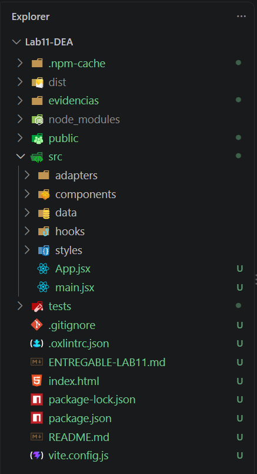

# Laboratorio 11 - Comunicación entre Componentes en ReactJS

**Proyecto:** Cine Lumière, cartelera académica ampliada a partir del laboratorio anterior.

## 2. Información general

- **Estudiante:** Michael Fernandez.
- **Curso:** Desarrollo de Aplicaciones Empresariales.
- **Institución:** Tecsup.
- **Laboratorio:** Semana 11.
- **Tecnología principal:** ReactJS.
- **Entregable académico:** [ENTREGABLE-LAB11.md](ENTREGABLE-LAB11.md).

Este documento corresponde exclusivamente a `Lab11-DEA`. Describe el código inspeccionado y las verificaciones del 15 de noviembre de 2026. La revisión final solo corrige documentación, identificación académica y exclusión de caché, sin cambiar funcionalidades. La correspondencia se basa en las 12 actividades oficiales transcritas por el estudiante; el documento original de la guía no está disponible en esta carpeta para contrastar requisitos adicionales de formato.

## 3. Objetivo del laboratorio

Comunicar componentes mediante props, callbacks y estado elevado para mantener sincronizadas la búsqueda, las tarjetas y la cabecera. Extraer lógica en hooks personalizados para separar la presentación del retardo de búsqueda, el tamaño de ventana y la simulación de carga de estrenos.

## 4. Tecnologías utilizadas

| Tecnología | Uso real | Versión instalada verificada |
| --- | --- | --- |
| React y React DOM | Componentes JSX, hooks, `createRoot` y `StrictMode` | 19.3.1 |
| Vite | Servidor de desarrollo y compilación | 8.3.6 |
| `@vitejs/plugin-react` | Integración de React con Vite | 6.2.1 |
| `react-hot-toast` | Notificaciones de favoritas y `Toaster` | 2.6.1 |
| Oxlint | Análisis estático | 1.91.0 |
| `@types/react` y `@types/react-dom` | Declaraciones de tipos para herramientas | 19.3.0 |
| JavaScript, JSX, CSS y SVG | Lógica, interfaz, estilos e imágenes locales | No corresponde |
| Node.js y Chrome/Edge | Pruebas con `node:assert`, `node:test` y protocolo de depuración del navegador | Node.js 24.15.0 verificado |

Las versiones instaladas se comprobaron con `npm ls --depth=0`; los rangos declarados están en [package.json](package.json) y la resolución en [package-lock.json](package-lock.json). Es un proyecto JavaScript, no TypeScript. No utiliza backend, API externa, base de datos, React Router, Redux, Vitest ni Playwright. No se añadieron dependencias.

## 5. Estructura del proyecto

```text
Lab11-DEA/
├── README.md
├── ENTREGABLE-LAB11.md
├── package.json
├── package-lock.json
├── index.html
├── vite.config.js
├── .oxlintrc.json
├── public/
│   ├── favicon.svg
│   └── images/                      # Ocho afiches y un banner SVG
├── src/
│   ├── main.jsx
│   ├── App.jsx
│   ├── adapters/movieAdapter.js
│   ├── components/
│   │   ├── Button/Button.jsx
│   │   ├── Footer/Footer.jsx
│   │   ├── Header/Header.jsx
│   │   ├── Hero/Hero.jsx
│   │   ├── MovieCard/MovieCard.jsx
│   │   ├── MovieList/MovieList.jsx
│   │   ├── MovieSearch/MovieSearch.jsx
│   │   ├── PremieresCarousel/PremieresCarousel.jsx
│   │   ├── PremieresSection/PremieresSection.jsx
│   │   └── Skeleton/Skeleton.jsx
│   ├── hooks/
│   │   ├── useDebounce.js
│   │   ├── useWindowSize.js
│   │   └── usePremieres.js
│   ├── data/movies.js
│   └── styles/global.css
├── tests/
│   ├── browser.test.mjs
│   ├── movieAdapter.test.mjs
│   ├── sharedState.browser.mjs
│   ├── useDebounce.browser.mjs
│   ├── useWindowSize.browser.mjs
│   ├── usePremieres.browser.mjs
│   ├── premieresSection.browser.mjs
│   └── fixtures/                    # Páginas y componentes auxiliares de prueba
├── evidencias/                      # Capturas y registros de distintas ejecuciones
├── dist/                            # Compilación existente
└── node_modules/                    # Dependencias y cachés locales
```

`src/components/` separa responsabilidades visuales; `src/hooks/` encapsula lógica con estado y efectos; `src/adapters/` normaliza películas; `src/data/` conserva los ocho registros locales; `src/styles/` contiene el diseño global. `public/` sirve recursos estáticos, `tests/` verifica la aplicación y los hooks, y `evidencias/` conserva resultados. Dependencias, cachés y compilación no son código fuente.

## 6. Funcionalidades implementadas

- **Cartelera y estilos:** ocho películas, 24 horarios informativos, afiches, sinopsis, clasificación y valoración; navegación por anclas, contacto ficticio, diseño oscuro adaptable, variantes de `Button` y foco visible.
- **Patrón adaptador:** `adaptMovie` normaliza valores opcionales, convierte `rating` a número finito, conserva IDs y campos adicionales, copia `showtimes` y utiliza `image` como respaldo de `banner`. Se aplica en `App` y `usePremieres`; no consulta una API ni genera IDs.
- **Favoritas y notificaciones:** selección en `App`, persistencia en `localStorage` y mensajes de agregar/quitar con `react-hot-toast`. El ID `favorite-feedback` reemplaza el aviso anterior y evita acumulaciones; duración configurada: 2500 ms.
- **Buscador:** entrada controlada y filtrado parcial por título después de 400 ms con `useDebounce`; ignora mayúsculas y espacios externos, pero conserva las tildes. Muestra un mensaje sin coincidencias.
- **Diseño adaptable:** `useWindowSize` determina las columnas de `MovieList` y las tarjetas visibles de `PremieresCarousel`.
- **Estrenos simulados:** `usePremieres` reutiliza las cuatro primeras películas locales y simula una espera de 800 ms por defecto, sin solicitudes de red.
- **Estados y Skeleton:** `loading` muestra marcadores visuales, `success` el carrusel y `error` un mensaje con `Reintentar`, conectado a `retry`. `Skeleton` respeta la preferencia de movimiento reducido.
- **Carrusel:** botones, desplazamiento horizontal y teclado con flechas, `Home` y `End`; sin reproducción automática. Sus tarjetas son elementos `article`, no instancias de `MovieCard`, y no incluyen acciones de favoritas.
- **Contador:** `Header` muestra `favoriteCount`, derivado de la selección completa, no de los resultados visibles.
- **Limpieza de filtros:** un botón de `Hero` vacía la búsqueda y restaura inmediatamente la cartelera sin borrar favoritas, recargar ni reiniciar los estrenos.

## 7. Hooks personalizados

### `useDebounce`

- **Problema:** evitar que cada pulsación aplique inmediatamente el filtro.
- **Lógica extraída:** valor diferido, temporizador y limpieza del efecto asociados anteriormente al buscador.
- **Funcionamiento:** recibe `value` y `delay = 400`; conserva `debouncedValue`. Si cambia el valor, programa su publicación y cancela el temporizador anterior al cambiar dependencias o desmontar. `Object.is` evita programar valores idénticos; admite objetos y otros tipos.
- **Consumidor en la interfaz:** únicamente `App`, con `searchInput`. `MovieSearch` no llama al hook.
- **Ventaja:** permite probar el retardo y su limpieza por separado, manteniendo la entrada inmediata.

### `useWindowSize`

- **Problema:** reaccionar al tamaño de ventana sin repetir la gestión de `resize`.
- **Lógica extraída:** lectura de dimensiones, estado `size`, suscripción y eliminación del listener.
- **Funcionamiento:** devuelve `{ width, height }`, conserva la misma referencia si no cambian las dimensiones y elimina el listener al desmontar. La lectura inicial devuelve ceros si no existe `window`; esto no implica soporte completo de renderizado en servidor.
- **Consumidores en la interfaz:** **`MovieList` y `PremieresCarousel`**. Comparten la implementación del hook, no una instancia global: cada llamada mantiene estado y listener propios.
- **Ventaja:** ambas vistas responden al ancho con reglas propias sin duplicar la lógica del evento.

| Ancho | Columnas de `MovieList` | Tarjetas visibles del carrusel con cuatro películas |
| --- | --- | --- |
| Menor que 600 px | 1 | 1 |
| Desde 600 hasta menos de 900 px | 2 | 2 |
| Desde 900 hasta menos de 1200 px | 3 | 3 |
| Desde 1200 px | 4 | 3 |

### `usePremieres`

- **Problema:** separar la presentación del ciclo de carga simulada y su recuperación.
- **Lógica extraída:** temporizador, intentos, datos adaptados, error y cancelación de resultados anteriores.
- **Funcionamiento:** recibe `{ delay = 800, failAttempts = 0 }`; mantiene `attempt` y `result`, memoriza `request` y devuelve `{ status, data, error, retry }`. Solo acepta como vigente el resultado de la solicitud actual. La limpieza cancela el temporizador y desactiva callbacks tardíos.
- **Consumidor en la interfaz:** únicamente `PremieresSection`. `PremieresCarousel` recibe `movies` por props, sin solicitar datos.
- **Ventaja:** el componente elige la vista sin gestionar intentos ni temporizadores; `retry` conserva su referencia con `useCallback`.

Los auxiliares `HookProbe`, `WindowSizeProbe` y `PremieresProbe` ejercitan los hooks en `tests/fixtures/`, pero no pertenecen a la interfaz principal. No se atribuye a `useDebounce` ni a `usePremieres` una reutilización entre múltiples componentes de producción que no existe.

## 8. Comunicación entre componentes

| Mecanismo | Ejemplo real |
| --- | --- |
| Props | `App` entrega `favoriteCount` a `Header`; `Hero` recibe `movie` y `query`; `MovieList` recibe catálogo, filtro y selección. |
| Callbacks | `MovieSearch` llama `onQueryChange(event.target.value)`; `MovieCard` llama `onToggleFavorite(movie.id)`; el botón de `Hero` llama `onClearFilters`. |
| Estado elevado | `favoriteIds` y `searchInput` están en `App`, antecesor común de las ramas que deben leerlos o modificarlos. |
| Información derivada | `favoriteCount = favoriteIds.length`; `searchTerm` depende del debounce y su versión; `filteredMovies` e `isFavorite` se calculan desde props. No son estados independientes. |

Los datos bajan por props; las acciones llegan al propietario del estado mediante funciones recibidas por props. `Hero` y `MovieList` transmiten callbacks sin modificar datos del padre. No se utiliza Context ni un gestor global.

## 9. Árbol de componentes y ubicación de datos

`src/main.jsx` monta `App` dentro de `StrictMode`. `main` es HTML, no otro componente React.

```text
App
│ Estado: favoriteIds; searchInput = { query, resetVersion }
│ useDebounce: debouncedValue → debouncedSearch
│ Derivados: favoriteCount, searchTerm, featuredMovie
├── Header (favoriteCount; sin estado local)
├── main [HTML]
│   ├── Hero (movie, query, onQueryChange, onClearFilters; sin estado local)
│   │   ├── Button (enlace para explorar la cartelera)
│   │   ├── MovieSearch (query, onQueryChange; sin estado local)
│   │   └── Button (Limpiar filtros → onClearFilters)
│   ├── MovieList (movies, searchTerm, favoriteIds, onToggleFavorite)
│   │   │ useWindowSize: estado size = { width, height }
│   │   │ Derivados: columnCount, normalizedSearch, filteredMovies
│   │   └── MovieCard × resultados (movie, isFavorite, onToggleFavorite)
│   │       └── Button (favorita → onToggleFavorite(movie.id))
│   └── PremieresSection (requestOptions opcional; App no lo pasa)
│       │ usePremieres: estados attempt y result; request memorizada
│       │ Salida: status, data, error, retry; titleId con useId
│       ├── Skeleton × 3 [loading; CSS oculta algunos en pantallas pequeñas]
│       ├── PremieresCarousel (movies = data) [success]
│       │   │ Estado: activeIndex; useWindowSize: size independiente
│       │   │ Referencia: trackRef; identificador: trackId
│       │   │ Derivados: visibleCount, lastIndex, currentIndex
│       │   ├── Button (Anterior)
│       │   ├── Button (Siguiente)
│       │   └── article × película [HTML, no otro componente React]
│       └── Button (Reintentar → retry) [error]
├── Footer (sin props ni estado local)
└── Toaster (componente externo de react-hot-toast)
```

`Header` presenta navegación y contador; `Hero` presenta la destacada y conecta las acciones; `MovieSearch` representa la entrada; `MovieList` filtra y genera tarjetas; `PremieresSection` elige la vista según la carga; `PremieresCarousel` gestiona su navegación. `Button`, `MovieCard` y `Skeleton` son reutilizables sin estado propio. `Hero`, `MovieSearch`, `Header`, `Footer`, `MovieCard`, `Button` y `Skeleton` no declaran `useState`.

`useId` genera identificadores accesibles y `useRef` mantiene una referencia al elemento desplazable; no son copias de los estados de búsqueda o favoritas. `movies` es un catálogo adaptado a nivel de módulo en `App`; `localStorage` es un respaldo persistente, no otro estado React.

## 10. Contador de favoritas

En [App.jsx](src/App.jsx), `favoriteIds` se inicializa con `loadFavoriteIds`, que descarta IDs desconocidos y duplicados. Un efecto guarda la selección cuando cambia.

```jsx
  const [favoriteIds, setFavoriteIds] = useState(loadFavoriteIds)
  const [searchInput, setSearchInput] = useState({ query: '', resetVersion: 0 })
  const debouncedSearch = useDebounce(searchInput, 400)
  const favoriteCount = favoriteIds.length
  const searchTerm = debouncedSearch.resetVersion === searchInput.resetVersion ? debouncedSearch.query : ''
  const featuredMovie = movies[0]
```

`Header` recibe **solamente** `favoriteCount`: necesita mostrar un número, no administrar IDs, leer almacenamiento ni cambiar tarjetas. El contador no usa `useState` ni se incrementa manualmente; se recalcula desde la selección, incluso al filtrar o recargar.

**¿Por qué el contador de favoritas no puede vivir exclusivamente en la cabecera?** Las tarjetas están en una rama hermana de `Header` y originan las acciones. Un estado privado de `Header` no sería accesible a `MovieList` ni permitiría saber qué tarjeta está marcada. Duplicarlo obligaría a sincronizar selecciones y números. Por eso `App`, antecesor común, conserva `favoriteIds`, pasa la acción a las tarjetas y el número derivado a la cabecera. Es una decisión basada en este árbol, no una prohibición general de React.

## 11. Sincronización del buscador y limpieza de filtros

1. `App` pasa `searchInput.query` y `handleQueryChange` a `Hero`.
2. `Hero` los transmite como `query` y `onQueryChange` a `MovieSearch`.
3. El `onChange` llama al callback; `App` actualiza el texto inmediatamente. `MovieSearch` no conserva una segunda `query`.
4. `useDebounce(searchInput, 400)` publica el objeto tras la pausa. `App` deriva `searchTerm` y lo pasa a `MovieList`.
5. `MovieList` calcula `filteredMovies` sin mutar el catálogo ni guardar otra lista en estado.

El botón **Limpiar filtros** llama a `handleClearFilters` mediante `onClearFilters`. Su actualización real es:

```jsx
    setSearchInput((currentInput) => ({ query: '', resetVersion: currentInput.resetVersion + 1 }))
```

Vaciar `query` limpia la entrada; aumentar `resetVersion` invalida el resultado diferido anterior. Mientras las versiones no coincidan, `searchTerm` es `''` y se muestran inmediatamente las ocho películas. El efecto del hook cancela el temporizador previo. Si se vuelve a escribir antes de otros 400 ms, la versión impide que reaparezca una búsqueda antigua. No se alteran favoritas ni estrenos. Actualmente el único filtro es el título; no hay filtros de género o clasificación.

## 12. Estados de los estrenos

| Estado/acción | Datos y respuesta visual |
| --- | --- |
| `loading` | `data: []`, `error: null`; mensaje, `aria-busy` y tres `Skeleton` en el DOM, con visibilidad adaptable por CSS. |
| `success` | Cuatro registros locales adaptados; `PremieresCarousel` recibe `movies={data}`. |
| `error` | `data: []`, mensaje comprensible, alerta y botón `Reintentar`. |
| `retry` | Función, no un cuarto estado. Aumenta `attempt`, crea una solicitud vigente y vuelve a `loading`; después puede llegar a `success` o a `error`. |

`App` monta `<PremieresSection />` sin opciones: `failAttempts` es cero y el recorrido normal es `loading → success`. Error y recuperación se verifican con `requestOptions={{ failAttempts: 1 }}` en una página aislada de pruebas. No existe un control de simulación de fallos en la página principal.

## 13. Instalación y ejecución

Ejecutar desde `Lab11-DEA`, sin cambiar de laboratorio. Se requiere Node.js compatible con Vite; las pruebas se verificaron con Node.js 24.15.0 y un navegador Chrome/Edge instalado.

```powershell
npm ci
npm run dev
npm run build
npm test
npm run lint
node --test tests/movieAdapter.test.mjs
```

| Comando | Finalidad |
| --- | --- |
| `npm ci` | Instala las versiones del bloqueo. Reemplaza `node_modules` si existe; se documenta para una instalación reproducible, pero **no se ejecutó** en esta revisión. |
| `npm run dev` | Inicia Vite; abrir la URL indicada en la terminal. |
| `npm run build` | Compila para producción; por defecto utiliza `dist/`. |
| `npm test` | Ejecuta `tests/browser.test.mjs` y sus módulos sobre la aplicación y las páginas de prueba. |
| `npm run lint` | Ejecuta Oxlint sin aplicar correcciones. |
| `node --test tests/movieAdapter.test.mjs` | Ejecuta seis pruebas del adaptador, no incluidas en `npm test`. |

La suite levanta su propio Vite en un puerto libre y usa un perfil temporal en `node_modules/.cache/`, que limpia al terminar; no modifica el perfil personal. Cada ejecución crea una carpeta única `evidencias/lab11-activities-9-10-*`, sin sobrescribir registros previos. Si no encuentra el navegador, configurar `CHROME_PATH` con su ruta instalada. Conservar origen, puerto y perfil para verificar manualmente la persistencia.

## 14. Pruebas realizadas

**Ejecución de navegador después de las correcciones finales:** `2026-11-15T06:36:49.495Z` (UTC): **67 aprobadas, cero fallidas, cero errores de navegador y cero solicitudes fallidas**. Registro completo: [resultados-pruebas.json](evidencias/lab11-activities-9-10-G8eFtG/resultados-pruebas.json). Esta ejecución confirma que los cambios de identificación no alteraron contador, búsqueda, notificaciones, carrusel, estados ni limpieza de filtros.

| Verificación ejecutada | Resultado real |
| --- | --- |
| Script `npm run build` con salida aislada indicada debajo | Aprobado: 33 módulos transformados, sin errores de compilación. |
| `npm test` | 67/67 comprobaciones aprobadas. |
| `npm run lint` | Código de salida 0, sin diagnósticos. |
| `node --test tests/movieAdapter.test.mjs` | 6/6 pruebas aprobadas, cero fallidas. |
| `npm ls --depth=0` | Dependencias directas disponibles, sin faltantes. |

Para no vaciar ni modificar el `dist/` previo se ejecutó el mismo script con una salida nueva:

```powershell
npm run build -- --outDir node_modules/.cache/lab11-final-build-bacc09a42c2f41cf8def6fe4aeda2c94 --emptyOutDir false
```

| Grupo de comprobaciones | Cantidad | Casos aprobados representativos |
| --- | --- | --- |
| Cartelera, búsqueda, favoritas y persistencia heredadas | 14 | Ocho películas y 24 horarios; `Button`; selección sin duplicados; recarga; entrada inmediata y debounce; ` FARO `; estado vacío; restauración; validación de IDs; diseño y consola. |
| Notificaciones | 4 | Agregar, quitar, clics rápidos sin duplicados y cierre automático en móvil. |
| Diseño con `useWindowSize` | 10 | Anchos 1440, 1200, 1199, 900, 899, 600, 599, 390 y 320 px; búsqueda y persistencia al redimensionar. |
| Estrenos en la aplicación | 4 | Carga inicial, carrusel de escritorio/móvil, teclado e independencia de búsqueda/favoritas. |
| Estado compartido y limpieza | 10 | Contador inicial, agregar/quitar, recargas, limpieza por teclado, desde estado vacío, antes del debounce y seguida de nueva escritura; móvil. |
| `useDebounce` aislado | 7 | Inicio, 400 ms, cambios rápidos, retardo configurable/cero, vuelta al valor publicado, identidad de objetos y desmontaje. |
| `useWindowSize` aislado | 5 | Inicio, ancho/alto, dimensiones iguales, desmontaje y montajes repetidos en `StrictMode`. |
| `usePremieres` aislado | 7 | 800 ms, datos adaptados, fallo controlado, `retry`, opciones equivalentes/nuevas y cancelación. |
| Sección de estrenos aislada | 6 | `Skeleton`, movimiento reducido, transición en 800 ms, error, recuperación por teclado y carrusel con dos películas o ninguna. |
| **Total** | **67** | **Todos aprobados en la ejecución indicada.** |

El adaptador se prueba aparte: conservación de campos/horarios, copia sin mutar, valores ausentes, valoraciones inválidas, IDs numéricos/campos adicionales y rechazo de valores que no sean objetos. Las seis pruebas aprobaron.

**Alcance:** la suite navega sobre desarrollo y utiliza relojes controlados en páginas aisladas; también comprueba temporización real en la aplicación. Compilar no equivale a navegar sobre `preview`. No se probaron cuotas agotadas ni bloqueo de `localStorage`, ni se declara cobertura total de accesibilidad o navegadores. Se conservan registros históricos, incluidos intentos fallidos; no son el resultado actual.

## 15. Evidencias representativas

Se conservan las 11 capturas representativas de la ejecución anterior `lab11-activities-9-10-wJRSpy`, sin moverlas ni sustituirlas. La nueva verificación posterior a las correcciones generó otras 34 capturas y un JSON en `evidencias/lab11-activities-9-10-G8eFtG/`; no se duplican aquí las imágenes equivalentes. Las capturas históricas pueden mostrar todavía Lab10 en el pie de página, aunque la interfaz actual ya identifica Lab11.

| Evidencia | Contenido y procedencia |
| --- | --- |
| [Contador y notificación](evidencias/lab11-activities-9-10-wJRSpy/23-lab11-favorite-count-added.png) | Página principal: tres favoritas y aviso de alta. |
| [Búsqueda aplicada](evidencias/lab11-activities-9-10-wJRSpy/26-lab11-filter-applied.png) | Página principal: ` FARO `, una coincidencia y dos favoritas totales. |
| [Limpieza con foco](evidencias/lab11-activities-9-10-wJRSpy/27-lab11-clear-filters-button.png) | Botón accesible mediante teclado en la página principal. |
| [Cartelera restaurada](evidencias/lab11-activities-9-10-wJRSpy/28-lab11-filter-cleared-billboard.png) | Entrada vacía, ocho tarjetas y selección conservada. |
| [Diseño de 600 px](evidencias/lab11-activities-9-10-wJRSpy/12-lab11-grid-600.png) | Cartelera en dos columnas. |
| [Estado compartido móvil](evidencias/lab11-activities-9-10-wJRSpy/31-lab11-shared-state-mobile.png) | Página principal de 390 px: cabecera, contador y buscador. |
| [Skeleton](evidencias/lab11-activities-9-10-wJRSpy/16-lab11-skeleton-loading.png) | `PremieresSection` real en la página aislada de pruebas. |
| [Carrusel de escritorio](evidencias/lab11-activities-9-10-wJRSpy/17-lab11-premieres-desktop.png) | Sección principal: tres estrenos visibles de cuatro. |
| [Carrusel móvil](evidencias/lab11-activities-9-10-wJRSpy/18-lab11-premieres-mobile.png) | Sección principal: un estreno visible. |
| [Error y Reintentar](evidencias/lab11-activities-9-10-wJRSpy/19-lab11-premieres-error.png) | Fallo controlado del componente real en página aislada. |
| [Recuperación](evidencias/lab11-activities-9-10-wJRSpy/21-lab11-premieres-after-retry.png) | Página aislada: carrusel recuperado después de `retry`. |

### Estructura del proyecto en el editor

La captura existente muestra `Lab11-DEA`, las carpetas principales de `src/`, `public/`, `tests/`, `evidencias/`, los documentos y la configuración. `components` y `hooks` están contraídos: el detalle de sus archivos se explica en el árbol textual de este README. La imagen original se conserva sin cambios.



Si la guía exige capturas del código, consola o terminal, deben obtenerse: los fragmentos y el JSON no se presentan como imágenes de esas herramientas. También falta contrastar el formato con la guía original. No se realizó entrega al campus virtual.

## 16. Conclusiones

1. Guardar las favoritas en `App` permitió que las tarjetas y la cabecera mostraran la misma selección sin mantener contadores separados.
2. Elevar la búsqueda facilitó limpiar el campo y la cartelera juntos; controlar la versión evitó que reapareciera un filtro antiguo después del retardo.
3. Los hooks separaron la lógica de la interfaz: `useWindowSize` se aprovechó en dos vistas y la carga de estrenos pudo probarse con espera, error y reintento.

## 17. Identificación actual y referencias históricas conservadas

La identificación académica se corrigió de forma puntual. Las referencias técnicas e históricas se conservan cuando cambiarlas afectaría persistencia, pruebas o trazabilidad; no se realizó un reemplazo global.

| Ubicación | Referencia actual | Tratamiento realizado |
| --- | --- | --- |
| `package.json:2` y `package-lock.json:2,8` | Nombre `lab11-dea` | Corregidos únicamente los nombres del proyecto raíz; versiones y dependencias intactas. |
| `index.html:8` | Descripción de comunicación entre componentes del Laboratorio 11 | Corregido solo el texto académico, sin cambiar la estructura HTML. |
| `src/components/Footer/Footer.jsx:22` | `Laboratorio 11 · React + Vite` | Corregida solo la identificación visible, sin cambios de diseño ni enlaces. Las capturas anteriores no se retocaron. |
| `src/App.jsx:13` y `tests/browser.test.mjs` | Clave `lab10-dea:favoriteIds`, repetida en aserciones | **Conservar ahora** para no perder la selección persistida ni romper pruebas. Renombrarla exige migración y cambios coordinados. |
| `tests/browser.test.mjs` | Prefijo temporal `lab10-browser-` y token `window.__lab10DocumentToken` | Conservar hasta una limpieza técnica autorizada; el token se escribe y comprueba en distintas aserciones. |
| `tests/browser.test.mjs` y `evidencias/` | Capturas `03-lab10-…` a `08-lab10-…` y registros anteriores | Conservar trazabilidad y enlaces. La suite actual todavía produce esos nombres para regresión; el nombre no determina por sí solo la versión capturada. |

Los casos inspeccionados describen comportamientos en inglés; las referencias explícitas a Lab10 están en claves, auxiliares y archivos, no en un supuesto conjunto adicional de pruebas llamado Lab10. `evidencias/resultados-pruebas.json` es histórico, no el resultado final de las 67 comprobaciones.

## 18. Alcance de la actividad 11 y cumplimiento preliminar

La actividad documental reúne el árbol real, los datos de cada nivel, props, callbacks, hooks, evidencias y conclusiones en este README y el entregable. Las actividades funcionales están implementadas y sus verificaciones posteriores a las correcciones aprobaron. La evaluación es **preliminar**, sin asignar una nota; la preparación del proyecto se completó manteniendo `main` por decisión del estudiante y la entrega externa continúa pendiente.

### Correspondencia con las 12 actividades oficiales

| Actividad | Requisito solicitado | Implementación realizada | Archivos involucrados | Estado actual |
| --- | --- | --- | --- | --- |
| 1 | Partir de Lab10 funcionando y crear una rama | Base de cartelera preparada y funcionando; se mantuvo `main` por decisión del estudiante, sin crear otra rama | `package.json`, `src/App.jsx`, `src/main.jsx` | Preparación cumplida; requisito de rama no cumplido literalmente |
| 2 | Ampliar estilos y revisar componentes | Utilidades, foco visible y diseño adaptable comprobados | `src/styles/global.css`, `src/components/` | Cumplido |
| 3 | Adaptar los datos al modelo de película | Normalización sin mutar el catálogo | `src/adapters/movieAdapter.js`, `src/App.jsx`, `src/hooks/usePremieres.js` | Cumplido |
| 4 | Notificar altas y bajas sin acoplar la tarjeta | Callback de tarjeta y notificación centralizada con `react-hot-toast` | `src/App.jsx`, `src/components/MovieCard/MovieCard.jsx` | Cumplido |
| 5 | Crear y aplicar `useDebounce` al buscador | Retardo de 400 ms extraído al hook, consumido por `App` | `src/hooks/useDebounce.js`, `src/App.jsx`, `src/components/MovieSearch/MovieSearch.jsx` | Cumplido |
| 6 | Crear `useWindowSize` para tarjetas por fila | Cuadrícula y carrusel adaptados al ancho | `src/hooks/useWindowSize.js`, `src/components/MovieList/MovieList.jsx`, `src/components/PremieresCarousel/PremieresCarousel.jsx` | Cumplido |
| 7 | Simular estrenos con tres estados | Espera local, datos adaptados, error controlado y reintento | `src/hooks/usePremieres.js` | Cumplido |
| 8 | Integrar Skeleton, carrusel y sección de estrenos | Vistas condicionales según `loading`, `success` y `error` | `src/components/Skeleton/Skeleton.jsx`, `src/components/PremieresCarousel/PremieresCarousel.jsx`, `src/components/PremieresSection/PremieresSection.jsx` | Cumplido |
| 9 | Elevar el contador y mostrarlo en Header sin pasar la lista | `favoriteIds` en `App`; `favoriteCount` derivado y única prop de `Header` | `src/App.jsx`, `src/components/Header/Header.jsx` | Cumplido |
| 10 | Limpiar filtros desde el banner y sincronizar buscador/lista | Campo controlado y reinicio con `resetVersion` | `src/App.jsx`, `src/components/Hero/Hero.jsx`, `src/components/MovieSearch/MovieSearch.jsx`, `src/components/MovieList/MovieList.jsx` | Cumplido |
| 11 | Registrar árbol, estados y justificación del contador | Árbol real, inventario de datos y explicación del ancestro común | `README.md`, `ENTREGABLE-LAB11.md`, `evidencias/estructura.png` | Cumplido |
| 12 | Publicar proyecto en GitHub y entregable en campus | Preparación local únicamente; ninguna publicación ni entrega realizada | Proyecto y evidencias de `Lab11-DEA`, `ENTREGABLE-LAB11.md` | Pendiente; no ejecutar sin autorización |

La revisión documental coteja enlaces relativos, las 11 capturas funcionales seleccionadas, la captura de estructura y los 16 fragmentos de código existentes. Se preservan las explicaciones de hooks y comunicación entre componentes. Solo queda contrastar posibles requisitos adicionales de formato con la guía original.

### Cambios finales y preparación para publicación

Se modificaron exclusivamente `.gitignore`, `package.json`, los nombres raíz de `package-lock.json`, la descripción de `index.html`, la identificación de `Footer.jsx` y ambos documentos. La regla `.npm-cache/` excluye toda esa caché; `node_modules/` y `dist/` conservan sus reglas anteriores. No se cambiaron funcionalidades, hooks, películas, pruebas, clave de `localStorage`, nombres de variables ni comentarios del código.

La suite generó una carpeta nueva y la compilación se aisló en caché para conservar archivos existentes. Las evidencias anteriores, incluida `estructura.png`, permanecen intactas. Para una futura subida conviene seleccionar código, recursos, pruebas, configuración, documentos y evidencias necesarias; una ejecución completa conserva las capturas referenciadas por su JSON. No se eliminan los registros históricos ni se publican cachés.

Todos los cambios se limitan a `Lab11-DEA`. Se mantuvo `main`, sin crear ramas, preparar staging, realizar commits ni publicar en GitHub o el campus virtual. La actividad 12 sigue pendiente.
