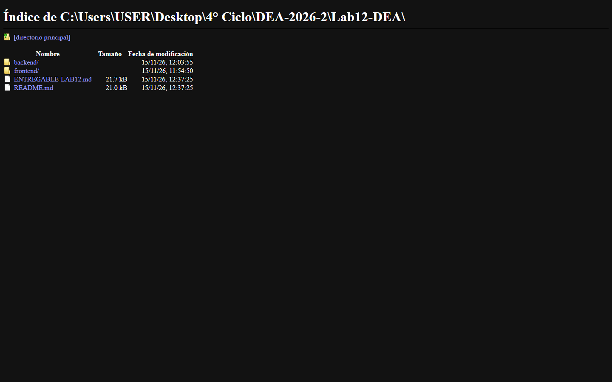
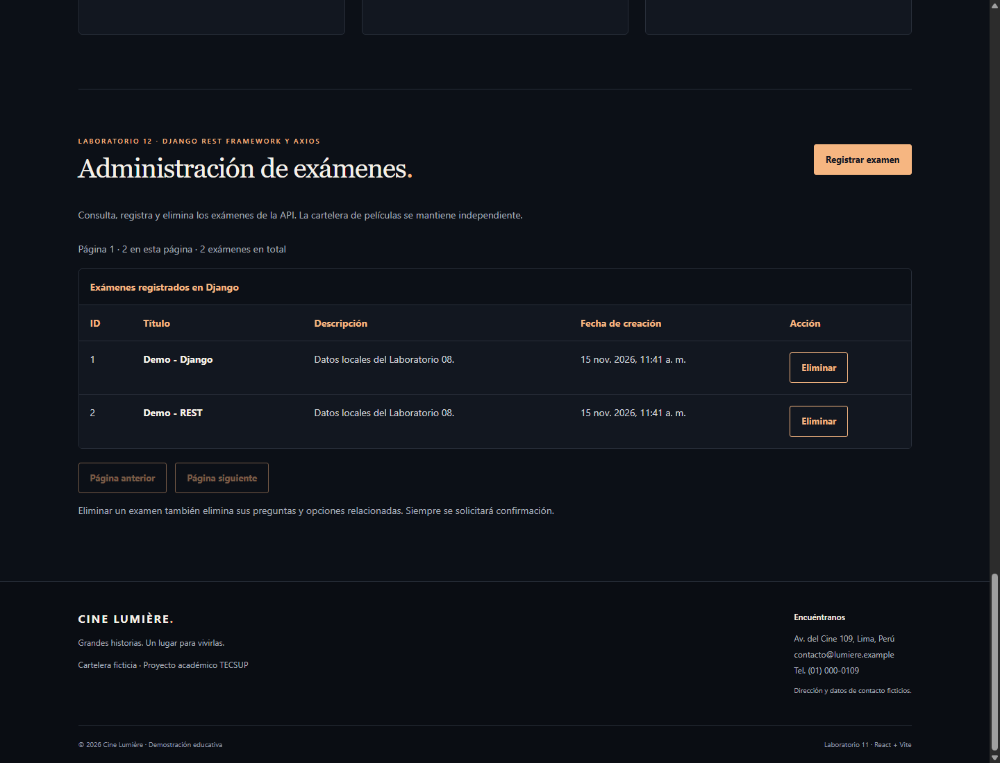
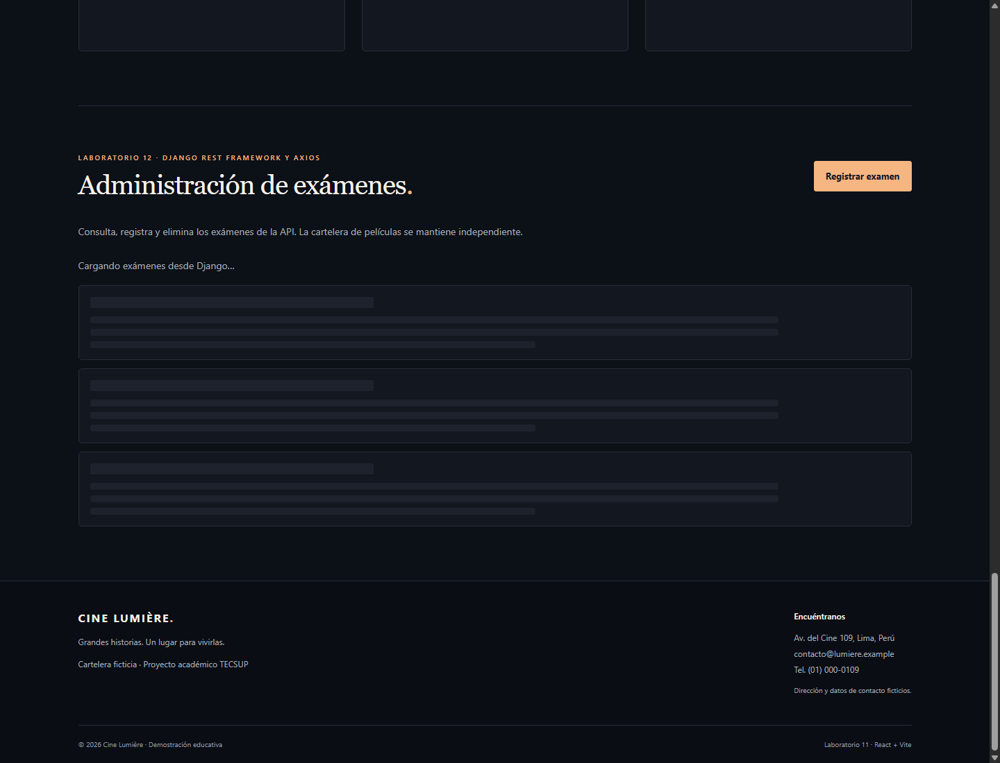
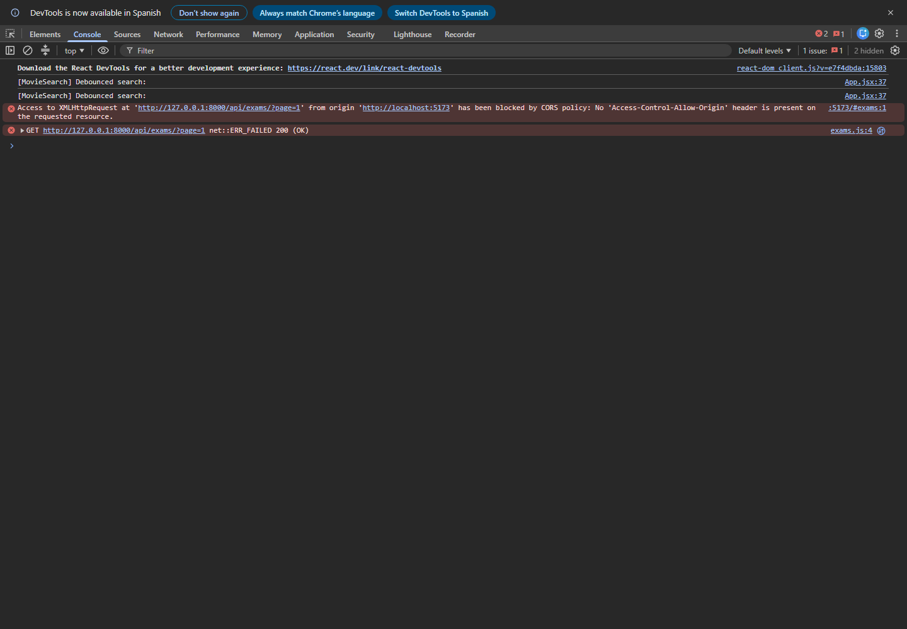
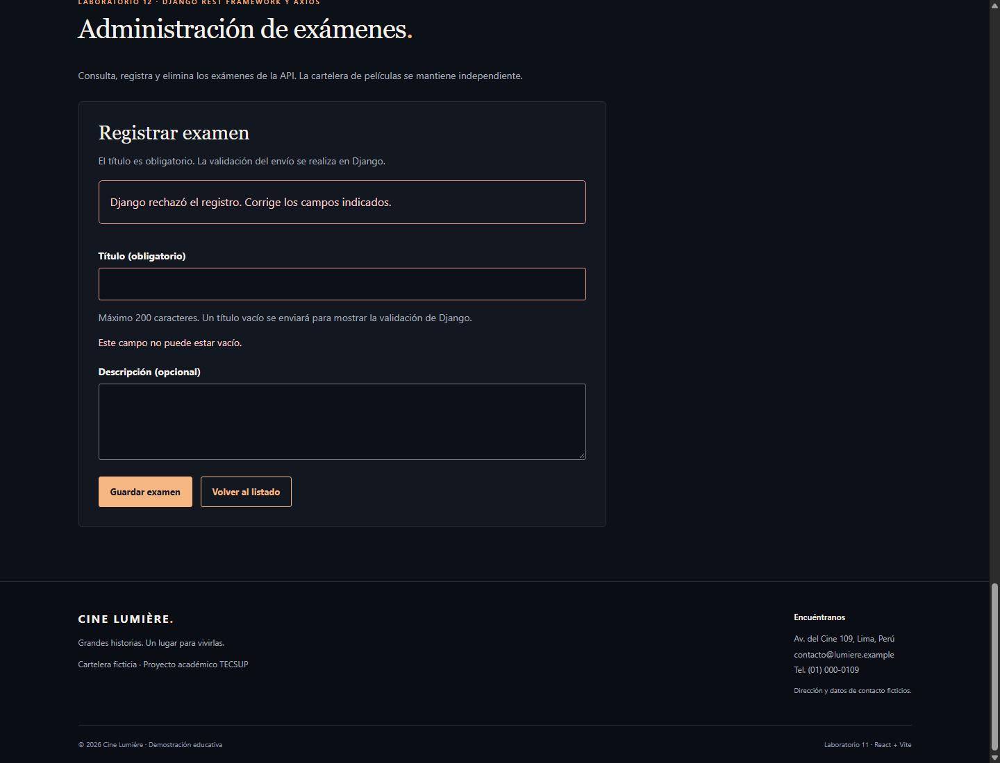
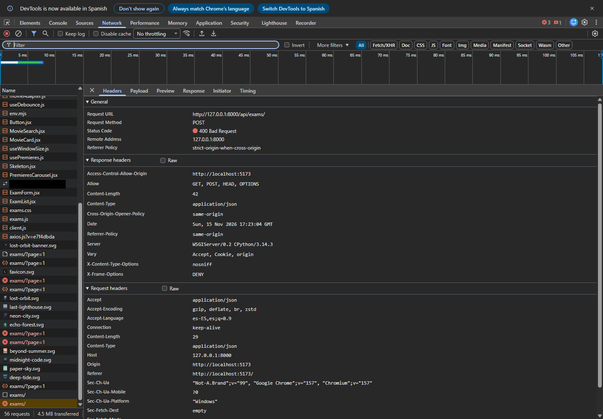
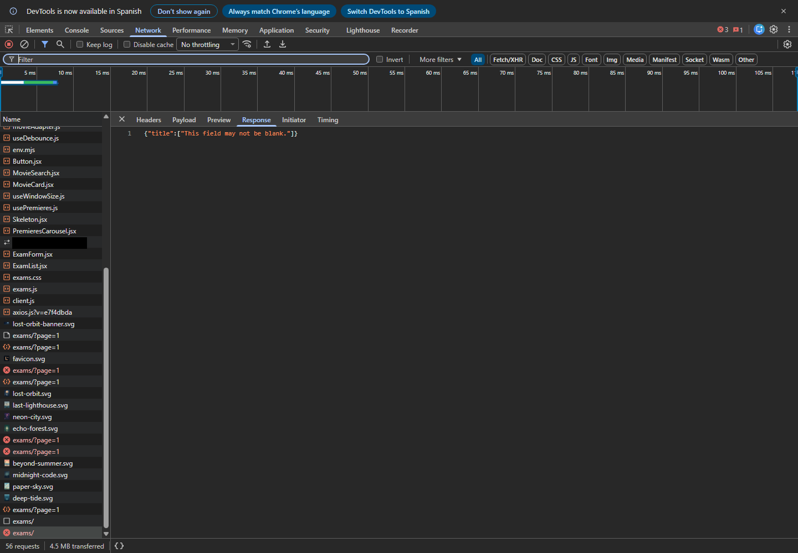
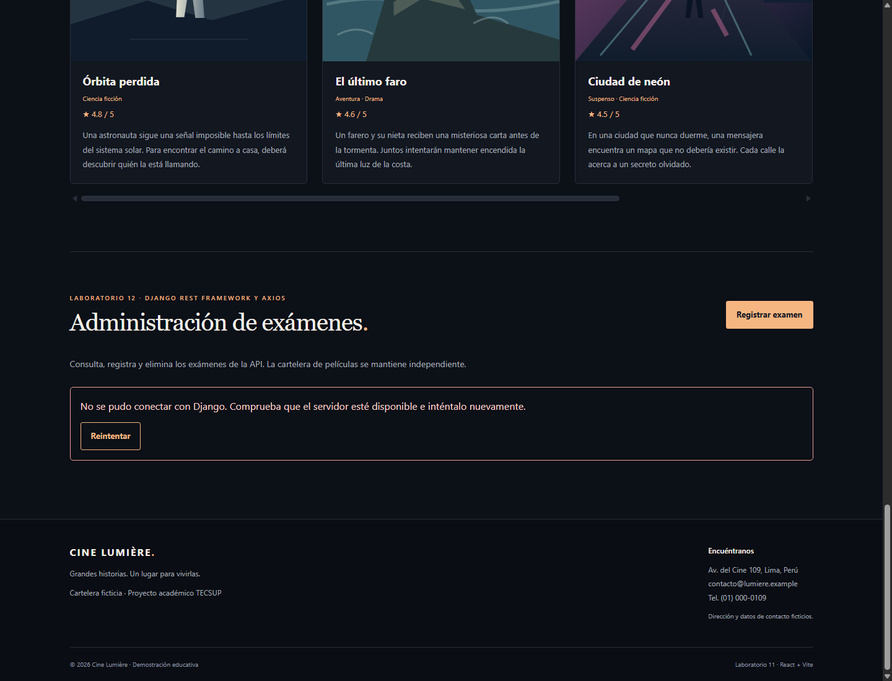
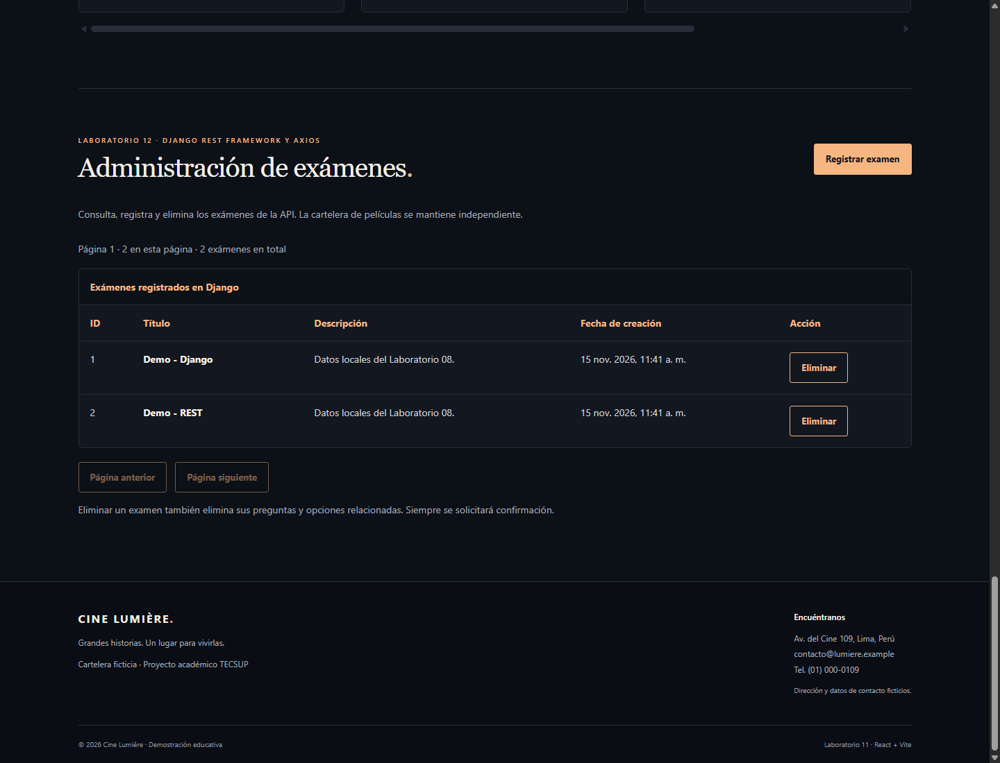

# Entregable — Laboratorio 12: Ajax y Servicios Web

## A. Datos generales

| Dato | Información |
|---|---|
| Alumno | Michael Fernandez |
| Institución | Tecsup |
| Curso | Desarrollo de Aplicaciones Empresariales |
| Ciclo | Cuarto |
| Laboratorio y semana | 12 |
| Tema | Ajax y Servicios Web |
| Desarrollo | Integración de Django REST Framework con React mediante Axios y CORS |
| Fecha de los resultados documentados | 15 de noviembre de 2026 |

Este informe utiliza el código y las evidencias existentes de **Lab12-DEA**. Las instrucciones completas de instalación y ejecución están en [README.md](README.md). La continuación del PASO 7 y sus verificaciones se detallan en [INFORME-PASO7.md](INFORME-PASO7.md), sin operaciones de escritura sobre la base original. La publicación en GitHub y la entrega al campus continúan pendientes de autorización.

## B. Capacidades

### 1. Configuración de CORS

Configurar un origen concreto para que el navegador permita a React leer las respuestas de Django. Registré `corsheaders`, ubiqué su middleware después de `SecurityMiddleware` y autoricé `http://localhost:5173`, sin desactivar CSRF ni habilitar todos los orígenes. Comprobé el bloqueo al retirar temporalmente ese permiso y su recuperación tras restaurarlo.

### 2. Consumo de servicios mediante Axios

Centralizar la dirección y la configuración HTTP en una instancia reutilizable. Separé las funciones GET, POST y DELETE de los componentes visuales, respetando JSON, barras finales, paginación y respuestas 204 sin cuerpo. Las solicitudes actualizan la interfaz de forma asíncrona sin recargar el documento.

### 3. Manejo de carga, datos y error

Utilizar estado y efectos para mostrar un esqueleto durante la espera, una tabla cuando llegan los registros y un mensaje con Reintentar cuando falla la consulta. Diferencié estas situaciones de los estados de guardado y eliminación, y de una cancelación legítima al desmontar un componente.

## C. Desarrollo de las actividades

### 1. Preparación del backend

**Explicación.** Reutilicé la copia de la API del Lab08 dentro de `backend/`, con un entorno `.venv` independiente y las dependencias fijadas. Conservé los modelos `Exam`, `Question` y `Option`, sus serializers, ViewSets, rutas y validaciones. Apliqué las migraciones existentes y cargué los datos demo después de revisar que `seed_demo` no eliminaba información ni llamaba servicios externos.

**Archivos utilizados:** [requirements.txt](backend/requirements.txt), [settings.py](backend/config/settings.py), [migración inicial](backend/quiz/migrations/0001_initial.py) y [seed_demo.py](backend/quiz/management/commands/seed_demo.py).

**Fragmento real — ubicación independiente de SQLite:**

```python
DATABASES = {
    'default': {
        'ENGINE': 'django.db.backends.sqlite3',
        'NAME': BASE_DIR / 'db.sqlite3',
    }
}
```

**Resultado.** El backend utiliza Django 5.2.15 y DRF 3.16.1. En la preparación se aplicaron 19 migraciones y se obtuvieron 2 exámenes, 12 preguntas y 24 opciones. La [verificación final](frontend/evidencias/lab12/run-DgJS4v/final-health.json) confirma esos totales; no es una captura de la ejecución de migraciones.

**Evidencia de estructura.** Captura nueva del índice real del directorio en Chrome. Muestra `backend/`, `frontend/` y los dos documentos, no un árbol expandido del editor:



### 2. Configuración de CORS

**Explicación.** Instalé `django-cors-headers==4.9.0`, agregué `corsheaders` a `INSTALLED_APPS` y conservé la seguridad y el orden relativo de los middleware originales.

**Archivos utilizados:** [backend/requirements.txt](backend/requirements.txt) y [backend/config/settings.py](backend/config/settings.py).

**Fragmentos reales — posición del middleware y origen:**

```python
    'django.middleware.security.SecurityMiddleware',
    'corsheaders.middleware.CorsMiddleware',
    'django.contrib.sessions.middleware.SessionMiddleware',
```

```python
CORS_ALLOWED_ORIGINS = ['http://localhost:5173']
```

**Resultado.** Las respuestas permiten ese origen exacto. `ALLOWED_HOSTS` y CSRF se conservaron. Cambiar el host a `127.0.0.1` o utilizar otro puerto no equivale al origen autorizado.

**Evidencia.** La prueba de retirada y restauración se presenta en la actividad 10; su [registro de restauración](frontend/evidencias/lab12/run-DgJS4v/cors-restoration.json) confirma que el archivo recuperó su contenido original.

### 3. Preparación de React

**Explicación.** Reutilicé la copia del Lab11 y mantuve sus carpetas de componentes, hooks, datos, adaptador, estilos y pruebas. No eliminé la cartelera ni añadí React Router. Integré `ExamSection` como una sección independiente y agregué un enlace Exámenes a la cabecera.

**Archivos utilizados:** [App.jsx](frontend/src/App.jsx), [Header.jsx](frontend/src/components/Header/Header.jsx), [ExamSection.jsx](frontend/src/components/ExamSection/ExamSection.jsx) y [vite.config.js](frontend/vite.config.js).

**Fragmento real — origen estable de desarrollo:**

```javascript
  server: { host: 'localhost', port: 5173, strictPort: true },
```

**Resultado.** React 19.3.1 y Vite 8.3.6 se conservaron. Las favoritas, búsqueda con debounce, limpieza de filtros, contador y carrusel continúan presentes. La [integración real](frontend/evidencias/lab12-django-6ZVlek/results.json) incluye comprobaciones de regresión de estas funcionalidades.

### 4. Instalación de Axios

**Explicación.** Desde `frontend/` ejecuté primero la instalación reproducible y después agregué Axios. No actualicé las resoluciones existentes del archivo de bloqueo.

**Archivos utilizados:** [package.json](frontend/package.json) y [package-lock.json](frontend/package-lock.json).

**Comandos utilizados durante la implementación:**

```powershell
npm ci
npm install axios
```

**Resultado.** Se instaló Axios **1.21.1** y se conservaron las 69 resoluciones originales. Estos comandos no se volvieron a ejecutar durante la documentación; `npm ci` ya instala Axios en una instalación nueva del proyecto actual.

### 5. Creación del cliente API

**Explicación.** Centralicé el destino en una instancia Axios, con tiempo máximo de espera y respuesta JSON. `VITE_API_BASE_URL` permite cambiar el destino sin escribir direcciones en los componentes; no contiene credenciales.

**Archivos utilizados:** [client.js](frontend/src/api/client.js) y [exams.js](frontend/src/api/exams.js).

**Fragmento real:**

```javascript
const baseURL = import.meta.env?.VITE_API_BASE_URL || 'http://127.0.0.1:8000/api/'

const api = axios.create({
  baseURL: `${baseURL.replace(/\/+$/, '')}/`,
  timeout: 10000,
  headers: { Accept: 'application/json' },
})
```

**Resultado.** Las funciones `getExams`, `createExam` y `deleteExam` comparten configuración y respetan la barra final que utiliza Django. La interfaz conserva la separación entre transporte y presentación.

### 6. Implementación de GET

**Explicación.** `ExamList` carga los exámenes con `useEffect`, recibe el objeto paginado y guarda sus `results` en estado. La tabla presenta ID, título, descripción, fecha y eliminación. `count` se muestra como total; los enlaces `next` y `previous` determinan si se puede navegar.

**Archivos utilizados:** [exams.js](frontend/src/api/exams.js) y [ExamList.jsx](frontend/src/components/ExamList/ExamList.jsx).

**Fragmento real — petición paginada y cancelable:**

```javascript
  const { data } = await api.get('exams/', { params: { page }, signal })
```

**Fragmento real — datos utilizados por la tabla:**

```javascript
          setResult({ status: 'success', data: data.results, count: data.count, page, next: data.next, previous: data.previous, error: null })
```

**Resultado.** GET devolvió HTTP 200. En la ejecución de errores aparecen los dos exámenes en una página; la navegación entre páginas se comprobó en la etapa de integración mediante registros temporales, eliminados posteriormente. No se alteró el tamaño de página de DRF.



### 7. Implementación de POST

**Explicación.** El formulario mantiene `title` y `description` en estado, utiliza entradas controladas y envía desde `onSubmit`. `preventDefault()` evita la navegación y una referencia impide envíos duplicados. Durante el guardado se deshabilitan los controles. Al completar POST se muestra una confirmación y se vuelve al listado, localizando la última página.

**Archivos utilizados:** [ExamForm.jsx](frontend/src/components/ExamForm/ExamForm.jsx), [ExamSection.jsx](frontend/src/components/ExamSection/ExamSection.jsx) y [exams.js](frontend/src/api/exams.js).

**Fragmentos reales — control del envío y llamada:**

```javascript
    event.preventDefault()
    if (savingRef.current) return
    savingRef.current = true
    setIsSaving(true)
```

```javascript
      const exam = await createExam(values)
      onCreated(exam)
```

**Resultado.** La [prueba de integración con Django](frontend/evidencias/lab12-django-6ZVlek/results.json) registró POST 201 con un examen temporal, sin duplicados y sin recargar. El formulario utiliza `noValidate` para que el título vacío llegue al backend; no depende únicamente de la validación HTML. La captura de ese error y su respuesta 400 están en la actividad 10, y no se presentan como captura de un POST satisfactorio.

### 8. Implementación de DELETE

**Explicación.** Cada fila identifica el examen por su ID y solicita confirmación antes de llamar a Axios. El aviso explica que CASCADE también elimina preguntas y opciones. Solo después de una respuesta satisfactoria se refresca la lista. Si falla, la fila permanece visible y puede intentarse de nuevo.

**Archivos utilizados:** [ExamList.jsx](frontend/src/components/ExamList/ExamList.jsx) y [exams.js](frontend/src/api/exams.js).

**Fragmento real — respuesta sin cuerpo:**

```javascript
export async function deleteExam(id) {
  await api.delete(`exams/${id}/`)
}
```

**Fragmento real — actualización tras el éxito:**

```javascript
      await deleteExam(exam.id)
      onDeleted(exam)
      loadPage(result.data.length === 1 && result.page > 1 ? result.page - 1 : result.page)
```

**Resultado.** Se comprobó DELETE 204 con un registro creado para la prueba y la cancelación de la confirmación sin enviar DELETE. No se eliminaron exámenes demo. La [evidencia es el registro JSON de integración](frontend/evidencias/lab12-django-6ZVlek/results.json); no existe una captura específica de DELETE en la serie de errores y no se inventa una.

### 9. Implementación de estados

**Explicación.** Separé la consulta en `loading`, `success` y `error`. Reutilicé `Skeleton` y `Button`. Los datos vacíos tienen un mensaje propio y no se confunden con un error. El botón Reintentar inicia otra consulta y vuelve a carga.

**Archivos utilizados:** [ExamList.jsx](frontend/src/components/ExamList/ExamList.jsx), [Skeleton.jsx](frontend/src/components/Skeleton/Skeleton.jsx), [Button.jsx](frontend/src/components/Button/Button.jsx) y [exams.css](frontend/src/styles/exams.css).

**Fragmento real — presentación durante la espera:**

```jsx
          <div className="exam-skeletons">
            {[0, 1, 2].map((index) => <Skeleton key={index} className="exam-table-skeleton" />)}
          </div>
```

**Fragmento real — recuperación:**

```jsx
          <Button variant="secondary" onClick={() => loadPage(request.page)}>Reintentar</Button>
```

**Resultado.** Chrome aplicó latencia a una solicitud HTTP real para capturar los tres esqueletos; después apareció la tabla. No se sustituyeron las respuestas de exámenes por datos simulados. Los mensajes de error y su recuperación se muestran en la actividad siguiente.



### 10. Pruebas de errores

**Explicación.** Ejecuté las pruebas solicitadas con Chrome, React, Axios y Django reales. Primero provoqué el bloqueo CORS, después la validación del título y finalmente la desconexión del backend. Guardé registros de red y capturas nuevas. No modifiqué modelos, endpoints ni validaciones.

**Archivos utilizados:** [ejecutor de evidencias](frontend/tests/lab12-errors.browser.mjs), [supervisor de restauración](frontend/tests/helpers/corsRestoreGuard.mjs), [cliente CDP](frontend/tests/helpers/cdpClient.mjs), [ExamList.jsx](frontend/src/components/ExamList/ExamList.jsx), [ExamForm.jsx](frontend/src/components/ExamForm/ExamForm.jsx) y [exams.js](frontend/src/api/exams.js).

**Fragmento real — mensaje ante una respuesta no accesible:**

```javascript
  if (error.isAxiosError && !error.response) {
    return 'No se pudo conectar con Django. Comprueba que el servidor esté disponible e inténtalo nuevamente.'
  }
```

#### 10.1. Error CORS provocado y restauración

Guardé el contenido original de `settings.py`, retiré temporalmente el origen permitido y reinicié el Django iniciado para la prueba. El servidor respondió 200, pero Chrome bloqueó la lectura por falta de `Access-Control-Allow-Origin`. La consola permite distinguirlo de un error de conexión aunque React presente un mensaje genérico similar.




Restauré inmediatamente el archivo original byte por byte, con `finally` y un supervisor independiente con límite de 45 segundos. No habilité todos los orígenes ni desactivé CSRF. Al presionar Reintentar aparecieron nuevamente los datos.


#### 10.2. Validación de un campo obligatorio

Envié el título vacío mediante el formulario. La petición llegó a Django y devolvió 400, sin crear registros. El cuerpo real fue:

```json
{"title":["This field may not be blank."]}
```

React presentó **«Este campo no puede estar vacío.»** mediante la traducción del error del servidor.







Estas dos copias anonimizadas conservan el código HTTP y el cuerpo original. Las capturas originales se conservan localmente, excluidas por `.gitignore` y por la [lista cerrada de publicación](PUBLICACION-LAB12.txt). El JSON histórico conserva los nombres usados durante la captura; las versiones públicas son las enlazadas en este documento.

#### 10.3. Django apagado y recuperación

Detuve únicamente el árbol de procesos Django que se había iniciado para la prueba y mantuve React activo. GET produjo `ERR_CONNECTION_REFUSED`: no hubo código HTTP porque no respondió un servidor. La interfaz mantuvo la cartelera, mostró el mensaje de conexión y ofreció Reintentar, en lugar de quedar completamente en blanco.



Reinicié Django y presioné Reintentar. La tabla reapareció sin recargar React.



**Resultado global.** La ejecución [run-DgJS4v](frontend/evidencias/lab12/run-DgJS4v/results.json) registró nueve comprobaciones correctas. La [verificación posterior](frontend/evidencias/lab12/run-DgJS4v/final-health.json) confirmó respuestas 200, CORS restaurado y los datos originales. SQLite conservó su hash; no se crearon ni eliminaron registros en esa etapa. Los intentos incompletos por problemas de automatización se conservaron, pero no se contaron como aprobados.

## D. Pruebas y evaluación de resultados

### Tabla de pruebas funcionales y errores reales

| Prueba | Método HTTP | Código de respuesta | Resultado | Evidencia |
|---|---|---|---|---|
| Listado con datos y paginación | GET `exams/?page=1` | 200 | Correcto; dos exámenes originales | [Listado](frontend/evidencias/lab12/run-DgJS4v/01-listado-examenes.png) |
| Carga durante espera real | GET `exams/?page=1` | 200 al completar | Correcto; esqueleto visible antes de los datos | [Carga](frontend/evidencias/lab12/run-DgJS4v/02-estado-carga.png) |
| Registro válido temporal | POST `exams/` | 201 | Correcto; un registro, sin duplicados ni recarga | [JSON de integración real](frontend/evidencias/lab12-django-6ZVlek/results.json) |
| Eliminación temporal confirmada | DELETE `exams/{id}/` | 204 | Correcto; sin cuerpo, lista actualizada y datos demo conservados | [JSON de integración real](frontend/evidencias/lab12-django-6ZVlek/results.json) |
| CORS retirado intencionalmente | GET `exams/?page=1` | 200 en servidor; bloqueado en navegador | Correcto; se reproduce el error esperado | [Consola](frontend/evidencias/lab12/run-DgJS4v/03-error-cors-consola.png), [interfaz](frontend/evidencias/lab12/run-DgJS4v/04-error-cors-interfaz.png) |
| CORS restaurado y Reintentar | GET `exams/?page=1` | 200 | Correcto; vuelve la tabla | [Restauración](frontend/evidencias/lab12/run-DgJS4v/05-cors-restaurado.png) |
| Título vacío intencional | POST `exams/` | 400 | Correcto; error de Django visible en español | [Formulario](frontend/evidencias/lab12/run-DgJS4v/06-error-validacion-formulario.png), [estado HTTP anonimizado](frontend/evidencias/lab12/run-DgJS4v/07a-error-validacion-http400-publica.png), [respuesta anonimizada](frontend/evidencias/lab12/run-DgJS4v/07-error-validacion-respuesta-http-publica.png) |
| Servidor apagado intencionalmente | GET `exams/?page=1` | Sin respuesta HTTP | Correcto; mensaje y Reintentar, sin pantalla en blanco | [Servidor apagado](frontend/evidencias/lab12/run-DgJS4v/08-servidor-apagado.png) |
| Recuperación del servidor | GET `exams/?page=1` | 200 | Correcto; datos recuperados sin recargar | [Recuperación](frontend/evidencias/lab12/run-DgJS4v/09-recuperacion.png) |
| Cancelación por desmontaje | GET `exams/?page=1` | Sin respuesta completa | Correcto para este contexto; `canceled=true` y carga posterior satisfactoria | [Trazas reales](frontend/evidencias/lab12/run-DgJS4v/abort-diagnosis.json) |
| Integridad de los datos | GET de `exams/`, `questions/`, `options/` | 200 | Correcto; 2, 12 y 24 registros originales | [Verificación final](frontend/evidencias/lab12/run-DgJS4v/final-health.json) |

Los fallos de CORS, validación y servidor apagado son **provocados** y se consideran correctos porque produjeron el comportamiento solicitado y luego se recuperó el servicio. Las incidencias preliminares de captura de DevTools y arranque de procesos fueron errores inesperados de automatización, corregidos antes de la ejecución válida; no se confunden con fallos de la aplicación.

### Otras comprobaciones ejecutadas en etapas anteriores

- `npm run lint`: correcto; también se verificaron los auxiliares de evidencias.
- `npm run build`: compilación correcta, 97 módulos transformados. No demuestra navegación de producción con `preview`.
- `npm run test:api`: 14 pruebas correctas del cliente y del adaptador, incluyendo HTTP sobre un servidor de prueba, no Django.
- `npm run test:integration`: [44 comprobaciones con Django real](frontend/evidencias/lab12-django-6ZVlek/results.json), incluidos registros temporales que se limpiaron y verificaciones heredadas reutilizables.
- `npm run test:integration:fixture`: [47 comprobaciones con servidor HTTP de prueba](frontend/evidencias/lab12-fixture-XCHBNM/results.json); sus casos 503 y DELETE fallido no se presentan como caídas reales de Django.
- Ejecutor final de errores reales: [9 comprobaciones](frontend/evidencias/lab12/run-DgJS4v/results.json), sin respuestas simuladas y sin cambios de datos.

Estos registros corresponden a las etapas anteriores, no a una repetición del CRUD real en el PASO 7. Las verificaciones actuales y su alcance figuran en [INFORME-PASO7.md](INFORME-PASO7.md).

### Observación de la suite heredada: `ERR_ABORTED`

En la versión histórica de [frontend/tests/browser.test.mjs](frontend/tests/browser.test.mjs), el recolector registraba cualquier fallo de carga:

```javascript
    } else if (message.method === 'Network.loadingFailed') {
      failedRequests.push(message.params.errorText)
```

La prueba `Browser console and local image requests have no errors` exigía después:

```javascript
    assert.deepEqual(failedRequests, [])
```

La [reproducción instrumentada](frontend/evidencias/lab12/run-DgJS4v/abort-diagnosis.json) identificó un GET real a `http://127.0.0.1:8000/api/exams/?page=1`, cancelado al desmontar `ExamList` mientras había una respuesta pendiente. Se observaron `AbortController.abort()`, `XMLHttpRequest.abort()` y `ERR_ABORTED`, con `canceled=true`. La limpieza existe en el componente:

```javascript
    return () => {
      active = false
      controller.abort()
    }
```

No fue un fallo funcional en el caso reproducido: otra solicitud cargó los datos al volver al listado. El informe histórico solo conservaba el texto del error, sin la URL, por lo que no permite identificar retrospectivamente cada solicitud cancelada.

**Corrección aplicada en la continuación:** [requestAudit.mjs](frontend/tests/helpers/requestAudit.mjs) conserva ID, URL, método y contexto. Admite exclusivamente el GET de exámenes iniciado por `ExamList`, con `canceled=true` y `net::ERR_ABORTED`, sin error CORS ni bloqueo, con limpieza de efecto probada o navegación del ejecutor completada y recuperación posterior 200 de la misma URL. [requestAudit.test.mjs](frontend/tests/requestAudit.test.mjs) verifica que una cancelación sin prueba o recuperación, CORS, conexión rechazada, otros endpoints, POST y HTTP fallidos no queden ocultos.

El navegador heredado utiliza ahora el origen autorizado `http://localhost:5173` y comprueba cancelación real y recuperación, sin ampliar CORS ni suprimir excepciones. La verificación [verify-step7.mjs](frontend/tests/verify-step7.mjs) usa Django con SQLite de solo lectura y prueba el cierre por PID del árbol propio mediante [ownedProcess.mjs](frontend/tests/helpers/ownedProcess.mjs), sin terminar servidores ajenos. La carrera de CDP durante recargas se reintenta únicamente cuando Chrome informa que reemplazó el contexto inspeccionado. Los resultados actuales están en el [informe final](INFORME-PASO7.md).

## E. Conclusiones

1. Aprendí a autorizar únicamente el origen de React mediante CORS, sin desactivar CSRF.
2. Comprendí cómo centralizar Axios para consumir una API Django sin repetir su URL en los componentes.
3. Implementé GET, POST y DELETE y comprobé que debo respetar la paginación y las respuestas sin contenido.
4. Aprendí a mostrar carga, datos y error para que la aplicación siga siendo comprensible cuando falla una petición.
5. Diferencié una validación 400, un bloqueo CORS y una cancelación esperada antes de decidir si existe un error real.
