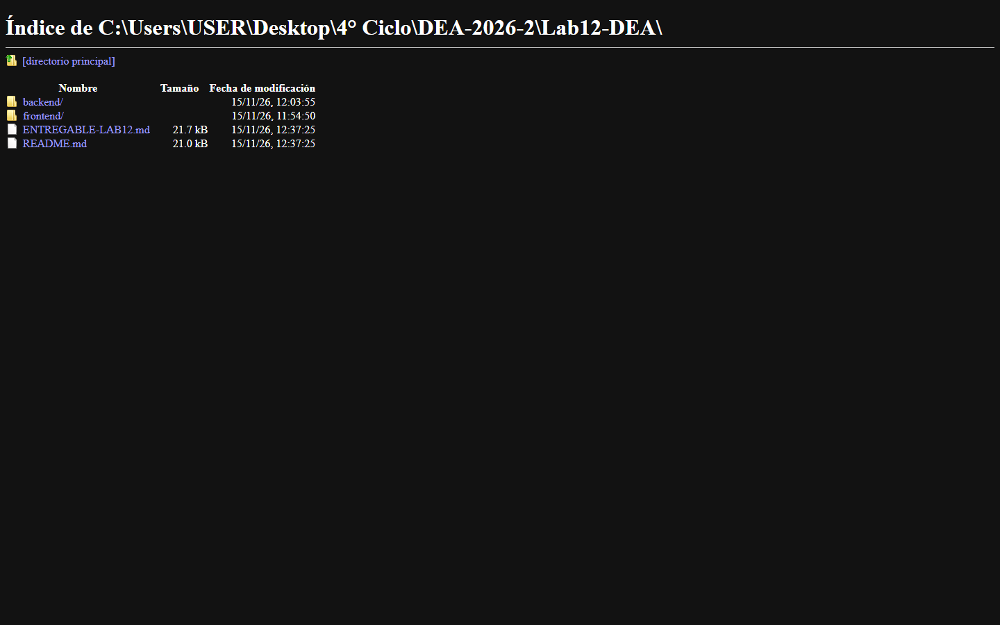

# Laboratorio 12 — Ajax y Servicios Web

## 1. Datos generales

- **Alumno:** Michael Fernandez.
- **Institución:** Tecsup.
- **Curso:** Desarrollo de Aplicaciones Empresariales.
- **Ciclo:** cuarto.
- **Semana y laboratorio:** 12.
- **Tema:** integración de Django REST Framework con React mediante Axios y CORS.
- **Entregable académico:** [ENTREGABLE-LAB12.md](ENTREGABLE-LAB12.md).

Esta documentación describe la implementación existente y las pruebas registradas el **15 de noviembre de 2026**. La continuación del PASO 7 se registra por separado en [INFORME-PASO7.md](INFORME-PASO7.md): no ejecuta migraciones ni CRUD sobre la base original. No se ha publicado en GitHub ni se ha realizado la entrega al campus.

## 2. Objetivo

Integrar una interfaz React con una API Django para consultar, registrar y eliminar exámenes de forma asíncrona, configurar un origen CORS específico y comunicar los estados de carga, datos y error sin recargar la página. Se aplica el concepto de Ajax mediante solicitudes HTTP de Axios; no se utiliza jQuery.

## 3. Tecnologías utilizadas

| Tecnología | Versión utilizada | Responsabilidad |
|---|---|---|
| Python | 3.14.3 | Entorno del backend |
| Django | 5.2.15 | Proyecto, modelos, migraciones y SQLite |
| Django REST Framework | 3.16.1 | Serialización, validación y API REST |
| django-cors-headers | 4.9.0 | Encabezados CORS |
| Node.js | 24.15.0 | Entorno de desarrollo del frontend |
| React / React DOM | 19.3.1 | Componentes, estado y efectos |
| Vite | 8.3.6 | Servidor de desarrollo y compilación |
| Axios | 1.21.1 | Cliente HTTP reutilizable |
| react-hot-toast | 2.6.1 | Confirmaciones de acciones |
| Oxlint | 1.91.0 | Análisis estático |
| Chrome y protocolo de depuración | Navegador local | Pruebas y capturas reales |

Las versiones Python están fijadas en [requirements.txt](backend/requirements.txt). Los rangos npm están en [package.json](frontend/package.json) y las versiones resueltas en [package-lock.json](frontend/package-lock.json). La instalación de Axios conservó las 69 resoluciones anteriores; no se añadieron React Router ni bibliotecas de interfaz.

## 4. Arquitectura Django + React

```text
Navegador: http://localhost:5173
  React: ExamSection → ExamList / ExamForm
  Axios: src/api/client.js → src/api/exams.js
                   │ GET / POST / DELETE, JSON
                   ▼
Django: http://127.0.0.1:8000/api/
  CorsMiddleware → router → ExamViewSet → ExamSerializer
                   │
                   ▼
             backend/db.sqlite3
```

El backend reutiliza la API del Lab08 y el frontend conserva la cartelera del Lab11, pero ambas copias están dentro de Lab12. La administración de exámenes es una sección independiente: no se convirtieron películas en exámenes ni se crearon modelos nuevos.

## 5. Estructura del proyecto

```text
Lab12-DEA/
├── README.md
├── ENTREGABLE-LAB12.md
├── backend/
│   ├── config/                 # settings.py, urls.py, ASGI y WSGI
│   ├── quiz/
│   │   ├── models.py
│   │   ├── serializers.py
│   │   ├── views.py
│   │   ├── urls.py
│   │   ├── migrations/0001_initial.py
│   │   └── management/commands/seed_demo.py
│   ├── scripts/
│   ├── manage.py
│   ├── requirements.txt
│   ├── .gitignore
│   ├── .venv/                  # Entorno local; no publicar
│   └── db.sqlite3              # Base local; no publicar
└── frontend/
    ├── public/
    ├── src/
    │   ├── api/client.js
    │   ├── api/exams.js
    │   ├── components/
    │   │   ├── ExamSection/ExamSection.jsx
    │   │   ├── ExamList/ExamList.jsx
    │   │   ├── ExamForm/ExamForm.jsx
    │   │   └── ...             # Componentes de películas conservados
    │   ├── hooks/
    │   ├── adapters/
    │   ├── data/
    │   ├── styles/
    │   ├── App.jsx
    │   └── main.jsx
    ├── tests/
    ├── evidencias/lab12/run-DgJS4v/
    ├── package.json
    ├── package-lock.json
    ├── vite.config.js
    ├── index.html
    └── .gitignore
```

La captura siguiente corresponde al **índice real del directorio local en Chrome**, no a una imagen generada de un árbol. Muestra las dos carpetas principales y los dos documentos; el detalle interno se explica en el árbol anterior.



## 6. Configuración de CORS

En [backend/config/settings.py](backend/config/settings.py):

1. Se registró `corsheaders` en `INSTALLED_APPS`, conservando las aplicaciones existentes.
2. Se colocó `corsheaders.middleware.CorsMiddleware` inmediatamente después de `django.middleware.security.SecurityMiddleware` y antes de `CommonMiddleware`.
3. Se autorizó exclusivamente el origen de React:

```python
CORS_ALLOWED_ORIGINS = ['http://localhost:5173']
```

No se habilitaron todos los orígenes, no se usaron comodines y no se desactivó CSRF. `ALLOWED_HOSTS`, SQLite, permisos, validaciones y paginación se conservaron.

`http://localhost:5173` y `http://127.0.0.1:5173` son orígenes distintos. También importa el protocolo y el puerto. `ALLOWED_HOSTS` no sustituye a CORS y CORS no es un sistema de autenticación.

## 7. Endpoints utilizados

**Base:** `http://127.0.0.1:8000/api/`. Las rutas Django llevan barra final.

| Método | Ruta | Uso | Respuesta satisfactoria |
|---|---|---|---|
| GET | `/api/` | Consultar recursos publicados | 200 |
| GET | `/api/exams/?page=1` | Listar una página de exámenes | 200 con objeto paginado |
| POST | `/api/exams/` | Crear un examen | 201 con el examen creado |
| DELETE | `/api/exams/{id}/` | Eliminar un examen, previa confirmación | 204 sin contenido |

`{id}` es un marcador: se sustituye por el identificador real. Los endpoints `questions/` y `options/` siguen existiendo y se consultaron para verificar integridad, pero no se añadieron operaciones de administración de esos recursos en React. PUT y PATCH del backend quedan fuera de la interfaz solicitada.

## 8. Contrato del examen y paginación

| Campo | Regla |
|---|---|
| `id` | Generado por Django, de solo lectura |
| `title` | Obligatorio, no vacío, máximo 200 caracteres |
| `description` | Opcional; admite texto vacío |
| `created_at` | Fecha automática, de solo lectura |

El listado devuelve `count`, `next`, `previous` y `results`. **La tabla utiliza `results`**, mientras que `count` representa el total, no el número de filas de la página. DRF conserva páginas de cinco elementos y orden ascendente por ID.

Los botones anterior/siguiente utilizan los enlaces de existencia de página y solicitan el número correspondiente. Después de crear, el componente localiza la última página para mostrar el registro nuevo. Después de eliminar el único elemento de una página posterior, vuelve a la anterior. Una página que ya no existe puede recuperarse desde la primera.

## 9. Cliente Axios centralizado

En [src/api/client.js](frontend/src/api/client.js) se define una única URL predeterminada y se admite sobrescribirla con `VITE_API_BASE_URL`:

```javascript
const baseURL = import.meta.env?.VITE_API_BASE_URL || 'http://127.0.0.1:8000/api/'

const api = axios.create({
  baseURL: `${baseURL.replace(/\/+$/, '')}/`,
  timeout: 10000,
  headers: { Accept: 'application/json' },
})
```

Las funciones de [src/api/exams.js](frontend/src/api/exams.js) son `getExams(page, { signal })`, `createExam({ title, description })` y `deleteExam(id)`. Los componentes llaman estas funciones sin escribir la dirección del backend. Axios envía los objetos como JSON y DELETE no intenta interpretar un cuerpo inexistente.

No se necesita crear un archivo de entorno para el destino actual. Si cambia `VITE_API_BASE_URL`, hay que reiniciar Vite; esta variable se incorpora al código del navegador y **no debe contener secretos**.

## 10. Funcionalidades implementadas

- **Listado:** `ExamList` usa `useState`, `useEffect` y Axios para mostrar ID, título, descripción, fecha y acción de eliminación.
- **Registro:** `ExamForm` conserva `title` y `description` como entradas controladas, ejecuta `preventDefault()`, bloquea envíos duplicados y muestra el progreso de guardado.
- **Validación:** el formulario usa `noValidate` para permitir comprobar la validación real de Django. Los errores por campo se traducen al español; no se cambió el backend.
- **Actualización:** después de registrar o eliminar se vuelve a consultar sin recargar el navegador. `ExamSection` muestra confirmaciones y utiliza `react-hot-toast`.
- **Eliminación segura:** se solicita confirmación y se advierte que CASCADE elimina las preguntas y opciones del examen. La fila se conserva si falla DELETE.
- **Interfaz:** sección independiente, tabla desplazable en pantallas pequeñas y reutilización de `Button`, `Skeleton` y los estilos del proyecto.
- **Funciones conservadas:** ocho películas, búsqueda con debounce, limpieza del filtro, favoritas persistentes, contador, notificaciones y carrusel.

La carga simulada de estrenos heredada sigue perteneciendo a la cartelera. **La administración de exámenes usa solicitudes reales**, no temporizadores que inventen respuestas.

## 11. Estados de petición

| Estado del listado | Interfaz | Recuperación |
|---|---|---|
| `loading` — carga | Mensaje y tres esqueletos; `aria-busy=true` | Espera la respuesta real |
| `success` — datos | Tabla, total y paginación; mensaje específico si está vacío | Registrar o navegar |
| `error` — error | Mensaje comprensible y botón Reintentar | Repite GET en la página solicitada |

La limpieza de `useEffect` cancela solicitudes obsoletas mediante `AbortController`. Una cancelación intencionada no se presenta como error de carga. El envío y la eliminación tienen además sus indicadores independientes de guardado y borrado.

## 12. Ejecutar Django en PowerShell

Abra una terminal en **Lab12-DEA**. Python 3.14.3 es compatible con la versión fijada de Django. Estos son comandos de preparación para una instalación local; **no se ejecutaron otra vez al redactar esta documentación**.

```powershell
Set-Location .\backend
python --version
if (-not (Test-Path .\.venv)) { python -m venv .venv }
.\.venv\Scripts\python.exe -m pip install -r requirements.txt
.\.venv\Scripts\python.exe manage.py check
.\.venv\Scripts\python.exe manage.py migrate
```

Si `.venv` ya existe, inspeccionarlo antes de reutilizarlo; no eliminarlo ni reemplazarlo automáticamente. No hace falta activarlo ni cambiar políticas de ejecución de PowerShell.

**Solo cuando corresponda preparar los datos de una base nueva:**

```powershell
.\.venv\Scripts\python.exe manage.py seed_demo
```

El comando reutiliza los exámenes demo y omite preguntas ya existentes; no elimina datos. La base preparada ya contiene 2 exámenes, 12 preguntas y 24 opciones, por lo que no necesita volver a cargarse para iniciar el servidor. Los identificadores y las fechas pueden variar en una instalación nueva.

```powershell
.\.venv\Scripts\python.exe manage.py runserver 127.0.0.1:8000
```

Abrir `http://127.0.0.1:8000/api/`. La base independiente es `backend/db.sqlite3`; no se utiliza la del Lab08. No se requiere `makemigrations` porque no se modificaron modelos.

## 13. Ejecutar React en PowerShell

Abra **otra terminal**, también inicialmente en **Lab12-DEA**:

```powershell
Set-Location .\frontend
node --version
npm ci
npm run dev
```

Abrir **http://localhost:5173** y seleccionar **Exámenes**. `npm ci` instala lo declarado en el archivo de bloqueo; Axios ya está incluido y no es necesario volver a agregarlo. Vite requiere Node `^20.19.0 || >=22.12.0`; se utilizó 24.15.0.

**Ambos servidores deben funcionar simultáneamente.** Vite está configurado con `host: 'localhost'`, puerto 5173 y `strictPort: true`. Si un puerto está ocupado, identificar primero el proceso: no cerrar procesos ajenos ni cambiar silenciosamente de origen. Si los servidores de la verificación anterior siguen activos, no iniciar duplicados.

## 14. Pruebas realizadas y alcance

Durante la implementación se ejecutaron:

| Comprobación | Resultado registrado | Qué demuestra |
|---|---|---|
| `npm run lint` | Correcto, sin diagnósticos finales | Análisis estático; no equivale a probar HTTP |
| `npm run build` | Correcto, 97 módulos transformados | Compilación; no equivale a navegar en producción |
| `npm run test:api` | 14/14 | Cliente sobre un servidor HTTP de prueba y pruebas del adaptador de películas |
| `npm run test:integration:fixture` | 47/47 | Interfaz real contra un servidor HTTP de prueba; incluye 503, reintento y DELETE fallido |
| `npm run test:integration` | 44/44 | Navegador con Django real; CRUD temporal, validación, paginación y regresiones |
| Ejecutor de errores reales | 9/9 | CORS provocado/restaurado, validación, servidor apagado, recuperación e integridad |

Registros de Lab12: [44 comprobaciones con Django](frontend/evidencias/lab12-django-6ZVlek/results.json), [47 comprobaciones con el servidor de prueba](frontend/evidencias/lab12-fixture-XCHBNM/results.json) y [9 comprobaciones finales reales](frontend/evidencias/lab12/run-DgJS4v/results.json). Los dos primeros resultados no son etapas adicionales de la última ejecución: tienen alcances distintos.

Las pruebas de integración crean y eliminan únicamente sus registros temporales, y verifican que los originales permanezcan intactos. No ejecutarlas indiscriminadamente sobre una base con información ajena a la práctica. Para repetir pruebas de navegador se necesita Chrome o Edge; puede indicarse su ejecutable mediante `CHROME_PATH`.

El ejecutor `frontend/tests/lab12-errors.browser.mjs` interviene temporalmente CORS y los procesos que inicia. Requiere autorización, puertos libres y revisión previa de propiedad de los procesos; **no es un comando rutinario de arranque**. No se volvió a ejecutar en el PASO 7. La suite heredada se adaptó al origen permitido y al diagnóstico contextual de cancelaciones descrito en la sección 17; los resultados actuales se separan de los históricos en el [informe del PASO 7](INFORME-PASO7.md).

## 15. Resultados de las pruebas de errores

| Prueba real | Petición | Código | Resultado observado |
|---|---|---|---|
| Listado normal | GET `exams/?page=1` | 200 | Tabla con dos exámenes y controles de página |
| Carga | GET `exams/?page=1` | 200 al terminar | Tres esqueletos durante latencia de red aplicada por Chrome |
| CORS retirado intencionalmente | GET `exams/?page=1` | 200 en Django, bloqueado en el navegador | Falta `Access-Control-Allow-Origin`; Axios no puede leer la respuesta |
| CORS restaurado | GET `exams/?page=1` | 200 | Reintentar vuelve a mostrar datos |
| Título vacío | POST `exams/` | 400 | Django rechaza `title`; React informa el error en español |
| Django detenido | GET `exams/?page=1` | Sin respuesta HTTP | `ERR_CONNECTION_REFUSED`; mensaje y Reintentar, sin pantalla en blanco |
| Django reiniciado | GET `exams/?page=1` | 200 | Recuperación sin recargar React |
| Cancelación al desmontar | GET `exams/?page=1` | Sin respuesta completa | `canceled=true`, `ERR_ABORTED`; siguiente carga correcta |
| Integridad | GET de los tres recursos | 200 | Se conservan 2 exámenes, 12 preguntas y 24 opciones |

La configuración CORS se restauró inmediatamente después de capturar el bloqueo. `settings.py` y SQLite conservaron sus hashes originales en la etapa final. No se crearon registros para provocar los errores. Ver [verificación final](frontend/evidencias/lab12/run-DgJS4v/final-health.json) y [restauración de CORS](frontend/evidencias/lab12/run-DgJS4v/cors-restoration.json).

## 16. Evidencias reales

Todas las capturas funcionales pertenecen a `frontend/evidencias/lab12/run-DgJS4v/`; no se reutilizaron imágenes de Lab11. El [entregable](ENTREGABLE-LAB12.md) las muestra junto a la explicación de cada actividad.

| Evidencia | Archivo |
|---|---|
| Listado de exámenes | [01-listado-examenes.png](frontend/evidencias/lab12/run-DgJS4v/01-listado-examenes.png) |
| Estado de carga | [02-estado-carga.png](frontend/evidencias/lab12/run-DgJS4v/02-estado-carga.png) |
| CORS en la consola real | [03-error-cors-consola.png](frontend/evidencias/lab12/run-DgJS4v/03-error-cors-consola.png) |
| CORS en la interfaz | [04-error-cors-interfaz.png](frontend/evidencias/lab12/run-DgJS4v/04-error-cors-interfaz.png) |
| CORS restaurado | [05-cors-restaurado.png](frontend/evidencias/lab12/run-DgJS4v/05-cors-restaurado.png) |
| Validación en el formulario | [06-error-validacion-formulario.png](frontend/evidencias/lab12/run-DgJS4v/06-error-validacion-formulario.png) |
| Estado HTTP 400 | [07a-error-validacion-http400-publica.png](frontend/evidencias/lab12/run-DgJS4v/07a-error-validacion-http400-publica.png) |
| Cuerpo de la respuesta HTTP | [07-error-validacion-respuesta-http-publica.png](frontend/evidencias/lab12/run-DgJS4v/07-error-validacion-respuesta-http-publica.png) |
| Django apagado | [08-servidor-apagado.png](frontend/evidencias/lab12/run-DgJS4v/08-servidor-apagado.png) |
| Recuperación | [09-recuperacion.png](frontend/evidencias/lab12/run-DgJS4v/09-recuperacion.png) |

Son **11 capturas distintas** al añadir la estructura principal de la sección 5. Los JSON enlazados son registros técnicos, no capturas. Los códigos 201 y 204 de la integración están documentados en su JSON; las diez capturas de la etapa de errores no se presentan como prueba visual de esas dos operaciones.

Las dos copias `*-publica.png` ocultan únicamente el token local HMR visible en DevTools; conservan el estado 400 y la respuesta de Django. Los originales se mantienen localmente, ignorados por Git y fuera de la lista de publicación. Los nombres de capturas dentro del JSON histórico corresponden al registro original; para publicación se utilizan las copias enlazadas en esta tabla.

## 17. Problemas encontrados y soluciones

### CORS, validación y disponibilidad

Se reprodujeron intencionalmente tres fallos distintos: origen no autorizado, título vacío y servidor detenido. CORS y conexión rechazada pueden producir el mismo mensaje genérico de Axios por ausencia de una respuesta legible; se diferenciaron mediante la consola y el registro de red, no mediante suposiciones sobre el texto de la interfaz.

### Suite heredada y `ERR_ABORTED`

La versión anterior de la prueba **`Browser console and local image requests have no errors`**, en [browser.test.mjs](frontend/tests/browser.test.mjs), agregaba cualquier `Network.loadingFailed`, sin distinguir `canceled` ni conservar la URL. Esta limitación histórica motivó la corrección; los números de línea del diagnóstico original ya no corresponden al archivo actual.

En la [reproducción instrumentada](frontend/evidencias/lab12/run-DgJS4v/abort-diagnosis.json), el GET de `http://127.0.0.1:8000/api/exams/?page=1` se canceló al desmontar `ExamList`: limpieza del efecto → `AbortController.abort()` → `XMLHttpRequest.abort()` → `ERR_ABORTED`, con `canceled=true`. Volver al listado produjo una carga correcta. El histórico solo guardaba el texto del error, por lo que no se atribuyen retrospectivamente sus eventos a URL que no registró.

**Corrección aplicada:** [requestAudit.mjs](frontend/tests/helpers/requestAudit.mjs) conserva ID, URL, método, estado HTTP y contexto CDP. Solo admite `GET /api/exams/` iniciado desde `ExamList`, con `canceled=true`, `net::ERR_ABORTED`, sin bloqueo ni error CORS, cuando existe una limpieza de efecto probada o una navegación del ejecutor completada, y una petición posterior a la misma URL termina con 200. No ignora globalmente `ERR_ABORTED` ni oculta CORS, conexión rechazada, excepciones o HTTP fallidos. [requestAudit.test.mjs](frontend/tests/requestAudit.test.mjs) comprueba también los casos que deben seguir fallando.

El ejecutor heredado ahora utiliza `http://localhost:5173`, sin ampliar CORS, y prueba una cancelación real por desmontaje seguida de recuperación. Un reintento limitado del sondeo CDP maneja el reemplazo del contexto durante recargas; no ignora excepciones de React. El auxiliar [ownedProcess.mjs](frontend/tests/helpers/ownedProcess.mjs) cierra solo un `ChildProcess` propio y, en Windows, su árbol por PID. La verificación reproducible [verify-step7.mjs](frontend/tests/verify-step7.mjs) abre SQLite en modo de solo lectura, comprueba hashes y libera sus propios procesos y puertos.

### Incidencias de automatización resueltas

Una primera ejecución se vio afectada por temporales de Chrome observados por Vite; se ubicaron en `node_modules/.cache`. Durante las capturas se corrigió la selección del panel de DevTools y el control del árbol de procesos del lanzador Python de Windows. Se conservaron los intentos incompletos, sin presentarlos como aprobados. La ejecución final `run-DgJS4v` terminó con nueve comprobaciones correctas y restauración verificada.

## 18. Seguridad y revisión previa a GitHub

La configuración mantiene `DEBUG=True` y permisos DRF `AllowAny`: es una práctica local, no un despliegue de producción. No exponer estos servidores a Internet. No se incluyen valores de credenciales en los documentos.

La selección exacta está en [PUBLICACION-LAB12.txt](PUBLICACION-LAB12.txt), con una ruta por archivo y sin comodines. No publicar `.venv/`, `node_modules/`, `dist/`, `.npm-cache/`, perfiles de navegador, cachés Python, bases SQLite, archivos de entorno privados ni respaldos de configuración. Los directorios de evidencias contienen intentos incompletos y registros auxiliares: **no subirlos completos**. La lista incluye solo las evidencias revisadas y las dos capturas anonimizadas, no sus originales.

Esta etapa verifica las reglas locales de Git y prepara archivos para revisión; no autoriza `git add`, commits, push o entrega al campus. El estado final y las limitaciones se indican en [INFORME-PASO7.md](INFORME-PASO7.md). Publicar el código académico no equivale a desplegarlo en producción.

## 19. Conclusiones

La integración permitió aplicar Ajax con una separación clara entre interfaz y API. Centralizar Axios evitó repetir la URL y facilitó respetar el contrato de Django. Los estados y el reintento mantuvieron la aplicación utilizable ante errores, mientras que las pruebas reales permitieron distinguir validación, CORS, conexión y cancelación. Se conservaron la cartelera, los modelos y los datos originales.
