# Laboratorio 13 — Estructura de una aplicación de comercio electrónico

- **Alumno:** Michael Fernandez Camarena
- **Institución:** TECSUP
- **Curso:** Desarrollo de Aplicaciones Empresariales
- **Docente:** Michael Montgomery Rosell
- **Periodo:** 2026-2
- **Desarrollo:** TechStore con Django REST Framework y React.

## Alcance y trazabilidad

Este documento desarrolla los pasos 1–11 con código existente y capturas reales.
El paso 12 queda pendiente de publicación autorizada. La guía original de aula
no fue proporcionada: el diagrama representa el código implementado, y las tres
capacidades se formulan operativamente en el [README](README.md#descripción-y-objetivos),
pendientes de cotejar con su texto oficial. Solo se documenta el trabajo conocido
de Michael Fernandez Camarena; no se inventan integrantes ni responsabilidades.

Las suites funcionales fueron ejecutadas en las fases 01–03. En esta fase se
reutilizan sus resultados, sin presentarlos como nuevas ejecuciones. Son nuevas
la auditoría documental, la reconstrucción aislada, las consultas HTTP de lectura
y la comprobación de migraciones/check. Las capturas se reutilizan por rutas
relativas, sin duplicar físicamente las imágenes.

## Actividad 1 — Preparación y reutilización del proyecto

**Objetivo:** obtener un entorno independiente reutilizando Lab12 sin alterarlo.

**Archivos:** `backend/config/settings.py`, `backend/requirements.txt`,
`frontend/package.json`, `frontend/package-lock.json`, `.gitignore`.

**Código real — configuración de la base de datos:**

```python
DATABASES = {
    'default': {
        'ENGINE': 'django.db.backends.sqlite3',
        'NAME': BASE_DIR / 'db.sqlite3',
    }
}
```

**Explicación:** SQLite, entorno virtual y medios pertenecen exclusivamente al
backend del Lab13. Se preservaron quiz, componentes y pruebas anteriores.
Las instrucciones reproducibles están en el [README](README.md#instalación-del-backend).

**Captura del editor:** backend y frontend dentro del proyecto real.

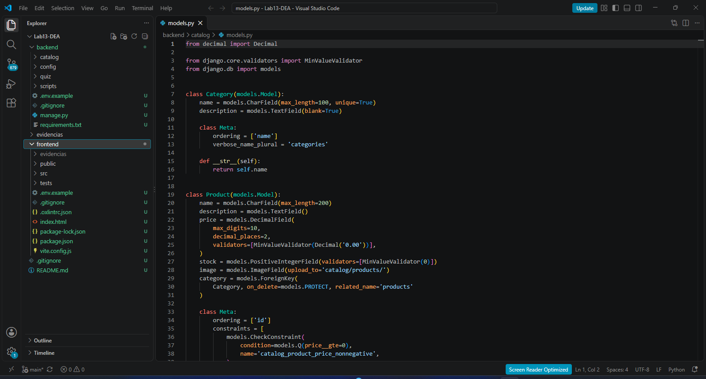

**Caso de prueba:** contrastar rama, HEAD, staging y hashes de archivos externos.
**Resultado:** main y staging intactos; 1499 archivos externos protegidos sin cambios.

## Actividad 2 — Modelos del catálogo, migraciones y Admin

**Objetivo:** representar categorías y productos con integridad referencial.

**Archivos:** `backend/catalog/models.py`, `admin.py`,
`migrations/0001_initial.py`, `management/commands/seed_catalog.py`.

**Código real — campos de categoría:**

```python
class Category(models.Model):
    name = models.CharField(max_length=100, unique=True)
    description = models.TextField(blank=True)
```

**Código real — campos relacionados del producto:**

```python
    stock = models.PositiveIntegerField(validators=[MinValueValidator(0)])
    image = models.ImageField(upload_to='catalog/products/')
    category = models.ForeignKey(
        Category, on_delete=models.PROTECT, related_name='products'
    )
```

El precio es `DecimalField(10, 2)` con mínimo cero. Restricciones CHECK protegen
precio y stock en la base. Cada producto tiene una categoría; una categoría
admite cero o muchos productos. PROTECT impide eliminar categorías utilizadas.

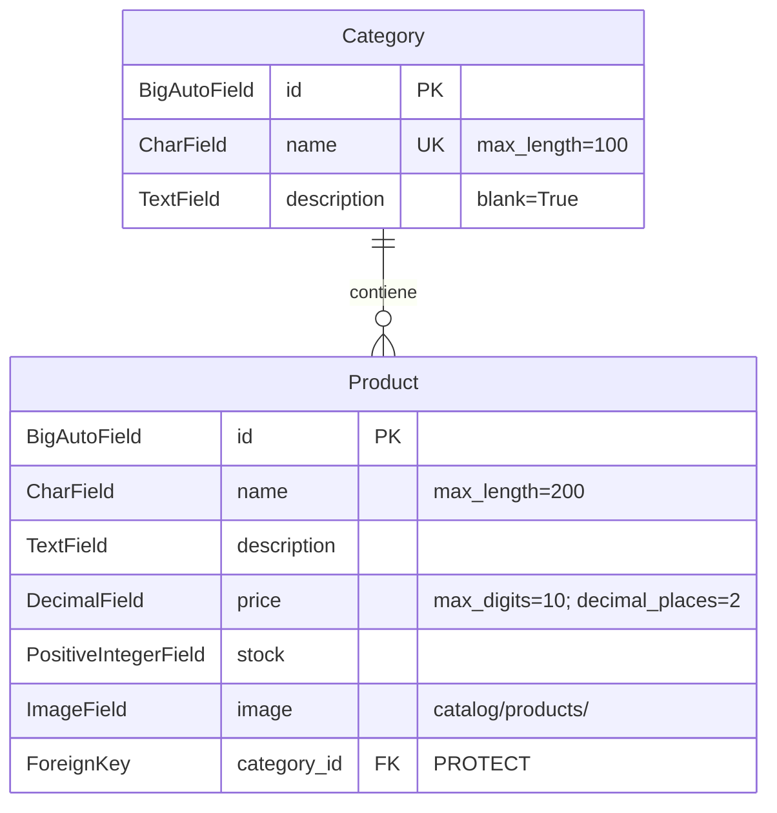

Este es el diagrama de la implementación, no una reproducción del diagrama
original de aula. En Python la relación se llama `category`; `category_id` es
el identificador asociado.

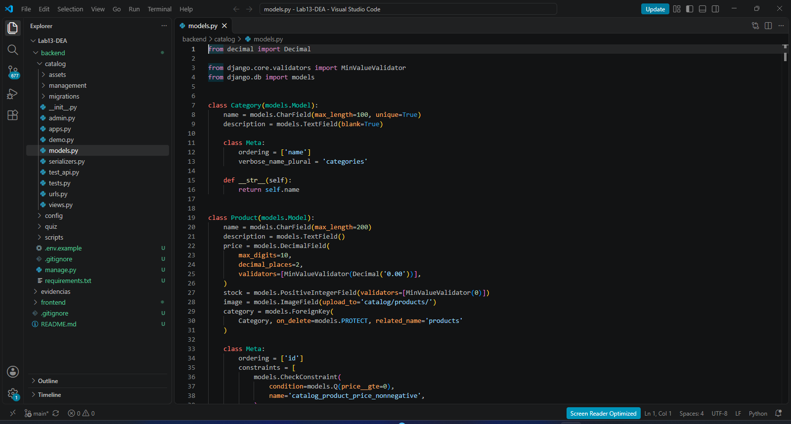

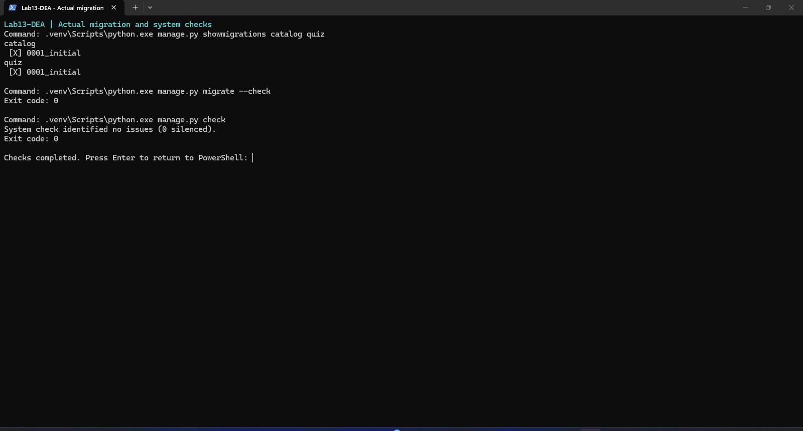

**Admin:** las tres categorías y los ocho productos están registrados. El usuario
`evidence_*` de las capturas era temporal y ya fue eliminado; no hay contraseña
administrativa documentada. El usuario personal se crea con
`.\.venv\Scripts\python.exe manage.py createsuperuser`, de forma interactiva.

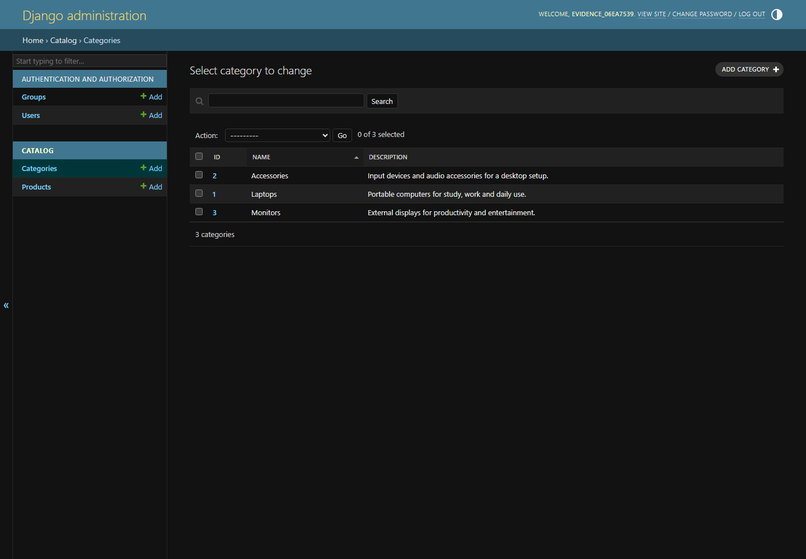

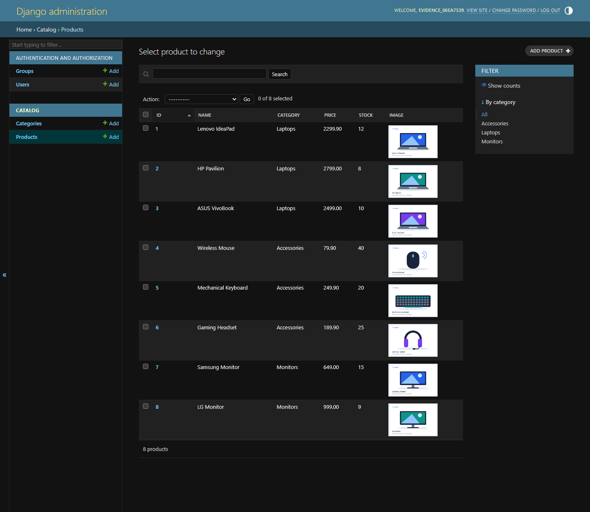

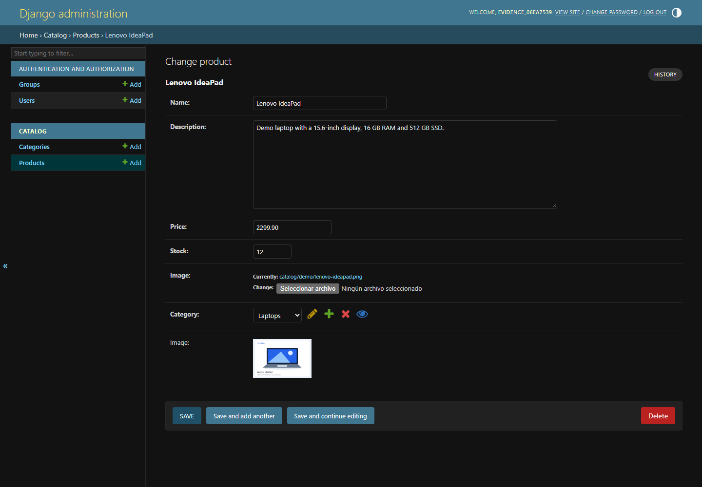

**Casos de prueba:** relaciones, negativos, borrado protegido, carga idempotente
y recuperación de imágenes; nueva reconstrucción desde SQLite vacío.
**Resultado:** tres categorías, ocho productos y ocho PNG recuperados desde los
recursos publicables; dos ejecuciones del seed sin duplicados. La base local
actual no se usó para esa reconstrucción.

## Actividad 3 — Serializadores anidados

**Objetivo:** entregar la categoría completa junto al producto, sin otra petición.

**Archivo:** `backend/catalog/serializers.py`.

```python
class ProductSerializer(serializers.ModelSerializer):
    category = CategorySerializer(read_only=True)
    category_id = serializers.PrimaryKeyRelatedField(
        queryset=Category.objects.all(), source='category', write_only=True
    )
```

**Explicación:** `category` es un objeto anidado solo de lectura, con `id`, `name`
y `description`. `category_id` es solo de escritura, valida la existencia y asigna
la relación; no crea categorías anidadas. Los campos públicos del producto son
id, nombre, descripción, precio, stock, imagen y categoría.

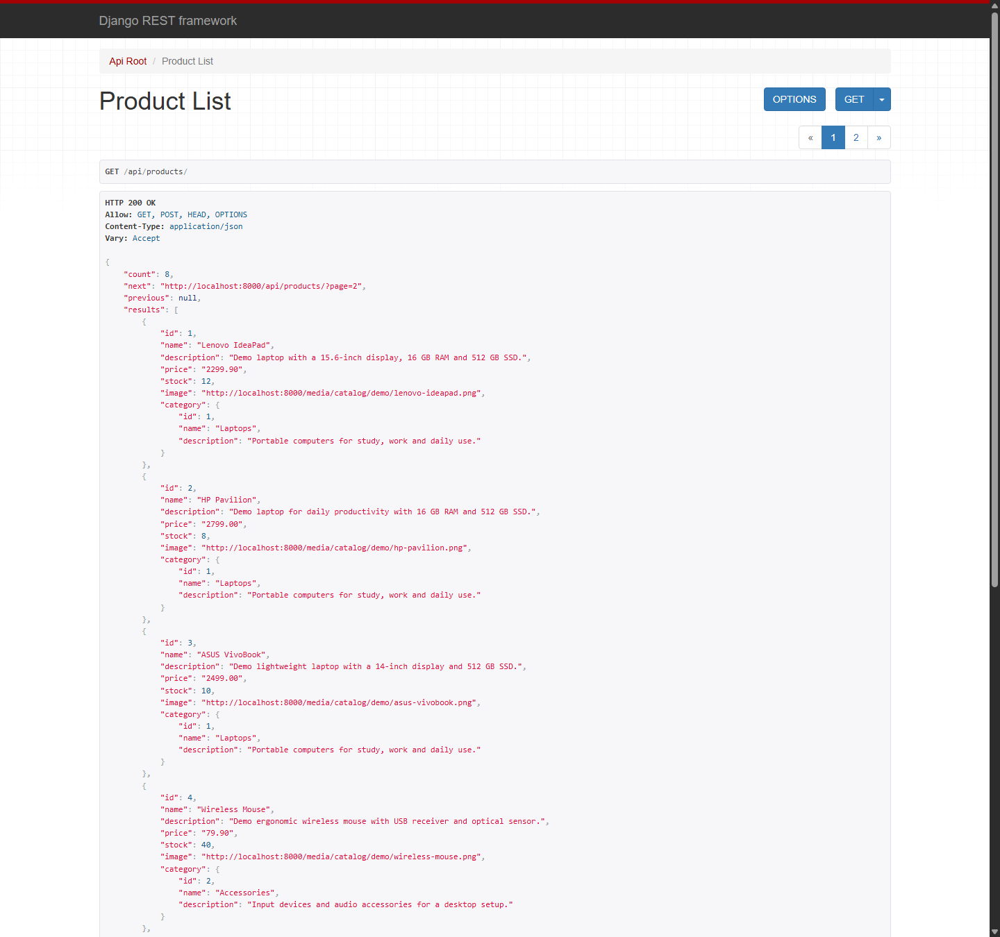

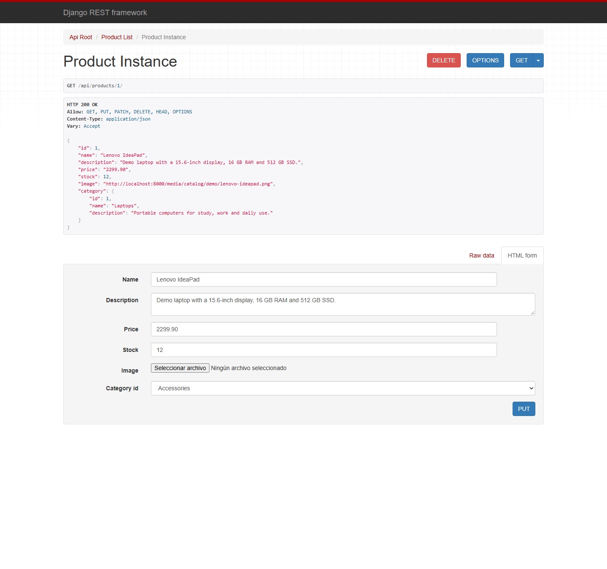

**Caso de prueba:** comparar categoría completa en listado/detalle y rechazar
un `category_id` inexistente. **Resultado:** respuestas correctas y 400 en la
relación inválida. El [JSON real](README.md#api-rest) conserva precio `2299.90`
y la imagen `media/catalog/demo/lenovo-ideapad.png` del producto inicial.

## Actividad 4 — ViewSets y router REST

**Objetivo:** exponer CRUD completo sin romper las rutas del quiz.

**Archivos:** `backend/catalog/views.py`, `catalog/urls.py`,
`config/api_urls.py`, `config/urls.py`.

```python
class ProductViewSet(viewsets.ModelViewSet):
    queryset = Product.objects.select_related('category')
    serializer_class = ProductSerializer
    parser_classes = [JSONParser, MultiPartParser, FormParser]
```

**Explicación:** ModelViewSet proporciona las operaciones y DRF interpreta JSON
y multipart. `select_related` evita N+1; el borrado protegido de categorías se
traduce a 409 en lugar de un error 500.

| Endpoint | Métodos |
|---|---|
| `/api/categories/` | GET, POST |
| `/api/categories/{id}/` | GET, PUT, PATCH, DELETE |
| `/api/products/` | GET, POST |
| `/api/products/{id}/` | GET, PUT, PATCH, DELETE |
| `/api/` | GET: recursos del catálogo y quiz |

Se conservan `/api/exams/`, `/api/questions/` y `/api/options/` con sus detalles.
La [tabla completa](README.md#api-rest) incluye esos endpoints heredados.
Estados: 200 lectura/actualización, 201 creación, 204 borrado, 400 validación,
404 inexistente y 409 categoría protegida.

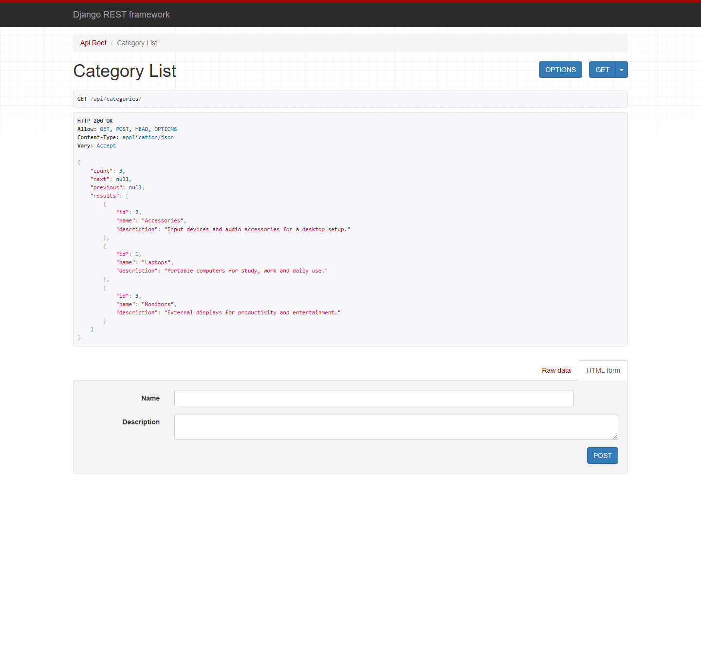

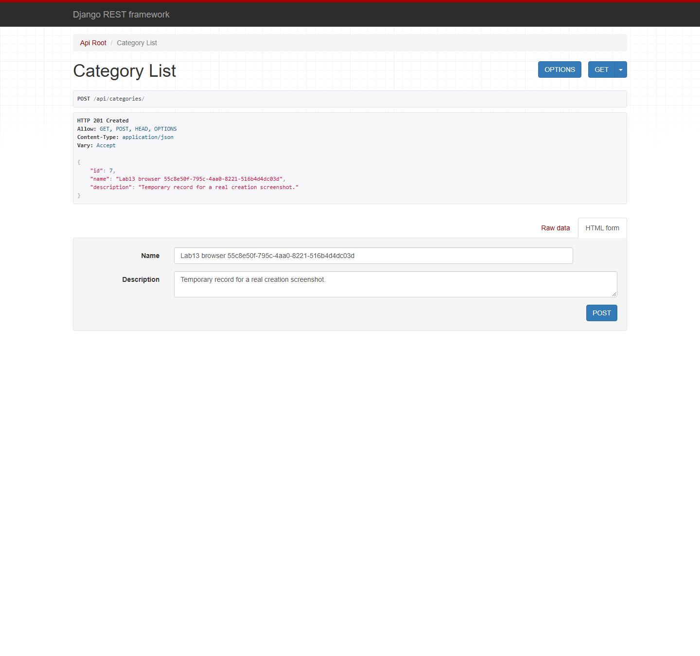

**Caso de prueba:** CRUD temporal, recursos inexistentes, categoría protegida y
número de consultas. **Resultado:** operaciones correctas; dos consultas por
listado paginado aunque aumente el número de productos. El registro 201 de la
captura fue eliminado posteriormente.

## Actividad 5 — Cliente Axios centralizado

**Objetivo:** parametrizar el backend y evitar configuraciones HTTP duplicadas.

**Archivos:** `frontend/src/services/api.js`, `frontend/.env.example`,
`frontend/src/api/client.js`.

```js
const baseURL = import.meta.env?.VITE_API_BASE_URL || 'http://127.0.0.1:8000/api/'

const api = axios.create({
  baseURL: `${baseURL.replace(/\/+$/, '')}/`,
  timeout: 10000,
  headers: { Accept: 'application/json' },
})
```

**Explicación:** una instancia compartida por catálogo y quiz. No se fija
Content-Type global, por lo que Axios puede definir el boundary de FormData.
Las variables Vite son públicas y no contienen secretos.

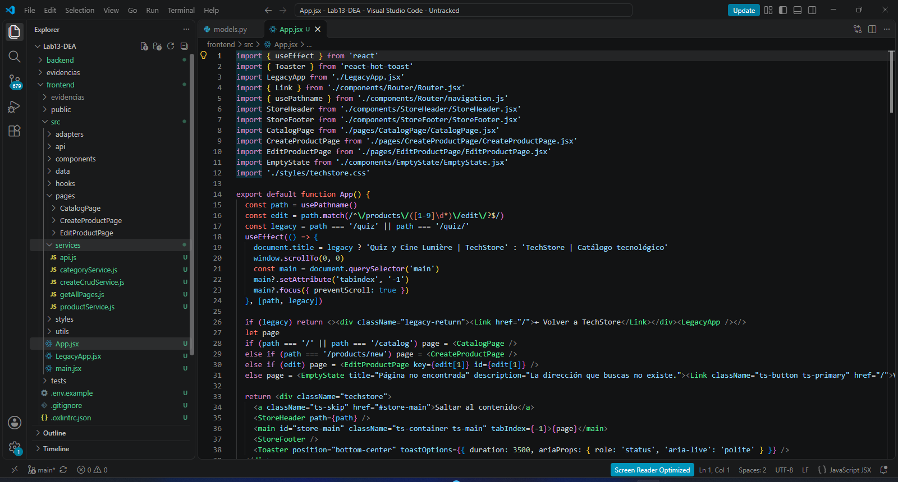

**Caso de prueba:** identidad de la instancia heredada, URL configurable, timeout,
cancelación y multipart. **Resultado:** pruebas de servicios correctas; ningún
componente ni página importa Axios o usa fetch para consumir la API.

## Actividad 6 — Servicios CRUD reutilizables

**Objetivo:** definir un contrato estable para los componentes.

**Archivos:** `frontend/src/services/productService.js`, `categoryService.js`
y `createCrudService.js`.

**Código real — actualización compartida:**

```js
    async update(id, payload, { replace = false, ...config } = {}) {
      const method = replace ? 'put' : 'patch'
      const { data } = await api[method](detail(id), payload, config)
      return data
    },
```

**Explicación:** ambos servicios ofrecen `getAll`, `getById`, `create`, `update`
y `remove`. Devuelven datos de DRF, no mutan la entrada y conservan los errores
Axios originales. `remove` devuelve undefined tras 204. PATCH es el valor por
defecto; `replace: true` solicita PUT.

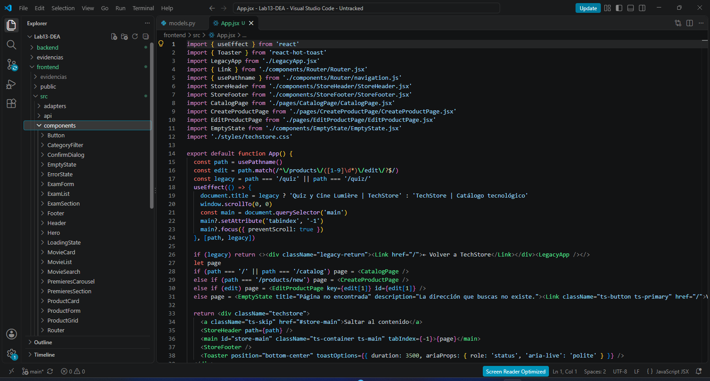

**Caso de prueba:** cinco operaciones de ambos recursos, propagación de 400/404/409
y FormData intacto. **Resultado:** suite de servicios e integración HTTP previa
correctas; las páginas nuevas reutilizan este contrato.

## Actividad 7 — Página del catálogo

**Objetivo:** mostrar todos los productos reales con sus categorías e imágenes.

**Archivos:** `pages/CatalogPage/CatalogPage.jsx`, componentes `ProductCard`,
`ProductGrid`, `LoadingState`, `ErrorState`, `EmptyState`,
`services/getAllPages.js`, dentro de `frontend/src`.

```js
  const load = useCallback(async signal => {
    const [products, categories] = await Promise.all([getAllPages(productService, { signal }), getAllPages(categoryService, { signal })])
    return { products, categories }
  }, [])
  const resource = useStoreResource(load)
```

**Explicación:** se agregan todas las páginas antes del filtrado. Cada tarjeta
utiliza la categoría anidada; los precios se formatean con Intl es-PE/PEN.
Se cubren carga, éxito, error, vacío, agotado e imagen alternativa local.

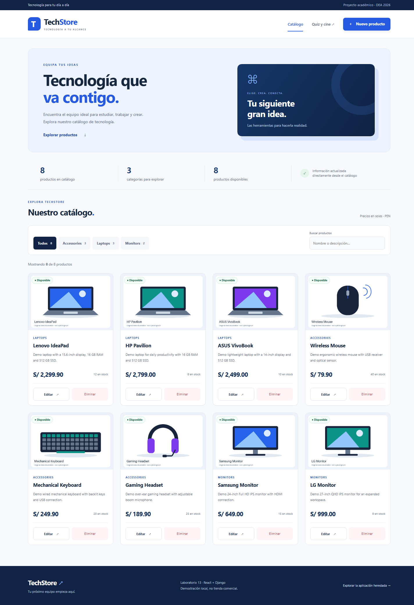

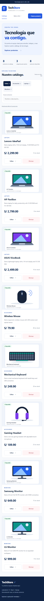

**Caso de prueba:** ocho IDs originales, dos páginas DRF, imágenes correctas y
cero peticiones individuales de categoría. **Resultado:** catálogo completo y
responsive a 1440/768/390 px, sin desbordamiento horizontal.

## Actividad 8 — Filtrado dinámico y búsqueda

**Objetivo:** combinar categoría y texto sin recargar ni consultar por pulsación.

**Archivos:** `frontend/src/components/CategoryFilter/CategoryFilter.jsx`,
`frontend/src/utils/catalog.js` y `CatalogPage.jsx`.

```js
export function filterProducts(products, categoryId, query) {
  const term = normalizeText(query)
  return products.filter(product => (!categoryId || String(product.category.id) === String(categoryId)) && normalizeText(`${product.name} ${product.description}`).includes(term))
}
```

**Explicación:** el filtro compara IDs y la búsqueda normaliza mayúsculas/tildes.
Las categorías proceden de categoryService; los productos ya están completos.

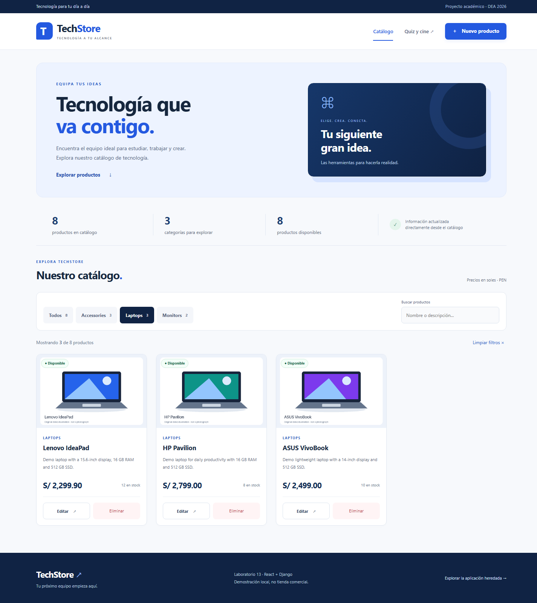

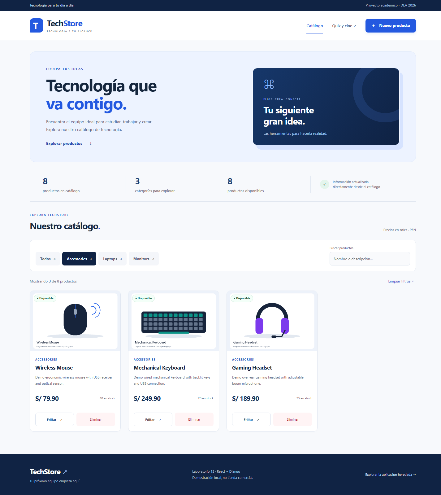

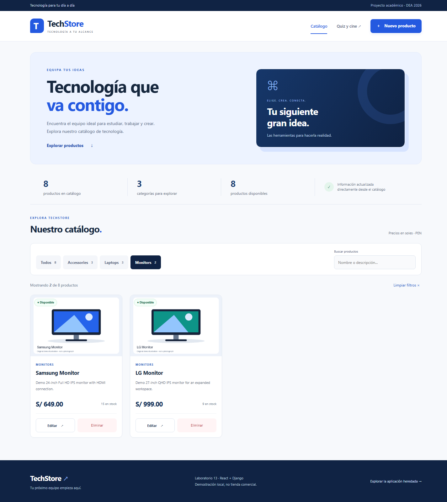

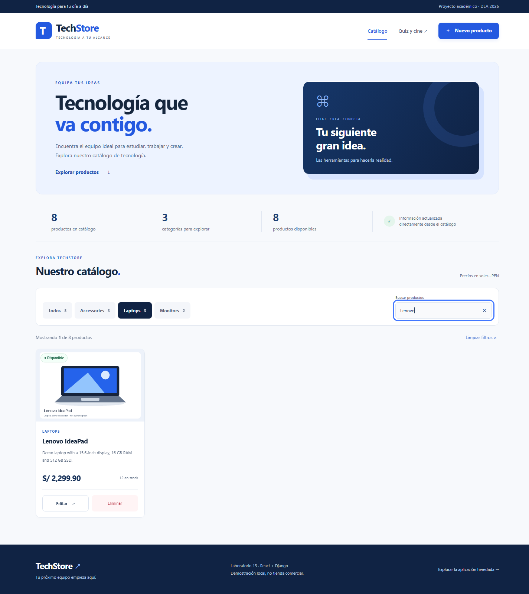

**Caso de prueba:** filtros 3/3/2, Todos restaura ocho, texto por nombre/descripción
y categoría temporal vacía. **Resultado:** actualización inmediata, estado vacío
cuando corresponde y ningún GET nuevo mientras se escribe.

## Actividad 9 — Registro de productos

**Objetivo:** registrar productos con validación y archivo de imagen real.

**Archivos:** `frontend/src/pages/CreateProductPage/CreateProductPage.jsx`,
`components/ProductForm/ProductForm.jsx` y `utils/catalog.js`.

```js
export function productFormData(values, file) {
  const data = new FormData()
  for (const [key, value] of Object.entries(values)) data.append(key, ['name', 'description'].includes(key) ? value.trim() : value)
  if (file) data.append('image', file)
  return data
}
```

**Explicación:** estado controlado, categorías dinámicas y envío de category_id.
Se validan obligatorios, precio/stock, enteros e imagen; las vistas previas usan
object URLs que se liberan. El bloqueo de envío impide duplicados.

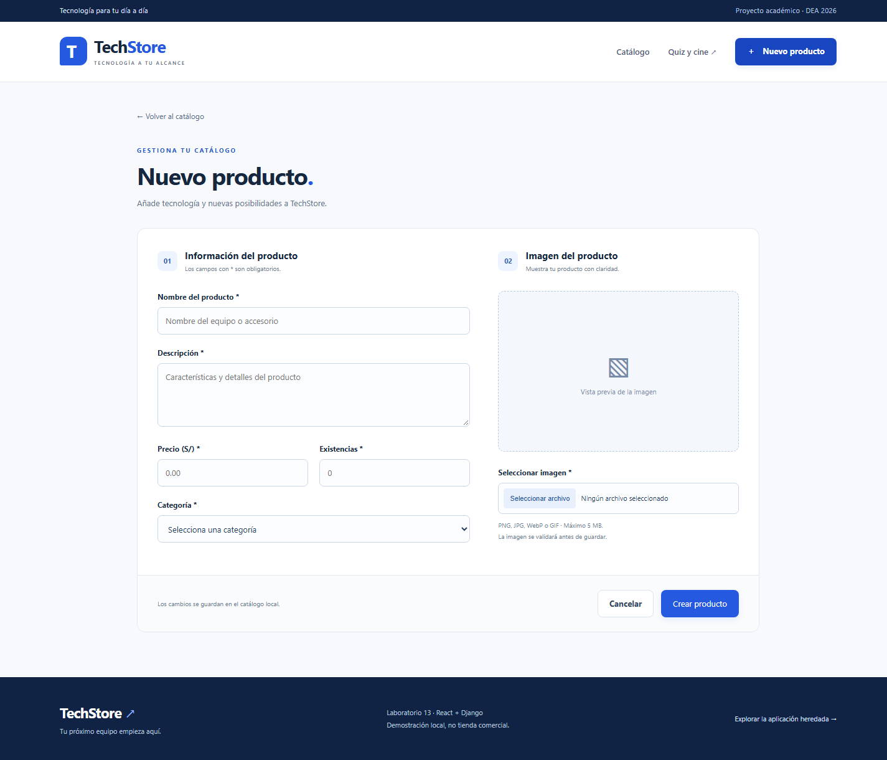


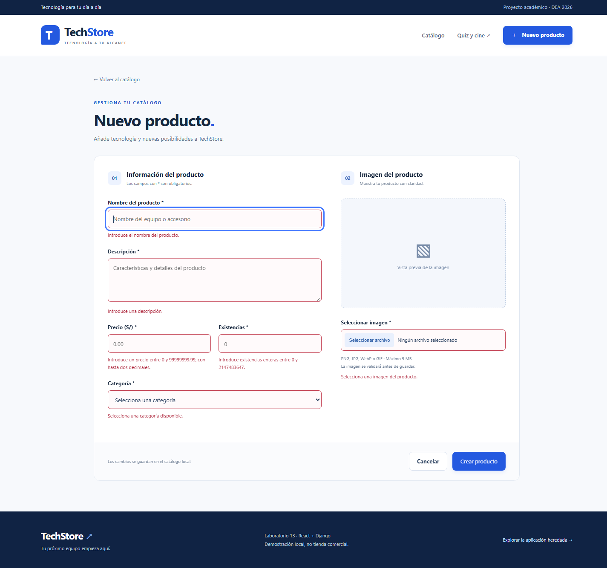

**Caso de prueba:** alta multipart con imagen, stock cero, imagen corrupta,
stock fraccionario y error 400 real por categoría temporal eliminada.
**Resultado:** registro válido visible como noveno producto y errores mostrados
sin perder campos; ese producto de prueba se eliminó al finalizar.

## Actividad 10 — Edición y eliminación

**Objetivo:** modificar o eliminar con confirmación y conservar el estado ante errores.

**Archivos:** `EditProductPage.jsx`, `ProductForm.jsx`, `CatalogPage.jsx` y
`components/ConfirmDialog/ConfirmDialog.jsx`, en `frontend/src`.

**Código real — envío compartido de alta/edición:**

```js
      const data = productFormData(values, file)
      if (editing) await productService.update(product.id, data)
      else await productService.create(data)
      toast.success(editing ? 'Producto actualizado correctamente.' : 'Producto creado correctamente.', { id: 'product-feedback' })
      navigate('/')
```

**Código real — eliminación solo después de respuesta correcta:**

```js
      await productService.remove(selected.id)
      setDeletedIds(ids => [...ids, selected.id])
      setSelected(null)
      toast.success('Producto eliminado correctamente.', { id: 'product-feedback' })
```

**Explicación:** getById precarga datos; la imagen no se reenvía si se conserva.
Se admite reemplazarla. El diálogo incluye nombre, cancelación, teclado y bloqueo
de duplicados. Si DELETE falla, se conserva el producto y puede reintentarse.

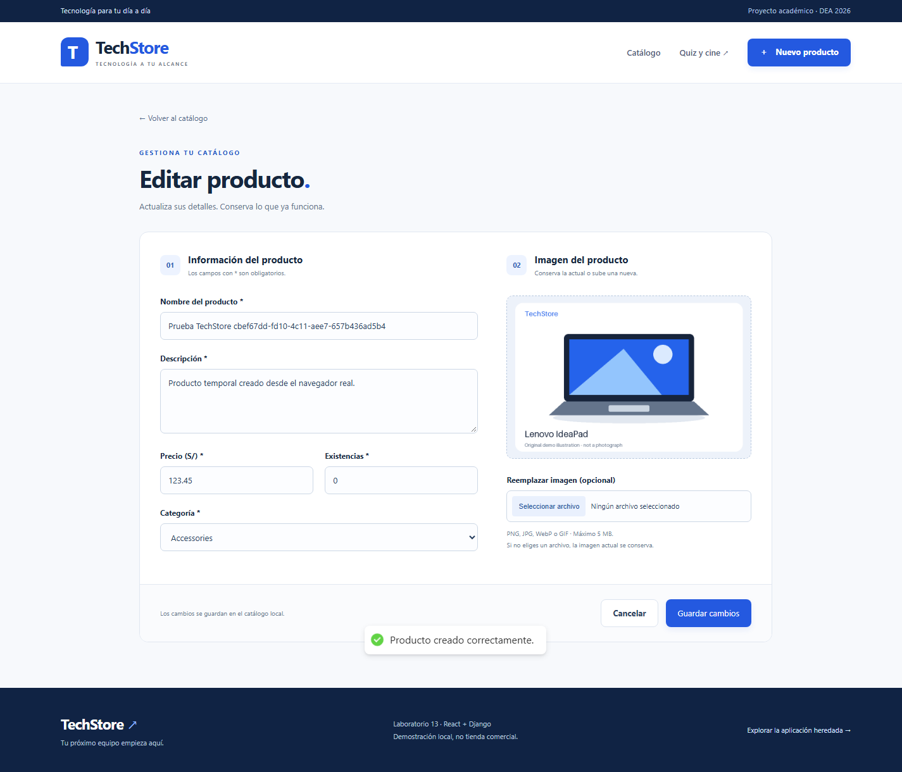

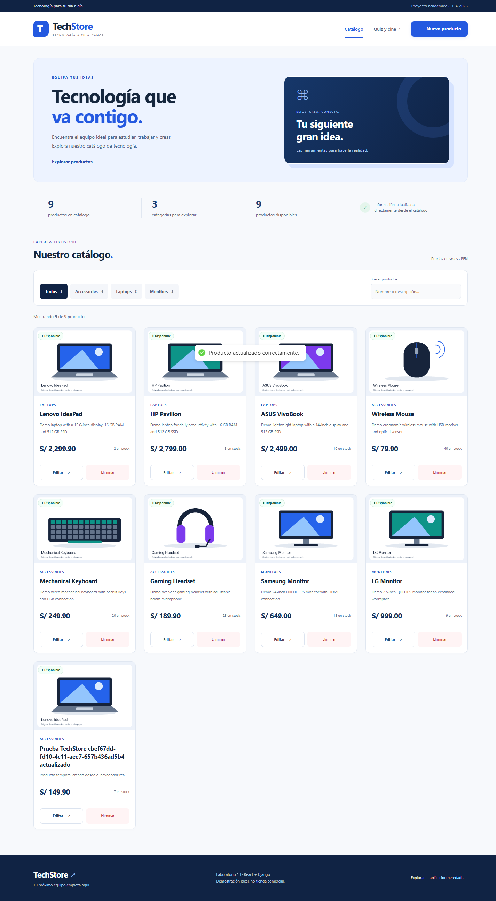

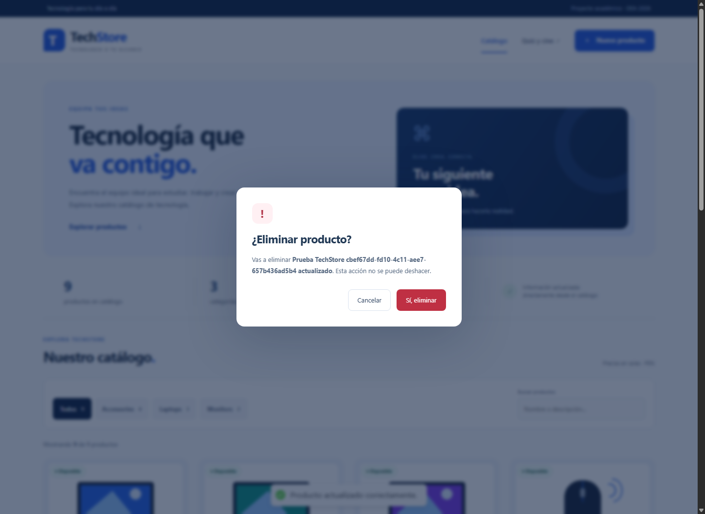

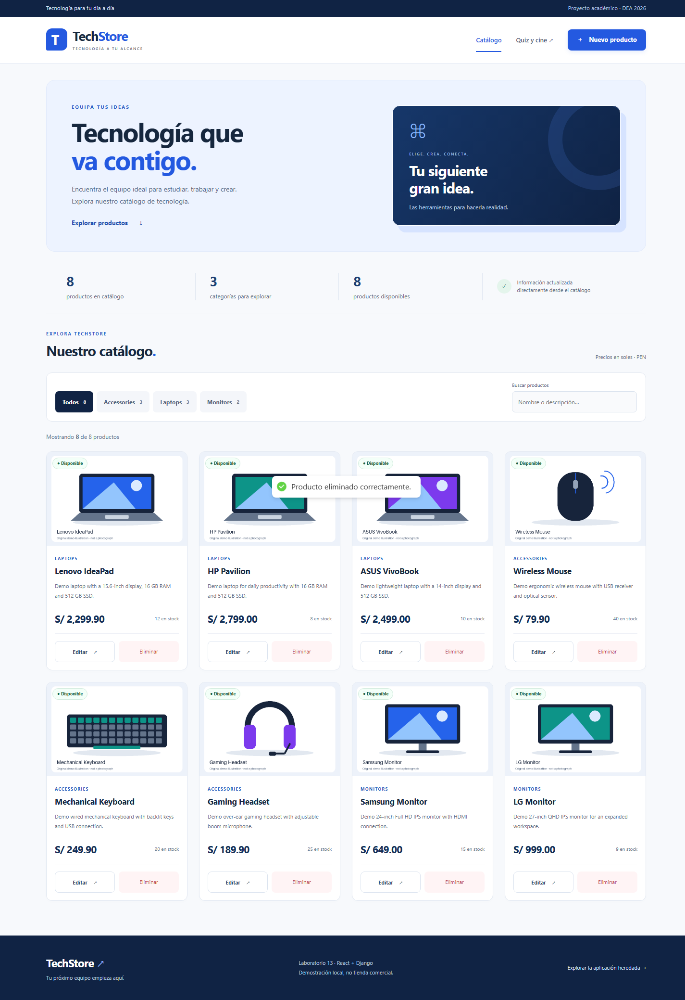

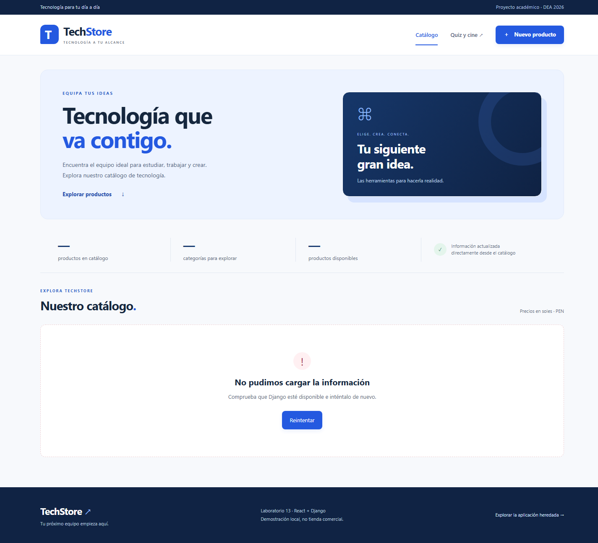

**Casos de prueba:** editar sin imagen y conservar URL; sustituirla y cambiar URL;
cancelar sin DELETE; fallo 503 conservando registro; confirmar un único DELETE;
404 de producto inexistente y reintento del catálogo.
**Resultado:** operaciones correctas sin recargar el documento. Solo se afectó
el registro temporal; tres categorías, ocho productos y medios originales intactos.

## Actividad 11 — Documentación, evidencias y verificación

**Objetivo:** presentar resultados reproducibles y preparar una publicación acotada.

**Archivos:** `README.md`, este entregable, `PUBLICACION-LAB13.txt`,
`evidencias/04-documentacion/{PASO11.md,VERIFICACION.json}` y
`backend/scripts/verify_documentation_phase.py`.

**Código real — comprobación de una imagen enlazada:**

```python
            with Image.open(dest) as im:
                im.verify()
            assert not ignored([dest]), target
```

**Explicación:** se comprueban rutas exactas, formato y exclusiones; el inventario
incluye tamaños y hashes útiles. Se distinguen pruebas previas y comprobaciones
documentales nuevas. No se afirma una visualización en GitHub no realizada.

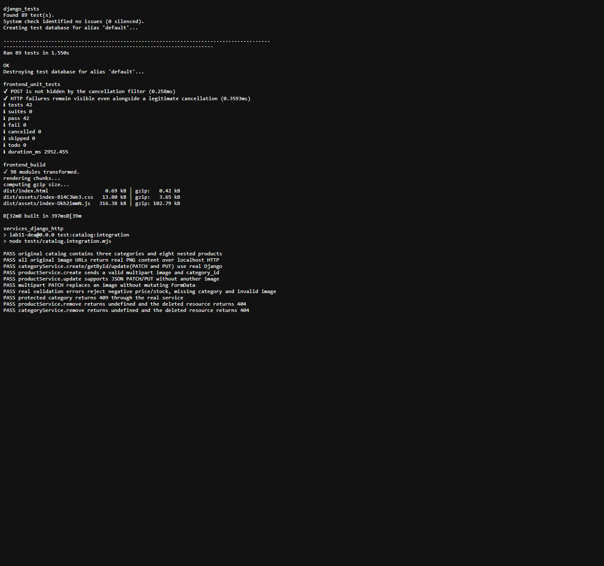

La imagen pertenece a fase 02: 89 pruebas Django y 42 unitarias JavaScript.
La fase 03 elevó las unitarias a 58 y añadió 27 comprobaciones TechStore.
Las 68 de navegador y 44 de integración heredadas también están registradas en
[su verificación](evidencias/03-frontend/VERIFICACION.json).

**Casos de prueba nuevos:** validar enlaces y PNG; reproducir migrate/seed dos
veces en base vacía; comparar medios con los ocho PNG fuente; comprobar HTTP
actual y hashes de archivos anteriores; auditar archivos candidatos sin staging.
**Resultado:** consultar el [cierre documental](evidencias/04-documentacion/PASO11.md)
y el [registro verificable](evidencias/04-documentacion/VERIFICACION.json).
El cotejo literal de las capacidades con la guía original permanece pendiente.

## Actividad 12 — Pendiente de publicación

No se ejecutaron git add, commit ni push. El inventario cerrado especifica los
archivos de Lab13 candidatos; no incluye otros laboratorios ni datos privados.
La fase 05 requiere autorización y deberá revisar el README realmente renderizado
en GitHub. Preparar la documentación no equivale a haber publicado el proyecto.

## Observaciones

- No se dispone del diagrama ni de la redacción literal de capacidades de aula.
  El código y sus evidencias son verificables; ese cotejo académico no se inventa.
- Si se exige trabajo en equipo, faltan datos de otros participantes. Este
  documento no atribuye tareas a personas de las que no existe información.
- Las ilustraciones locales son originales CC0-1.0, no fotografías de fabricantes.
- La escritura anónima y DEBUG se usan solo en localhost; no son ajustes de producción.
- Los datos ingleses se preservaron desde la API, con interfaz española. Las
  condiciones de fallo de pruebas fueron controladas y posteriormente retiradas.

## Cinco conclusiones personales

1. Aprendí a ampliar un proyecto existente sin empezar de cero. Mantener quiz y
   cine en `/quiz` me permitió comprobar que agregar TechStore no exige borrar
   lo que ya funcionaba en el laboratorio anterior.
2. Comprendí la diferencia entre leer una relación y escribirla. Con `category`
   veo el objeto completo, mientras que `category_id` me permite asignar una
   categoría existente sin duplicarla ni enviar datos anidados ambiguos.
3. Centralizar Axios me ayudó a mantener el mismo comportamiento en todos los
   servicios. También comprobé por qué no debo fijar Content-Type globalmente
   cuando el formulario puede enviar una imagen mediante FormData.
4. Al trabajar con páginas de la API entendí que un filtro puede parecer correcto
   y aun así omitir productos. Cargar todas las páginas antes de filtrar fue
   necesario para mostrar los tres accesorios y los dos monitores completos.
5. Verificar el CRUD con registros temporales me permitió demostrar altas,
   cambios y borrados sin arriesgar los ocho productos iniciales. Documentar qué
   se ejecutó y qué quedó pendiente hace que mis resultados sean más confiables.
